# CLAUDE.md — video-pipeline

> Contexto persistente para o Claude Code neste repositório. Ele lê este arquivo no início de cada sessão.
> Mantenha curto, factual e atualizado. Preferências pessoais vão em `CLAUDE.local.md` (gitignored).
> Fonte de verdade em caso de conflito: `docs/spec-v0.4.md` e os registros em `docs/decisions/`.

## 1. O que é este projeto

Pipeline local, retomável e auditável para produzir vídeos narrados em inglês (5–7 min, 16:9,
H.264/AAC, até 1080p) sobre histórias reais. Cada episódio nasce de fontes verificáveis, usa imagens
de acervo com licença registrada, gera ilustrações apenas para lacunas, narra com TTS local e sai como
`final.mp4` + `captions.srt` + `description.txt` + `credits.txt`.
**Publicação é sempre manual, após revisão humana.**

- **Recorte editorial da validação:** expedições e desastres de 1880–1930 — janela em que existe
  fotografia em domínio público, jornais digitalizados gratuitos e memórias de expedição em DP.
- **Piloto:** expedição polar de cauda longa (candidatos: Greely 1881–84, Karluk 1913, Belgica 1897–99).
- **Episódio 2 ou 3:** expedição sul-americana contada em inglês (candidato: Roosevelt–Rondon 1913–14),
  o diferencial editorial do canal.
- **Fase atual:** piloto técnico (Fase 0 + primeiro episódio). Nada de produção em escala.
- **Evitar:** sobrevivência recente (fotos de agência, vira 100% ilustração gerada), true crime,
  Titanic/Hindenburg/Everest 1996 (saturados), Segunda Guerra (oceano de concorrentes).

## 2. Regras inegociáveis (ler antes de qualquer alteração)

1. **Custo zero durante a validação.** `MAX_API_SPEND_USD=0` e `ALLOW_PAID_API=false`. Nunca migrar
   para endpoint pago, comprar créditos ou trocar de modelo por conta própria. Em 429, cota esgotada,
   modelo ausente ou licença incompatível: registrar o motivo em `review.json`, marcar a etapa como
   `needs_review` e parar **aquela cena**, sem bloquear as demais.
2. **Nenhuma fonte inventada.** O LLM escreve somente a partir de trechos extraídos de fontes reais já
   baixadas em `sources.json`. Toda `claim` tem `source_ids`. Roteiro com claim sem suporte não passa
   da validação automática.
3. **Nenhum ativo sem licença registrada entra no render.** Campos obrigatórios em §6. Imagem sem
   licença identificável vai para `needs_review`.
4. **Stock e imagem gerada são ilustração**, nunca "registro" do fato. `visual_need` correto sempre;
   imagem sintética realista de fato histórico exige a divulgação de conteúdo alterado do YouTube.
5. **Revisão humana obrigatória** nos 4 gates: tema/fontes, roteiro, ativos/direitos, prévia/descrição.
   Score de IA não aprova direitos nem autenticidade histórica.
6. **Arquivos com `review_status: approved` são imutáveis para o código.** Nova execução reutiliza,
   nunca sobrescreve.
7. **Segredos só em `.env`** (fora do Git). Adapters não logam tokens, headers de auth nem URLs assinadas.
8. **No MVP não existe:** upload automático, Docker, banco de dados, FastAPI, LiteLLM, framework
   multiagente, segundo motor de render, segundo editor visual, render em nuvem.
9. **Nenhuma dependência nova sem justificativa no commit e licença verificada.**
10. **Testes não acessam rede.** Provedores externos são mockados; respostas reais aprovadas viram
    fixtures em `data/cache/`.

## 3. Ambiente

- Windows + WSL2/Ubuntu. Python 3.12 em `.venv` criado com `uv` (Kokoro exige < 3.13), PyTorch só-CPU.
  `ffmpeg`/`ffprobe`, Git, `espeak-ng`, Ollama local (instalação de usuário em `~/.local`, serviço
  `systemctl --user`, só `127.0.0.1`). Detalhes em `docs/decisions/004-ambiente-wsl.md`.
  Node.js LTS **apenas** se o Remotion for o motor escolhido na Fase 0.
- `scripts/check_env.sh` valida o ambiente; rodar após qualquer mudança de máquina ou `.wslconfig`.
- Projeto vive em `~/projetos/auto-play` (repo `video-pipeline`, filesystem Linux do WSL). **Nunca** rodar em `/mnt/c` ou `/mnt/e`.
  Exports frios opcionais em `/mnt/e/VideoPipeline/exports`, copiados após o render.
- **`.wslconfig` obrigatório antes do benchmark:** o WSL2 limita a memória a 50% do host por padrão.
  Com 16 GB, configurar `memory=12GB` (ou o máximo que o Windows tolerar) para Ollama + Kokoro + ffmpeg
  coexistirem. Com 8 GB no host, usar modelo de texto menor ou provedor remoto gratuito.
  Configurado nesta máquina (host 19,4 GB / 16 threads): `memory=12GB`, `processors=12`, `swap=8GB`.
- Metas de planejamento (não requisitos rígidos): 16 GB RAM, 20 GB livres. GPU local **não** é pré-requisito.
- Interfaces de teste (galeria, futura API) só em `127.0.0.1`.
- Um render por vez. Registrar tempo e memória de cada etapa em `data/benchmarks/`.

### Estrutura de pastas

```
video-pipeline/
  CLAUDE.md
  docs/
    spec-v0.4.md              # especificação de referência
    decisions/                # ADRs: NNN-titulo.md (motor, provedores, nicho)
    pipeline-flowchart.mermaid
  app/
    cli.py                    # vp (argparse): monta o contexto e chama as etapas
    bootstrap.py              # raiz de composição: único módulo que conhece adapters concretos
    settings.py               # config/providers.toml + .env
    pipeline/                 # etapas, estados, schemas (pydantic), ports.py, failures.py
    providers/                # uma porta (base.py) + adapters por função: text/, tts/, image_gen/,
                              # archives/, alignment/; errors.py comum
    media/                    # ffmpeg/ffprobe, preparação de ativos, checks automáticos
    render/                   # base.py (RenderEngine) + motor escolhido na Fase 0
  video/                      # SOMENTE se Remotion for escolhido (um template React, public/episodes/)
  config/providers.toml       # implementação por função + parâmetros, sem credenciais
  data/
    cache/                    # miniaturas, respostas de busca, hashes, fixtures
    benchmarks/               # resultados de comparação de provedores e da máquina
    episodes/<id>/
      episode.json            # contrato aprovado; entrada do motor de render
      sources.json  script.json  scenes.json  review.json
      assets/  voice/  renders/  credits.txt
  tests/                      # fakes/ (uma por porta), test_contracts.py, test_architecture.py
  .env.example  .env(gitignored)  pyproject.toml  uv.lock
```

### Arquitetura (ADR 006, diagrama em `docs/arquitetura.md`)

- Portas e adaptadores: cada função tem um `Protocol` em `app/providers/<função>/base.py` (ou
  `app/render/base.py`); as etapas recebem um `Context` explícito e só conhecem portas.
- Trocar de abordagem = novo adapter + registro em `app/bootstrap.py` + passar em
  `tests/test_contracts.py` + **uma linha** em `config/providers.toml`.
- Todo adapter declara `ProviderInfo(name, remote, usd_per_call)`; custo > 0 é recusado sem
  `ALLOW_PAID_API=true` e `MAX_API_SPEND_USD > 0`. `ProviderError` vira `needs_review` só na cena.
- `tests/test_architecture.py` falha se `app/pipeline/` importar adapter concreto ou biblioteca pesada.

### Variáveis de ambiente (`.env.example` lista nomes e exemplos não secretos)

`OLLAMA_BASE_URL`, `OLLAMA_MODEL`, `PEXELS_API_KEY`, `CLOUDFLARE_ACCOUNT_ID`, `CLOUDFLARE_API_TOKEN`,
`WORKERS_AI_MODEL=@cf/black-forest-labs/flux-1-schnell`, `DATA_DIR`, `MAX_API_SPEND_USD=0`,
`ALLOW_PAID_API=false`, `MAX_GENERATED_IMAGES_PER_EPISODE=12`, `MAX_CANDIDATES_PER_SCENE=2`,
`MAX_CLOUD_REQUESTS_PER_EPISODE=40`. Opcionais para comparação: `GROQ_API_KEY`, `GEMINI_API_KEY`.

## 4. Fluxo de trabalho (o que fazemos, de ponta a ponta)

```mermaid
flowchart TD
    subgraph P0["Fase 0 — Setup e decisão do motor"]
        A0["Ambiente WSL2: venv, ffmpeg, Ollama, Kokoro, .wslconfig, .env"] --> A1["Benchmark da máquina: RAM, CPU, tok/s do LLM, tempo de TTS"]
        A1 --> A2["Experimento 30–60 s com o mesmo roteiro: ffmpeg puro vs MoneyPrinterTurbo vs Remotion"]
        A2 --> A3{"Um motor atende qualidade, revisão por cena e proveniência?"}
        A3 -- "não" --> A2
        A3 -- "sim" --> A4["ADR: motor único escolhido; episode.json fixado como contrato"]
    end

    subgraph P1["Pipeline por episódio — manifestos JSON, retomável por hash"]
        B0["Escolher o caso pela disponibilidade de fontes e imagens em DP"] --> B1["Coletar fontes: buscar, baixar, extrair texto → sources.json"]
        B1 --> R1{"Revisão 1: tema e fontes (≥ 2 independentes)"}
        R1 -- "reprovado" --> B0
        R1 -- "aprovado" --> B2["Roteiro em inglês: LLM escreve só a partir dos trechos-fonte; JSON Schema; claims → source_id"]
        B2 --> V1{"Toda claim relevante tem source_id?"}
        V1 -- "não" --> B2
        V1 -- "sim" --> R2{"Revisão 2: roteiro"}
        R2 -- "reprovado" --> B2
        R2 -- "aprovado" --> B3["Dividir em cenas: visual_need + search_query → scenes.json"]
        B3 --> B4["Busca visual em cascata: acervo interno → Commons/LoC/Flickr Commons → Pexels → Workers AI → gráfico original"]
        B4 --> B5["Galeria HTML estática por cena com origem, licença e créditos"]
        B5 --> R3{"Revisão 3: ativos e direitos"}
        R3 -- "trocar" --> B4
        R3 -- "aprovado" --> B6["Voz Kokoro por bloco → WAV; duração real via ffprobe"]
        B6 --> B7["Legendas alinhadas ao áudio; revisão de nomes próprios"]
        B7 --> B8["Montagem no motor escolhido → prévia MP4 (720p se preciso)"]
        B8 --> C1["Checks automáticos: abre no ffprobe, duração = voz, áudio presente, sem silêncio longo, 16:9, nenhuma cena sem ativo aprovado"]
        C1 --> R4{"Revisão 4: prévia e descrição"}
        R4 -- "ajustar imagem" --> B4
        R4 -- "ajustar texto" --> B2
        R4 -- "aprovado" --> B9["Export: final.mp4, captions.srt, description.txt, credits.txt"]
    end

    subgraph P2["Validação — sem API paga, sem promoção paga"]
        D0["Upload manual no YouTube com divulgação de IA quando aplicável"] --> D1["Métricas manuais no Studio aos 7 e 28 dias"]
        D1 --> D2{"4 vídeos no mesmo recorte publicados?"}
        D2 -- "não" --> B0
        D2 -- "sim" --> D3{"Decisão"}
        D3 -- "sinais orgânicos e qualidade ok" --> D4["Continuar sem pagar"]
        D3 -- "interesse, mas gargalo mensurável" --> D5["Gasto pequeno e delimitado em 1 componente, com teto por episódio/mês"]
        D3 -- "público não chega ou sai cedo" --> D6["Mudar assunto, embalagem ou formato; uma hipótese por vez"]
    end

    A4 --> B0
    B9 --> D0
```



O mesmo diagrama está em `docs/pipeline-flowchart.mermaid`.

## 5. Estados, cache e invalidação

- Estados por etapa no manifesto: `pending → running → needs_review → approved → completed`, ou `failed`.
- Chave de cache: `(episode_id, step, input_hash)`. Hash igual = reutiliza a saída; hash diferente
  = reexecuta **preservando** tudo que está `approved`.
- Regras de invalidação:
  - Trocar uma imagem invalida **só** montagem e prévia.
  - Alterar texto narrado invalida voz do bloco, timing, legendas e render.
  - Alterar fonte invalida roteiro e tudo abaixo.
- Erros de rede, cota ou licença param a cena, não o episódio.
- Aprovação humana é registrada por `vp approve <id> --step <step>` em `review.json`, nunca editando
  `review_status` à mão no manifesto principal.

## 6. Contratos de dados (schemas pydantic em `app/pipeline/schemas.py`, ADR 007)

Uma cena = um bloco de narração = um WAV = um visual. Exemplo completo em
`tests/fixtures/episodes/pilot-example/`.

**`sources.json`** — por fonte: `id`, `title`, `url`, `kind` (`primary|secondary|newspaper|archive`),
`retrieved_at`, `local_path` (texto extraído), `notes`. Mínimo de 2 fontes independentes para os
fatos principais.

**`scenes.json`** (exemplo simplificado da spec):

```json
{
  "episode_id": "pilot-001",
  "language": "en",
  "scenes": [
    {
      "id": "S01",
      "narration": "The expedition left port with one goal...",
      "claims": [{ "text": "Departure date", "source_ids": ["source-01"], "excerpt_ids": ["source-01#E1"] }],
      "visual_need": "historical_exact",
      "search_query": "expedition ship harbor historic photo",
      "chosen_asset_id": null,
      "duration_ms": null,
      "review_status": "pending"
    }
  ]
}
```

`visual_need` ∈ `historical_exact | contextual_stock | map_or_graphic | illustrative_reconstruction`.

**Ativo** (`assets/<id>.json`): `provider`, `provider_id`, `original_url`, `page_url`, `author`,
`license_id`, `license_url`, `attribution_text`, `usage_notes`, `retrieved_at`, `sha256`,
`review_status`, `used_in_scenes` (lista: um mapa pode voltar). Imagem gerada tem também
`generation: {prompt, model, seed, steps}`. Só chega a `approved` com licença da lista fechada da ADR 007
(PD, CC0, CC-BY, Flickr-NKCR, Pexels, Generated, Original — **sem** CC-BY-SA e NC), `sha256`, e
`usage_notes` para domínio público ou `author` + `attribution_text` para CC-BY.

**`review.json`** — fonte única das decisões humanas: entradas só acrescentadas, por etapa, cena ou ativo,
com `decision`, `reviewer`, `at` e `input_hash` do conteúdo revisado (mudou o conteúdo, a aprovação cai).

**`episode.json`** — contrato do render: `video` (1920×1080, 30 fps, 48 kHz, 16:9 validado), cenas com
`start_ms`/`duration_ms` medidos da voz real e sem sobreposição, texto, caminhos relativos de
imagem/áudio, `captions`. É a **única** entrada do motor de montagem;
se o motor for o Turbo, um adapter converte este arquivo para os parâmetros dele, nunca o contrário.

## 7. Provedores e política de escolha

| Função | Padrão do piloto (spec v0.4) | Candidato a teste | Critério de troca |
|---|---|---|---|
| Roteiro, cenas, consultas visuais | Ollama local + JSON Schema + validação Python | Groq e Gemini (nível gratuito), em separado | Melhor fidelidade ao texto-fonte sem custo e com cota suficiente. Ver proposta em §12. |
| Narração em inglês | Kokoro local, WAV por bloco | Gemini Flash TTS gratuito, se disponível na conta | Voz claramente melhor em escuta cega, nomes corretos, condições de dados aceitas. |
| Alinhamento de áudio | ffprobe + revisão manual | Groq Whisper gratuito, quando necessário | Corrigir problema concreto de legenda; não transcrever episódio inteiro sem necessidade. |
| Imagem para lacunas | Cloudflare Workers AI, FLUX.1 Schnell | Outro só após checar plano, direitos e cota | Qualidade útil dentro de custo zero. Acervo sempre antes de gerar. |
| Roteador de modelos | Nenhum | OpenRouter com variante `:free` | Só se o candidato direto falhar. |

- Um adapter por função expõe contratos simples: `generate_json()` (texto, só transporte),
  `synthesize_speech()`, `estimate_cost()`/`generate_image()`, `search_assets()`, `align()`, `render()`.
  `generate_script()` e `generate_scenes()` são funções do pipeline sobre `generate_json()`, para prompts
  e validação de claims ficarem num lugar só (ADR 006). `config/providers.toml` escolhe um padrão por função.
- Catálogos como free-llm-resources, free-ai-api-tiers e free-for-dev servem **só para descobrir** opções.
  Nunca copiar cotas ou claims de uso comercial deles para o código: registrar link oficial, data da
  consulta e resultado de um teste com a conta real em `data/benchmarks/`.
- Comparação pequena antes de tornar um remoto padrão: os mesmos 3 trechos (um nome próprio difícil,
  duas cenas com fatos verificáveis), um bloco de narração por voz, duas lacunas visuais.
  Anotar modelo/versão, endpoint, data, latência, unidades, limite observado, custo, consistência
  do JSON, erros, avaliação humana e URL dos termos. Nunca inferir confiabilidade factual de boa redação.

## 8. Política de imagens e cota

Ordem de busca por cena: (1) acervo interno já revisado → (2) Commons, Library of Congress e
Flickr Commons para pessoas, lugares e eventos específicos → (3) Pexels para cenas genéricas
(ondas, neve, céu) → (4) Workers AI, no máximo 2 alternativas, escolha humana → (5) mapa, cronologia,
citação curta permitida ou tela gráfica original. Nunca preencher com imagem irrelevante.

- Busca em lote por consulta normalizada; cache de metadados e miniaturas; `sha256` para deduplicar;
  redimensionar só o ativo final escolhido; registrar headers de cota do Pexels quando existirem.
- Regra prática de domínio público: publicado até 1930 é DP nos EUA; o Commons exige DP também no
  país de origem. Checar caso a caso e registrar o raciocínio em `usage_notes`.
- **Workers AI:** cota gratuita de 10.000 neurons/dia. FLUX.1 Schnell custa 4,80 neurons por tile
  512×512 + 9,60 por passo; uma imagem 1024×1024 com 4 passos ≈ 58 neurons (~170/dia). O teto de 12
  imagens/episódio é editorial, não de cota. O adapter estima o consumo antes de gerar, registra o uso
  do dia e devolve `quota_exhausted` em erro de cota. Riscos conhecidos a tratar no adapter:
  `num_steps` é obrigatório na prática; o filtro NSFW dá falso positivo com prompts curtos (código 3030,
  reescrever o prompt com contexto e tentar uma vez); modelos são aposentados sem aviso longo
  (modelo ausente → `needs_review`, nunca trocar de modelo sozinho).

## 9. Voz, legendas e montagem

- Roteiro escrito diretamente em inglês. WAV curto por bloco narrativo para trocar uma frase isolada.
- Glossário de pronúncia por episódio (`voice/glossary.json`); Kokoro aceita fonemas customizados.
- Timing das cenas vem da duração real dos WAVs (ffprobe), nunca de estimativa do LLM.
- Legendas geradas após aprovação da voz, por alinhamento do texto com o áudio; nomes próprios sempre
  revisados. `captions.srt` é editável.
- Montagem: 20–35 entradas visuais para 5–7 min (fotos/filmes, mapas, textos curtos, ilustrações).
  Reutilizar um mapa quando o roteiro volta ao mesmo local. Movimento leve em fotos só se o recorte
  preservar o assunto. Música e efeitos só com licença registrada por faixa.
- Motor de montagem: decidido na Fase 0 entre **ffmpeg puro** (candidato zero: `zoompan` + legendas
  gravadas + concat, sem Node), **MoneyPrinterTurbo** (MIT; desenhado para vídeos curtos com roteiro
  próprio — só serve se for domável por `episode.json`) e **Remotion** (um template React; licença
  gratuita para indivíduos e empresas até 3 pessoas). Registrar a escolha em `docs/decisions/001-render-engine.md`.

## 10. CLI planejada (`vp`, console script em `pyproject.toml`)

```
vp bench                      # RAM, CPU, tok/s do modelo local, tempo de TTS
vp new <id> --topic "..."     # cria data/episodes/<id>/ e manifesto inicial
vp sources <id>               # busca, download, extração de texto -> sources.json
vp script <id>                # roteiro com retrieval + validação de schema e de claims
vp scenes <id>                # divisão em cenas + visual_need + search_query
vp assets <id>                # busca visual em cascata, respeitando limites
vp gallery <id>               # galeria HTML estática em 127.0.0.1
vp voice <id>                 # Kokoro por bloco + ffprobe -> voice/
vp subs <id>                  # legendas alinhadas -> captions.srt
vp render <id> [--preview]    # motor escolhido -> renders/
vp export <id>                # final.mp4 + srt + description.txt + credits.txt
vp approve <id> --step <s>    # registra aprovação humana em review.json
vp status <id>                # estados por etapa e pendências
```

Cada comando é idempotente: reexecutar com o mesmo `input_hash` não refaz trabalho.

## 11. Ordem de implementação e critérios de aceite do piloto

Ordem: **(A)** experimento de motor da Fase 0 → **(B)** fixar `episode.json` e renderizar um episódio
inteiro → **(C)** CLI + Kokoro por bloco + timing + legendas → **(D)** adapters de busca/licença + galeria →
**(E)** geração condicional via Cloudflare + medidor de cota → **(F)** pesquisa assistida e revisão de
roteiro com LLM → **(G)** comparação pequena dos remotos, só para gargalo demonstrado.
FastAPI e SQLite só quando arquivos e galeria virarem obstáculo real.

Piloto aceito quando:

- [ ] Pauta + ≥ 2 fontes independentes para os fatos principais, em `sources.json`.
- [ ] Roteiro em inglês revisado, dividido em cenas, toda claim relevante com `source_ids`.
- [ ] Galeria com ≥ 1 opção visual por cena e direitos registrados; geração só para lacunas.
- [ ] Narração local, legendas editáveis, prévia renderizada, revisão por cena registrada.
- [ ] Export completo; **zero** custo de API paga.
- [ ] Métricas registradas: duração de cada etapa, imagens encontradas/geradas, decisões e rejeições
      humanas, horas humanas totais.

## 12. Validação de audiência e política do YouTube

- 4 vídeos longos no mesmo recorte em 4–6 semanas, títulos e capas próprios, **sem** anúncio pago
  (promoção paga altera a origem das visualizações e não conta para o Programa de Parcerias).
- Métricas manuais no YouTube Studio aos 7 e 28 dias: impressões orgânicas e origem do tráfego; CTR
  com contexto; retenção nos 30 s iniciais e duração média; retorno e comentários espontâneos (amigos
  não contam); tempo e custo por episódio. Sem integração com a API do YouTube nesta fase.
- **Política de conteúdo inautêntico (YPP, jul/2025):** o YouTube cita como exemplo de conteúdo
  mass-produced "histórias narradas com variações mínimas" e "slideshows com narração idêntica". É
  exatamente o risco deste formato. Defesa: pesquisa original, roteiro próprio por episódio, variação
  visual e de estrutura, edição real. Tratar isso como critério de aceite, não como risco genérico.
- Uso de IA continua monetizável quando o conteúdo é original e a divulgação de conteúdo sintético é feita.

## 13. Decisões pendentes e ajustes propostos sobre a spec v0.4

Registrar cada item como ADR quando decidido. Até lá, o código segue a spec.

1. **Etapa de recuperação de fontes (proposta forte).** A spec exige claims ligadas a fontes, mas não
   descreve como o texto das fontes chega ao LLM. Proposta: `vp sources` baixa e extrai; `vp script`
   passa ao modelo **apenas** trechos numerados dessas fontes e exige que cada frase cite o trecho.
   Sem isso, o validador de schema aprova ficção bem formatada.
2. **Provedor de texto padrão.** Spec: Ollama local. Proposta: Gemini/Groq gratuito para rascunho
   (fidelidade ao texto-fonte muito maior que modelos 7–8B em CPU), Ollama como fallback. Roteiro de
   história pública não é dado confidencial. Decidir após o benchmark da máquina.
3. **ffmpeg puro como candidato zero de montagem** (não estava na spec). Elimina Node/React do MVP se
   a qualidade bastar.
4. **`.wslconfig`** com limite de memória explícito antes de qualquer benchmark.
5. **Flickr Commons** adicionado à cascata de acervos ("no known copyright restrictions").
6. Pós-piloto (já previstas na spec): duração ideal do episódio; versões em português/espanhol.

## 14. Como trabalhar neste repositório (instruções para o Claude Code)

- Antes de escrever código de uma etapa, ler o schema correspondente em `app/pipeline/schemas.py` e
  o manifesto de exemplo em `tests/fixtures/episodes/pilot-example/`.
- Nunca executar comandos que chamem provedores externos (Pexels, Cloudflare, Groq, Gemini) a menos
  que o usuário peça explicitamente naquela sessão. Ollama e Kokoro locais podem rodar.
- Nunca editar arquivos em `data/episodes/*/` com `review_status: approved`; se um ajuste exigir isso,
  parar e perguntar.
- Em dúvida sobre licença de um ativo ou termos de um provedor, parar e perguntar; não decidir sozinho.
- Rodar `pytest` e `ruff check .` antes de encerrar qualquer tarefa. Testes novos para toda etapa nova.
- Commits pequenos e descritivos. Decisões de arquitetura viram `docs/decisions/NNN-titulo.md`.
- Ao mudar uma decisão registrada aqui, atualizar este arquivo no mesmo commit.
- Dependências só via `uv add` (com licença no comentário do `pyproject.toml`) e `uv.lock` versionado.
  Kokoro/PyTorch ficam no extra `tts`; testes rodam sem ele. CLI em `argparse` (`app/cli.py`):
  um comando novo é um handler `(args, context)` registrado em `HANDLERS`.
- Convenções: Python 3.11+ (3.12 no `.venv`), tipagem completa, pydantic v2 para manifestos, `pathlib`, sem estado global,
  um adapter por provedor em `app/providers/<função>/<provedor>.py` implementando o `Protocol` da função,
  logging estruturado sem segredos.
- Não propor Docker, banco, fila, API web, multiagente ou provedor pago "para facilitar". A spec já
  decidiu que não, e o motivo está em §2.

## Referências técnicas verificadas (23–24/09/2026)

Ver lista completa em `docs/spec-v0.4.md`. Principais: WSL filesystems (Microsoft), Ollama structured
outputs, Groq rate limits e speech-to-text, Gemini API pricing e rate limits, OpenRouter free variants,
Cloudflare Workers AI pricing e modelo flux-1-schnell, Pexels API e licença, Wikimedia Commons API,
Library of Congress JSON API, Kokoro-82M, FFmpeg, Remotion CLI e licença, MoneyPrinterTurbo README,
YouTube: monetização, divulgação de IA, retenção/CTR, campanhas e qualificação para o YPP.