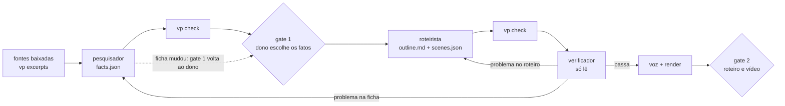

# CLAUDE.md — video-pipeline

> Contexto persistente para o Claude Code neste repositório. Ele lê este arquivo no início de cada sessão.
> Mantenha curto, factual e atualizado. Preferências pessoais vão em `CLAUDE.local.md` (gitignored).
> Fonte de verdade em caso de conflito: `docs/spec-v0.4.md` e os registros em `docs/decisions/`.

## 1. O que é este projeto

Pipeline local, retomável e auditável para produzir vídeos narrados em inglês ou em português (ADR 008;
voz Kokoro por idioma) (5–7 min, 16:9,
H.264/AAC, até 1080p) sobre histórias reais. Cada episódio nasce de fontes verificáveis, usa imagens
de acervo com licença registrada, gera ilustrações apenas para lacunas, narra com TTS local e sai como
`final.mp4` + `captions.srt` + `description.txt` + `credits.txt`.
**Publicação é sempre manual, após revisão humana.**

- **Recorte editorial da validação:** expedições e desastres de 1880–1930 — janela em que existe
  fotografia em domínio público, jornais digitalizados gratuitos e memórias de expedição em DP.
- **Piloto:** expedição polar de cauda longa (candidatos: Greely 1881–84, Karluk 1913, Belgica 1897–99).
- **Episódio 2 ou 3:** expedição sul-americana contada em inglês (candidato: Roosevelt–Rondon 1913–14),
  o diferencial editorial do canal.
- **Formato explicativo (em teste, #48):** perfil de "dinheiro e poder" de uma pessoa ou família, no estilo
  How Money Works, com tom crítico e documentado (nem herói, nem vilão). Modelo em
  `docs/pesquisa/modelo-perfil-de-poder.md`. Primeiro caso: Grupo Votorantim / família Ermírio de Moraes,
  em pt-BR com a voz `pm_alex`. O piloto documentário acima continua no roteiro.
- **Fase atual:** ver "Etapa atual" abaixo. Nada de produção em escala.
- **Evitar:** sobrevivência recente (fotos de agência, vira 100% ilustração gerada), true crime,
  Titanic/Hindenburg/Everest 1996 (saturados), Segunda Guerra (oceano de concorrentes).

### Etapa atual (atualizada em 2026-09-29)

Roteiro completo nas issues #1–#31, #41–#43, #48 e #69–#82 (`docs/ROADMAP.md`). A #48 foi antecipada: fatia
vertical do formato explicativo antes do piloto documentário. Nenhum vídeo publicado ainda.

- [x] **M0 · Fase 0** (#1–#9): ambiente, base, contratos, arquitetura, bench, motores (ADR 001).
- [x] **#10** estado, cache por `input_hash` e aprovação imutável.
- [x] **#48, passos 1–3:** planos tipados e `episode.json` v2 em pt-BR (ADR 008); Remotion + motion-kit no
  `main` com o template "negócios moderno" (tarja sobre a foto, mapa com contornos, números na forma da ficha).
- [x] **ADR 009:** agentes das etapas criativas (§15), `facts.json`, trechos numerados, `vp excerpts`, `vp check`;
  modelo de perfil de poder (tipos `impact_today` e `rule`, perguntas neutras, controvérsia atribuída).
- [x] **Protótipo `votorantim-fatia`** (90 s, 1914–1962): gate 1 aprovado; gate 2 com mudanças pedidas
  (faltava o objetivo: impacto hoje e como virou elite), o que originou o modelo de perfil.
- [x] **Protótipo `votorantim-abertura` v1** (80 s, modelo de perfil: gancho de impacto, ponte, origem,
  promessa): gate 2 com mudanças pedidas (gancho só com cartões de número). O gate 1 voltou ao dono
  (ajuste de F38). A v1 fica em `renders/v1-final.mp4` e `v1/`.
- [x] **Abertura v2** (79 s): gancho com fotos e B-roll do Pexels (sacos de cimento, pátio de carros,
  blister, torre de transmissão), S08 sem a dedução sobre acionistas. Termos das quatro fontes
  (`data/benchmarks/termos-bancos-de-imagem.md`), contrato (ADR 007, emenda de bancos de imagem), adapters
  Pexels/Pixabay/Unsplash, gates 1 e 3 registrados, verificador aprovou, render em `renders/final.mp4` (a v1
  fica em `renders/v1-final.mp4`). **Gate 2 aprovado em 2026-09-27.** Falta o gate 3 do retrato
  `an-jose-ermirio`; Pixabay e Unsplash aguardam as chaves.
- [x] **`votorantim-completo`** (47 cenas, ~7 min 35 s, 128 planos): gates 1 e 2 aprovados em 2026-09-27; prévia
  sem imagens em `votorantim-completo-previa`; mapa de lacunas em `lacunas.md`. Roteiro anterior à ADR 011.
- [x] **Diagnóstico do visual (#69)** e sugestões #70–#82; motion-kit 0.2.0 com o kit editorial (PR #83).
- [x] **Planos editoriais (ADR 011, aceita em 2026-09-28):** contrato e `vp check` (PR #85), template com as
  peças do kit (PR #86, cobre #70–#72), skills do roteirista e do verificador (PR #87).
- [x] **Episódio de teste `votorantim-dinheiro`** (ADR 011, etapa 4): 93 s, 10 cenas, 21 planos, gates 1–3
  aprovados; prévia em `renders/preview.mp4`; métricas em `data/benchmarks/episodio-votorantim-dinheiro.md`.
- [ ] **← Agora: Remotion.** Decisão do dono em 2026-09-29: o vídeo não será publicado por enquanto; o foco
  passa a ser o template do formato explicativo (`video/`, Remotion + motion-kit), com calma, uma frente por
  vez.
  - **Evolução do template (vídeo-régua), escolhida em 2026-09-29:** em vez de conferir cada correção num render
    avulso, o `votorantim-dinheiro` (conteúdo congelado) ganha uma versão `vN` ao fim de cada PR que muda o
    visual (template ou motion-kit), com a sonda de CPU antes; autorização do dono só para este vídeo. Script
    `scripts/provisorio/evolucao.py` (`gerar`, `guardar`, `comparar` com a folha de quadros, `lado-a-lado`),
    vídeos em `renders/evolucao/` e registro em `data/benchmarks/evolucao-template.md`.

  Frentes candidatas, a escolher com o dono (cada uma gera uma versão nova do vídeo-régua):
  - ver e ajustar os planos no Remotion Studio (navegador em 127.0.0.1), sem render;
  - defeitos vistos no `votorantim-dinheiro`: rótulos longos cortados na linha do tempo, rótulos das setas da rede
    pequenos (prop no motion-kit);
  - resto da #69: zoom nas transições (#72), entrada 2.5D (#71), tipos novos aplicados às cenas citadas nas
    #73 e #76–#80;
  - trilha e efeitos com `MusicBed`/`SfxTrack` (#81, licença por faixa decidida pelo dono);
  - `vp render` (#13) no lugar do script provisório; o `npm run render` de `video/package.json` ainda aponta
    para a composição `Episode`, que não existe mais.
- [ ] **Quando for publicar**, na ordem (análise na `docs/ANALISE.md`, revisão de 2026-09-29):
  1. Decisões do dono, numa rodada só: (a) o `votorantim-completo` sai com o roteiro atual (32 carimbos,
     7 planos com "Fonte:" no texto, que agora duplica o rodapé, trechos de até 18 planos sem imagem) ou é
     reescrito com os planos da ADR 011, o que reabre o gate 2 e cumpre os critérios das #73 e #76–#79;
     (b) o recorte da validação de audiência (§12): perfis de poder em pt-BR ou o piloto documentário, que o §1
     ainda cita.
  2. Se reescrito: roteirista e verificador só nas cenas afetadas, e gate 2 de novo.
  3. Gate 3 do `completo`: imagem por cena (várias sem candidato no Commons; a Brasiliana Fotográfica recusou o
     acesso automatizado com 403), retratos `an-jose-ermirio` e de Getúlio Vargas.
  4. Revisão de risco antes do gate 4 (pessoas vivas, empresa ativa, fatos de fonte única ou interessada): criar o
     agente `revisor-de-risco` (§15).
  5. Voz, render, legendas e pacote: não há `captions.srt`, `credits.txt` nem `description.txt` (#17 e #18,
     ou scripts provisórios como os de voz e render). Depois, gate 4.
  6. Publicação manual e métricas aos 7 e 28 dias (§12, #31), com as horas humanas do episódio medidas.
- [ ] **Próximos passos propostos**, cada um aguardando decisão do dono:
  - decupagem da referência (#69, passo 0, feita pelo dono);
  - Hemeroteca Digital para confirmar o leilão e o rateio de 1918 (cena S08 da fatia);
  - busca por vetor (ADR 010, ainda não escrita) quando as fontes passarem do que um agente lê de uma vez;
  - árvore da família com genro;
  - scripts provisórios de fonte, voz e render virarem `vp sources` (#26), `vp voice` (#16) e `vp render` (#13);
  - `vp new` e `vp reopen` (resto da #12; `vp approve`, `vp reject` e `vp status` já existem).
- Em pausa: #11 (invalidação) e M2–M7 do piloto documentário.

## 2. Regras inegociáveis (ler antes de qualquer alteração)

1. **Custo zero durante a validação.** `MAX_API_SPEND_USD=0` e `ALLOW_PAID_API=false`. Nunca migrar
   para endpoint pago, comprar créditos ou trocar de modelo por conta própria. O plano do Claude do dono,
   usado pelos agentes das etapas criativas, não conta como API paga (ADR 009). Em 429, cota esgotada,
   modelo ausente ou licença incompatível: registrar o motivo em `review.json`, marcar a etapa como
   `needs_review` e parar **aquela cena**, sem bloquear as demais.
2. **Nenhuma fonte inventada.** O LLM escreve somente a partir de trechos extraídos de fontes reais já
   baixadas em `sources.json`. Toda `claim` tem `source_ids` — **inclusive o que aparece na tela**
   (número, data, citação, cargo, gráfico; ADR 008). Roteiro com claim sem suporte não passa da validação.
3. **Nenhum ativo sem licença registrada entra no render.** Campos obrigatórios em §6. Imagem sem
   licença identificável vai para `needs_review`.
4. **Stock e imagem gerada são ilustração**, nunca "registro" do fato. `visual_need` correto sempre;
   imagem sintética realista de fato histórico exige a divulgação de conteúdo alterado do YouTube.
5. **Revisão humana obrigatória** nos 4 gates: tema/fontes, roteiro, ativos/direitos, prévia/descrição.
   Score de IA não aprova direitos nem autenticidade histórica.
6. **Arquivos com `review_status: approved` são imutáveis para o código.** Nova execução reutiliza,
   nunca sobrescreve.
7. **Segredos só em `.env`** (fora do Git). Adapters não logam tokens, headers de auth nem URLs assinadas.
8. **No MVP não existe:** upload automático, Docker, banco de dados, FastAPI, LiteLLM, framework
   multiagente **no código**, segundo editor visual, render em nuvem. Fichas, roteiro e checagem podem
   ser feitos por agentes do Claude Code definidos no repo; o código só valida (`vp check`, ADR 009).
   **Um motor de render por formato de episódio** (ADR 001): `archival_documentary` com ffmpeg (piloto) e
   `explainer` com Remotion (protótipo da #48).
9. **Nenhuma dependência nova sem justificativa no commit e licença verificada.**
10. **Testes não acessam rede.** Provedores externos são mockados; respostas reais aprovadas viram
    fixtures em `data/cache/`.

## 3. Ambiente

- Windows + WSL2/Ubuntu. Python 3.12 em `.venv` criado com `uv` (Kokoro exige < 3.13), PyTorch só-CPU.
  `ffmpeg`/`ffprobe`, Git, `espeak-ng`, Ollama local (instalação de usuário em `~/.local`, serviço
  `systemctl --user`, só `127.0.0.1`). Detalhes em `docs/decisions/004-ambiente-wsl.md`.
  Node.js LTS (via `nvm`) **só para o formato `explainer`**: `cd video && npm ci` instala o Remotion, o
  @viniciusk/motion-kit e o Chrome headless pelo lock. O documentário continua só com ffmpeg.
- `scripts/check_env.sh` valida o ambiente; rodar após qualquer mudança de máquina ou `.wslconfig`.
- Projeto vive em `~/projetos/auto-play` (repo `video-pipeline`, filesystem Linux do WSL). **Nunca** rodar em `/mnt/c` ou `/mnt/e`.
  Exports frios opcionais em `/mnt/e/VideoPipeline/exports`, copiados após o render.
- **`.wslconfig` obrigatório antes do benchmark:** o WSL2 limita a memória a 50% do host por padrão.
  Com 16 GB, configurar `memory=12GB` (ou o máximo que o Windows tolerar) para Ollama + Kokoro + ffmpeg
  coexistirem. Com 8 GB no host, usar modelo de texto menor ou provedor remoto gratuito.
  Configurado nesta máquina (host 19,4 GB / 16 threads): `memory=12GB`, `processors=12`, `swap=8GB`.
- Metas de planejamento (não requisitos rígidos): 16 GB RAM, 20 GB livres. GPU local **não** é pré-requisito.
- Interfaces de teste (galeria, futura API) só em `127.0.0.1`.
- Um render por vez. Registrar tempo e memória de cada etapa em `data/benchmarks/`.

### Estrutura de pastas

```
video-pipeline/
  CLAUDE.md
  docs/
    spec-v0.4.md              # especificação de referência
    decisions/                # ADRs: NNN-titulo.md (motor, provedores, nicho)
    pesquisa/                 # viabilidade de temas e modelos editoriais (ex.: modelo-perfil-de-poder.md)
    pipeline-flowchart.mermaid
  app/
    cli.py                    # vp (argparse): monta o contexto e chama as etapas
    bootstrap.py              # raiz de composição: único módulo que conhece adapters concretos
    settings.py               # config/providers.toml + .env
    pipeline/                 # etapas, estados, schemas (pydantic), ports.py, failures.py
    providers/                # uma porta (base.py) + adapters por função: text/, tts/, image_gen/,
                              # archives/, alignment/; errors.py comum
    media/                    # ffmpeg/ffprobe, preparação de ativos, checks automáticos
    render/                   # base.py (RenderEngine) + motor por formato (ADR 001)
    storage/                  # JsonFileStore (ManifestStore em JSON, trava por episódio)
  video/                      # template Remotion do formato explainer (ADR 008): planos, tema, fonte Inter (OFL)
  .claude/agents/             # pesquisador, roteirista, verificador (ADR 009): papel + ferramentas
  .claude/skills/             # método de cada etapa criativa: fichamento, roteiro-explicativo, checagem,
                              # humanizer-narracao (MIT, adaptado)
  config/providers.toml       # implementação por função + parâmetros, sem credenciais
  data/
    cache/                    # miniaturas, respostas de busca, hashes, fixtures
    benchmarks/               # resultados de comparação de provedores e da máquina
    episodes/<id>/
      manifest.json           # estado de cada etapa + input_hash (cache)
      episode.json            # contrato aprovado; entrada do motor de render
      sources.json  facts.json  outline.md  scenes.json  review.json
      sources/  excerpts/     # texto extraído de cada fonte; versão com trechos numerados (vp excerpts)
      assets/  voice/  renders/  credits.txt
  tests/                      # fakes/ (uma por porta), test_contracts.py, test_architecture.py
  .env.example  .env(gitignored)  pyproject.toml  uv.lock
```

### Arquitetura (ADR 006, diagrama em `docs/arquitetura.md`)

- Portas e adaptadores: cada função tem um `Protocol` em `app/providers/<função>/base.py` (ou
  `app/render/base.py`); as etapas recebem um `Context` explícito e só conhecem portas.
- Trocar de abordagem = novo adapter + registro em `app/bootstrap.py` + passar em
  `tests/test_contracts.py` + **uma linha** em `config/providers.toml`.
- Todo adapter declara `ProviderInfo(name, remote, usd_per_call)`; custo > 0 é recusado sem
  `ALLOW_PAID_API=true` e `MAX_API_SPEND_USD > 0`. `ProviderError` vira `needs_review` só na cena.
- `tests/test_architecture.py` falha se `app/pipeline/` importar adapter concreto ou biblioteca pesada.

### Variáveis de ambiente (`.env.example` lista nomes e exemplos não secretos)

`OLLAMA_BASE_URL`, `OLLAMA_MODEL`, `PEXELS_API_KEY`, `PIXABAY_API_KEY`, `UNSPLASH_ACCESS_KEY`,
`CLOUDFLARE_ACCOUNT_ID`, `CLOUDFLARE_API_TOKEN`,
`WORKERS_AI_MODEL=@cf/black-forest-labs/flux-1-schnell`, `DATA_DIR`, `MAX_API_SPEND_USD=0`,
`ALLOW_PAID_API=false`, `MAX_GENERATED_IMAGES_PER_EPISODE=12`, `MAX_CANDIDATES_PER_SCENE=2`,
`MAX_CLOUD_REQUESTS_PER_EPISODE=40`. Opcionais para comparação: `GROQ_API_KEY`, `GEMINI_API_KEY`.

## 4. Fluxo de trabalho (o que fazemos, de ponta a ponta)

```mermaid
flowchart TD
    subgraph P0["Fase 0 — Setup e decisão do motor"]
        A0["Ambiente WSL2: venv, ffmpeg, Ollama, Kokoro, .wslconfig, .env"] --> A1["Benchmark da máquina: RAM, CPU, tok/s do LLM, tempo de TTS"]
        A1 --> A2["Experimento 30–60 s com o mesmo roteiro: ffmpeg puro vs MoneyPrinterTurbo vs Remotion"]
        A2 --> A3{"Um motor atende qualidade, revisão por cena e proveniência?"}
        A3 -- "não" --> A2
        A3 -- "sim" --> A4["ADR: motor único escolhido; episode.json fixado como contrato"]
    end

    subgraph P1["Pipeline por episódio — manifestos JSON, retomável por hash"]
        B0["Escolher o caso pela disponibilidade de fontes e imagens em DP"] --> B1["Coletar fontes → sources.json; vp excerpts numera os trechos; agente pesquisador escreve facts.json"]
        B1 --> R1{"Revisão 1: fontes e fichas (≥ 2 independentes)"}
        R1 -- "reprovado" --> B0
        R1 -- "aprovado" --> B2["Roteiro no idioma do episódio: agente roteirista escreve só a partir das fichas, com planos por cena; humanizer"]
        B2 --> V1{"vp check sem erros e agente verificador aprovou?"}
        V1 -- "não" --> B2
        V1 -- "sim" --> R2{"Revisão 2: roteiro"}
        R2 -- "reprovado" --> B2
        R2 -- "aprovado" --> B3["Cenas e planos (ADR 008): visual_need + search_query por plano → scenes.json"]
        B3 --> B4["Busca visual em cascata: acervo interno → Commons/LoC/Flickr Commons → Pexels/Pixabay/Unsplash → Workers AI → gráfico original"]
        B4 --> B5["Galeria HTML estática por cena com origem, licença e créditos"]
        B5 --> R3{"Revisão 3: ativos e direitos"}
        R3 -- "trocar" --> B4
        R3 -- "aprovado" --> B6["Voz Kokoro por bloco → WAV; duração real via ffprobe"]
        B6 --> B7["Legendas alinhadas ao áudio; revisão de nomes próprios"]
        B7 --> B8["Montagem no motor escolhido → prévia MP4 (720p se preciso)"]
        B8 --> C1["Checks automáticos: abre no ffprobe, duração = voz, áudio presente, sem silêncio longo, 16:9, nenhuma cena sem ativo aprovado"]
        C1 --> R4{"Revisão 4: prévia e descrição"}
        R4 -- "ajustar imagem" --> B4
        R4 -- "ajustar texto" --> B2
        R4 -- "aprovado" --> B9["Export: final.mp4, captions.srt, description.txt, credits.txt"]
    end

    subgraph P2["Validação — sem API paga, sem promoção paga"]
        D0["Upload manual no YouTube com divulgação de IA quando aplicável"] --> D1["Métricas manuais no Studio aos 7 e 28 dias"]
        D1 --> D2{"4 vídeos no mesmo recorte publicados?"}
        D2 -- "não" --> B0
        D2 -- "sim" --> D3{"Decisão"}
        D3 -- "sinais orgânicos e qualidade ok" --> D4["Continuar sem pagar"]
        D3 -- "interesse, mas gargalo mensurável" --> D5["Gasto pequeno e delimitado em 1 componente, com teto por episódio/mês"]
        D3 -- "público não chega ou sai cedo" --> D6["Mudar assunto, embalagem ou formato; uma hipótese por vez"]
    end

    A4 --> B0
    B9 --> D0
```



O mesmo diagrama está em `docs/pipeline-flowchart.mermaid`.

## 5. Estados, cache e invalidação

- Estados por etapa em `data/episodes/<id>/manifest.json` (`app/pipeline/state.py`):
  `pending → running → needs_review → approved → completed`, ou `failed` (com o motivo).
- Chave de cache: `(episode_id, step, input_hash)`. O `input_hash` cobre o conteúdo das entradas **e** os
  parâmetros que mudam o resultado (modelo, voz, versão do motor). Hash igual = reutiliza a saída; hash
  diferente = reexecuta, **exceto** etapa `approved`: essa nunca é refeita nem sobrescrita sem
  `vp reopen <id> --step <s> --reason "..."`, registrado no `review.json` (§2.6).
- Uma execução por episódio de cada vez: trava em `data/episodes/<id>/.lock`.
- Regras de invalidação:
  - Trocar uma imagem invalida **só** montagem e prévia.
  - Alterar texto narrado invalida voz do bloco, timing, legendas e render.
  - Alterar fonte invalida roteiro e tudo abaixo.
- Erros de rede, cota ou licença param a cena, não o episódio.
- Aprovação humana é registrada por `vp approve <id> --step <step>` (ou `vp reject`) em `review.json`, nunca
  editando `review_status` à mão no manifesto principal. Nos gates feitos por agente ou pessoa, a decisão carimba
  `sources.json` + `facts.json` (gate 1), `scenes.json` + `outline.md` (gate 2) ou o arquivo do ativo (gate 3);
  `vp status` mostra se ela ainda vale (ADR 009, emenda de gates por comando).
- **Modalidade do vídeo** (ADR 001): `app/pipeline/format_decision.py` recomenda o formato pelo tema
  (`vp new`) e pelas cenas (`vp scenes`), com pontuação e motivos; o humano confirma ou troca
  (`step: format`, `choice`). O formato confirmado escolhe o motor de render.

## 6. Contratos de dados (schemas pydantic em `app/pipeline/schemas.py`, ADR 007)

Uma cena = um bloco de narração = um WAV, com uma **lista de planos tipados** (ADR 008): `photo`, `broll`,
`number`, `chart`, `quote`, `map`, `stamp`, `lower_third`, `timeline`, `family_tree`; a ADR 011 acrescenta
`compare`, `network` e `keyword`, e campos em `chart` (linha, participação, destaque), `quote` (página de
documento), `map` (mundo, países, rotas) e `timeline` (escala real). Cada plano fica
ancorado num trecho da narração; o tempo sai da posição da âncora sobre a duração real do WAV
(`app/pipeline/shots.py`). A fonte no rodapé sai das `claims` e do `sources.json`, e a tela não calcula razão
nem soma que não esteja numa ficha (ADR 011). Cena sem planos = forma v1 (um plano de foto). Exemplo v1
completo em `tests/fixtures/episodes/pilot-example/`.

**`sources.json`** — por fonte: `id`, `title`, `url`, `kind` (`primary|secondary|newspaper|archive`),
`retrieved_at`, `local_path` (texto extraído), `notes`. Mínimo de 2 fontes independentes para os
fatos principais.

**`facts.json`** (ADR 009) — fichas de fatos, a única base do roteiro: `text`, `kind` (`number`,
`conflict`, `turning_point`, `mechanism`, `curiosity`, `impact_today`, `rule`, `context`), `why_it_matters` e `evidence` com
`excerpt_id` + `quote` **literal** (conferida pelo `vp check`); `open_questions` para o que as fontes não
respondem. Trecho = parágrafo do texto extraído (`source-01#E7`). `Source.interested` marca fonte
interessada (fato só com ela gera alerta); fontes com autor em comum (`Source.authors`) contam como uma só. Com `facts.json`, toda afirmação do roteiro cita um trecho fichado.

**`scenes.json`** (exemplo simplificado da spec):

```json
{
  "episode_id": "pilot-001",
  "language": "en",
  "scenes": [
    {
      "id": "S01",
      "narration": "The expedition left port with one goal...",
      "claims": [{ "text": "Departure date", "source_ids": ["source-01"], "excerpt_ids": ["source-01#E1"] }],
      "visual_need": "historical_exact",
      "search_query": "expedition ship harbor historic photo",
      "chosen_asset_id": null,
      "duration_ms": null,
      "review_status": "pending"
    }
  ]
}
```

`visual_need` ∈ `historical_exact | contextual_stock | map_or_graphic | illustrative_reconstruction`.

**Ativo** (`assets/<id>.json`): `provider`, `provider_id`, `original_url`, `page_url`, `author`,
`license_id`, `license_url`, `attribution_text`, `usage_notes`, `retrieved_at`, `sha256`,
`review_status`, `used_in_scenes` (lista: um mapa pode voltar). Imagem gerada tem também
`generation: {prompt, model, seed, steps}`. Só chega a `approved` com licença da lista fechada da ADR 007
(PD, CC0, CC-BY incl. 3.0 BR, Flickr-NKCR, Pexels, Pixabay, Unsplash, Coverr, Generated, Original — **sem**
CC-BY-SA e NC), `sha256`, e `usage_notes` para domínio público ou `author` + `attribution_text` para CC-BY.
Ativo de banco de imagem só com a licença do próprio banco (ou CC0), `author`, `attribution_text` e, em
`usage_notes`, a conferência de pessoas, marcas e texto (emenda de bancos de imagem).

**`review.json`** — fonte única das decisões humanas: entradas só acrescentadas, por etapa, cena ou ativo,
com `decision`, `reviewer`, `at`, `input_hash` do conteúdo revisado (mudou o conteúdo, a aprovação cai) e
`choice` quando o humano troca a recomendação (ex.: formato).

**`episode.json`** — contrato do render (mudar exige nova ADR): `schema_version` 1 (um visual por cena,
ADR 001) ou 2 (planos contíguos por cena, ADR 008), `language` (`en` | `pt-BR`),
`format` (`archival_documentary` | `explainer`, decide o motor),
`video` (1920×1080, 30 fps, 48 kHz, 16:9 validado), cenas com
`start_ms`/`duration_ms` medidos da voz real e sem sobreposição, texto, caminhos relativos de
imagem/áudio, `captions`. É a **única** entrada do motor de montagem;
se o motor for o Turbo, um adapter converte este arquivo para os parâmetros dele, nunca o contrário.

## 7. Provedores e política de escolha

| Função | Padrão do piloto (spec v0.4) | Candidato a teste | Critério de troca |
|---|---|---|---|
| Fichas, roteiro, cenas, checagem | Agentes do Claude Code + skills + `vp check` (ADR 009; a spec previa Ollama) | Ollama local (#27); Groq e Gemini gratuitos; outro agente que leia as skills | Fidelidade ao texto-fonte e fatos que prendem, sem custo por chamada. |
| Narração em inglês | Kokoro local, WAV por bloco | Gemini Flash TTS gratuito, se disponível na conta | Voz claramente melhor em escuta cega, nomes corretos, condições de dados aceitas. |
| Alinhamento de áudio | ffprobe + revisão manual | Groq Whisper gratuito, quando necessário | Corrigir problema concreto de legenda; não transcrever episódio inteiro sem necessidade. |
| Imagem para lacunas | Cloudflare Workers AI, FLUX.1 Schnell | Outro só após checar plano, direitos e cota | Qualidade útil dentro de custo zero. Acervo sempre antes de gerar. |
| Roteador de modelos | Nenhum | OpenRouter com variante `:free` | Só se o candidato direto falhar. |

- Um adapter por função expõe contratos simples: `generate_json()` (texto, só transporte),
  `synthesize_speech()`, `estimate_cost()`/`generate_image()`, `search_assets()`, `align()`, `render()`.
  `generate_script()` e `generate_scenes()` são funções do pipeline sobre `generate_json()`, para prompts
  e validação de claims ficarem num lugar só (ADR 006). `config/providers.toml` escolhe um padrão por função.
- Catálogos como free-llm-resources, free-ai-api-tiers e free-for-dev servem **só para descobrir** opções.
  Nunca copiar cotas ou claims de uso comercial deles para o código: registrar link oficial, data da
  consulta e resultado de um teste com a conta real em `data/benchmarks/`.
- Comparação pequena antes de tornar um remoto padrão: os mesmos 3 trechos (um nome próprio difícil,
  duas cenas com fatos verificáveis), um bloco de narração por voz, duas lacunas visuais.
  Anotar modelo/versão, endpoint, data, latência, unidades, limite observado, custo, consistência
  do JSON, erros, avaliação humana e URL dos termos. Nunca inferir confiabilidade factual de boa redação.

## 8. Política de imagens e cota

Ordem de busca por cena: (1) acervo interno já revisado → (2) Commons, Library of Congress e
Flickr Commons para pessoas, lugares e eventos específicos → (3) bancos de imagem para cenas genéricas
(ondas, neve, céu): Pexels, Pixabay e Unsplash por API, Coverr só à mão pelo site → (4) Workers AI, no
máximo 2 alternativas, escolha humana → (5) mapa, cronologia, citação curta permitida ou tela gráfica
original. Nunca preencher com imagem irrelevante.

- Busca em lote por consulta normalizada; cache de metadados e miniaturas; `sha256` para deduplicar;
  redimensionar só o ativo final escolhido; registrar headers de cota dos bancos quando existirem.
- Termos de cada banco (limites, cache, crédito, registro de download) em
  `data/benchmarks/termos-bancos-de-imagem.md`. Nada de pessoa reconhecível doente ou tomando remédio, marca,
  logo, texto ou contexto político em imagem de banco.
- Regra prática de domínio público: publicado até 1930 é DP nos EUA; o Commons exige DP também no
  país de origem. Checar caso a caso e registrar o raciocínio em `usage_notes`.
- **Workers AI:** cota gratuita de 10.000 neurons/dia. FLUX.1 Schnell custa 4,80 neurons por tile
  512×512 + 9,60 por passo; uma imagem 1024×1024 com 4 passos ≈ 58 neurons (~170/dia). O teto de 12
  imagens/episódio é editorial, não de cota. O adapter estima o consumo antes de gerar, registra o uso
  do dia e devolve `quota_exhausted` em erro de cota. Riscos conhecidos a tratar no adapter:
  `num_steps` é obrigatório na prática; o filtro NSFW dá falso positivo com prompts curtos (código 3030,
  reescrever o prompt com contexto e tentar uma vez); modelos são aposentados sem aviso longo
  (modelo ausente → `needs_review`, nunca trocar de modelo sozinho).

## 9. Voz, legendas e montagem

- Roteiro escrito diretamente no idioma do episódio (en ou pt-BR). WAV curto por bloco narrativo para trocar
  uma frase isolada.
- Glossário de pronúncia por episódio (`voice/glossary.json`); Kokoro aceita fonemas customizados.
- Timing das cenas vem da duração real dos WAVs (ffprobe), nunca de estimativa do LLM.
- Legendas geradas após aprovação da voz, por alinhamento do texto com o áudio; nomes próprios sempre
  revisados. `captions.srt` é editável.
- Montagem: 20–35 entradas visuais para 5–7 min (fotos/filmes, mapas, textos curtos, ilustrações).
  Reutilizar um mapa quando o roteiro volta ao mesmo local. Movimento leve em fotos só se o recorte
  preservar o assunto. Música e efeitos só com licença registrada por faixa.
- Motor de montagem **por formato** (ADR 001, `render` em `config/providers.toml`):
  `archival_documentary` → **ffmpeg puro** (`app/render/ffmpeg.py`: segmento por cena em cache, fundo
  desfocado para imagens estreitas, legendas gravadas só na prévia, cor bt709); `explainer` →
  **Remotion + @viniciusk/motion-kit** (`app/render/remotion.py` e o template em `video/`, no `main` desde a
  #48): um componente por tipo de plano, tarja ou número sobre a foto ou o B-roll quando vem logo depois dela,
  foto de banco colorida em tela cheia (a de arquivo fica no cartão P&B), mapa com contornos do Natural Earth
  (domínio público) e cache por cena. Com a ADR 011, o template passa a usar as peças do motion-kit 0.2
  (kit editorial, tema `editorial`). MoneyPrinterTurbo reprovado (branch `experimento-mpt`).
  Cena gráfica animada num documentário = clipe gerado pelo motion-kit como ativo `Original` (etapa #42).
  Comparação em `data/benchmarks/README.md`; entrada de teste `tests/fixtures/episodes/engine-test/`.

## 10. CLI planejada (`vp`, console script em `pyproject.toml`)

```
vp bench [--models a,b] [--runs N] [--render DIR]  # máquina, LLM, TTS e render pelas portas -> data/benchmarks/
vp new <id> --topic "..." [--format archival_documentary|explainer]  # formato decide o motor
vp sources <id>               # busca, download, extração de texto -> sources.json
vp script <id>                # roteiro com retrieval + validação de schema e de claims
vp scenes <id>                # divisão em cenas + visual_need + search_query
vp assets <id>                # busca visual em cascata, respeitando limites
vp gallery <id>               # galeria HTML estática em 127.0.0.1
vp voice <id>                 # Kokoro por bloco + ffprobe -> voice/
vp subs <id>                  # legendas alinhadas -> captions.srt
vp render <id> [--preview]    # motor escolhido -> renders/
vp export <id>                # final.mp4 + srt + description.txt + credits.txt
vp approve <id> --step <s> [--asset <a>]  # aprovação humana em review.json (gates 1–3, ADR 009)
vp reject <id> --step <s> --reason "..." [--changes]  # reprovação ou mudanças pedidas
vp status <id>                # última decisão de cada gate e ativo, se ainda vale, e pendências
vp reopen <id> --step <s> --reason "..."  # reabre etapa aprovada para refazer (§2.6)
vp excerpts <id>              # trechos numerados de cada fonte -> excerpts/ (ADR 009)
vp check <id>                 # valida fontes, fichas e cenas escritas por agente ou à mão (ADR 009)
```

Cada comando é idempotente: reexecutar com o mesmo `input_hash` não refaz trabalho.

## 11. Ordem de implementação e critérios de aceite do piloto

Ordem: **(A)** experimento de motor da Fase 0 → **(B)** fixar `episode.json` e renderizar um episódio
inteiro → **(C)** CLI + Kokoro por bloco + timing + legendas → **(D)** adapters de busca/licença + galeria →
**(E)** geração condicional via Cloudflare + medidor de cota → **(F)** pesquisa assistida e revisão de
roteiro com LLM → **(G)** comparação pequena dos remotos, só para gargalo demonstrado.
FastAPI e SQLite só quando arquivos e galeria virarem obstáculo real.

Piloto aceito quando:

- [ ] Pauta + ≥ 2 fontes independentes para os fatos principais, em `sources.json`.
- [ ] Roteiro em inglês revisado, dividido em cenas, toda claim relevante com `source_ids`.
- [ ] Galeria com ≥ 1 opção visual por cena e direitos registrados; geração só para lacunas.
- [ ] Narração local, legendas editáveis, prévia renderizada, revisão por cena registrada.
- [ ] Export completo; **zero** custo de API paga.
- [ ] Métricas registradas: duração de cada etapa, imagens encontradas/geradas, decisões e rejeições
      humanas, horas humanas totais.

## 12. Validação de audiência e política do YouTube

- 4 vídeos longos no mesmo recorte em 4–6 semanas, títulos e capas próprios, **sem** anúncio pago
  (promoção paga altera a origem das visualizações e não conta para o Programa de Parcerias).
- Métricas manuais no YouTube Studio aos 7 e 28 dias: impressões orgânicas e origem do tráfego; CTR
  com contexto; retenção nos 30 s iniciais e duração média; retorno e comentários espontâneos (amigos
  não contam); tempo e custo por episódio. Sem integração com a API do YouTube nesta fase.
- **Política de conteúdo inautêntico (YPP, jul/2025):** o YouTube cita como exemplo de conteúdo
  mass-produced "histórias narradas com variações mínimas" e "slideshows com narração idêntica". É
  exatamente o risco deste formato. Defesa: pesquisa original, roteiro próprio por episódio, variação
  visual e de estrutura, edição real. Tratar isso como critério de aceite, não como risco genérico.
- Uso de IA continua monetizável quando o conteúdo é original e a divulgação de conteúdo sintético é feita.

## 13. Decisões pendentes e ajustes propostos sobre a spec v0.4

Registrar cada item como ADR quando decidido. Até lá, o código segue a spec.

1. **Etapa de recuperação de fontes (proposta forte; numeração dos trechos e fichas decididas na ADR 009).** A spec exige claims ligadas a fontes, mas não
   descreve como o texto das fontes chega ao LLM. Proposta: `vp sources` baixa e extrai; `vp script`
   passa ao modelo **apenas** trechos numerados dessas fontes e exige que cada frase cite o trecho.
   Sem isso, o validador de schema aprova ficção bem formatada.
2. **Provedor de texto padrão** (para o modo sem agente; o padrão das etapas criativas é a ADR 009). Spec: Ollama local. Proposta: Gemini/Groq gratuito para rascunho
   (fidelidade ao texto-fonte muito maior que modelos 7–8B em CPU), Ollama como fallback. Roteiro de
   história pública não é dado confidencial. Decidir após o benchmark da máquina.
3. ~~ffmpeg puro como candidato zero de montagem~~ **Decidido** na ADR 001: um motor por formato.
4. ~~`.wslconfig` com limite de memória explícito~~ **Feito** (§3, ADR 004).
5. **Flickr Commons** adicionado à cascata de acervos ("no known copyright restrictions").
6. Pós-piloto (já previstas na spec): duração ideal do episódio; versões em português/espanhol.
7. **Busca por vetor (ADR 010, proposta ainda sem arquivo em `docs/decisions/`):** `vp search` sobre os trechos numerados, com embeddings locais
   guardados em arquivo (sem banco). Serve para achar trechos; a prova continua literal no `vp check`. Entra
   quando as fontes passarem do que um agente lê de uma vez (ex.: jornais da Hemeroteca).
8. ~~B-roll de banco de imagens no gancho do explicativo~~ **Decidido** na emenda de bancos de imagem da
   ADR 007 (2026-09-26): Pexels, Pixabay e Unsplash por API, Coverr só manual, sempre como ilustração (§2.4).

## 14. Como trabalhar neste repositório (instruções para o Claude Code)

- Antes de escrever código de uma etapa, ler o schema correspondente em `app/pipeline/schemas.py` e
  o manifesto de exemplo em `tests/fixtures/episodes/pilot-example/`.
- Nunca executar comandos que chamem provedores externos (Pexels, Pixabay, Unsplash, Coverr, Cloudflare, Groq,
  Gemini) a menos que o usuário peça explicitamente naquela sessão. Ollama e Kokoro locais podem rodar.
- Nunca editar arquivos em `data/episodes/*/` com `review_status: approved`; se um ajuste exigir isso,
  parar e perguntar.
- Em dúvida sobre licença de um ativo ou termos de um provedor, parar e perguntar; não decidir sozinho.
- Rodar `pytest` e `ruff check .` antes de encerrar qualquer tarefa. Testes novos para toda etapa nova.
  Testes com modelos locais pesados levam `@pytest.mark.slow` e ficam fora da rodada padrão
  (`pytest -m slow` para rodá-los; usam `HF_HUB_OFFLINE=1`, sem rede).
- Commits pequenos e descritivos. Decisões de arquitetura viram `docs/decisions/NNN-titulo.md`.
- Ao mudar uma decisão registrada aqui, atualizar este arquivo no mesmo commit.
- Dependências só via `uv add` (com licença no comentário do `pyproject.toml`) e `uv.lock` versionado.
  Kokoro/PyTorch ficam no extra `tts`; testes rodam sem ele. CLI em `argparse` (`app/cli.py`):
  um comando novo é um handler `(args, context)` registrado em `HANDLERS`.
- Convenções: Python 3.11+ (3.12 no `.venv`), tipagem completa, pydantic v2 para manifestos, `pathlib`, sem estado global,
  um adapter por provedor em `app/providers/<função>/<provedor>.py` implementando o `Protocol` da função,
  logging estruturado sem segredos.
- Etapas criativas: `.claude/agents/` (pesquisador → roteirista → verificador) com o método nas skills
  de `.claude/skills/`; o que eles escrevem passa pelo `vp check` e pelos gates humanos (ADR 009). Ver §15.
- **Instruções a agentes, notas de fonte e exemplos:** nenhum fato de memória (nome, ofício, data, número)
  e nenhum juízo embutido. Citar fichas por id (F08) e trechos (`source-02#E46`) em vez de reescrever o
  fato; conferir na página antes de escrever uma nota; pedir gancho e promessa como pergunta neutra. Um
  fato ou enquadramento meu no prompt vira roteiro, e o `vp check` não pega.
- Não propor Docker, banco, fila, API web, framework multiagente no código ou provedor pago "para
  facilitar". A spec já decidiu que não, e o motivo está em §2.

## 15. Agentes das etapas criativas (ADR 009)

Os agentes escrevem **só arquivos de dados** em `data/episodes/<id>/`; a aplicação valida (`vp check`) e o dono
decide nos gates. O método de cada etapa está na skill (Markdown portável: outro agente, um modelo local ou
uma pessoa podem seguir o mesmo método e passar pelo mesmo `vp check`); o arquivo do agente só define papel e
ferramentas. Agentes e skills novos aparecem numa sessão nova do Claude Code; as skills também rodam como
`/fichamento <id>`, `/roteiro-explicativo <id>`, `/checagem <id>`.

| Agente | Skill | Escreve | Ferramentas |
|---|---|---|---|
| `pesquisador` | `fichamento` | `facts.json` | Read, Grep, Glob, Write, Bash (`vp excerpts`, `vp check`) |
| `roteirista` | `roteiro-explicativo`, `humanizer-narracao` | `outline.md`, `scenes.json` | Read, Grep, Glob, Write, Edit, Bash (`vp check`) |
| `verificador` | `checagem` | nada (relatório) | Read, Grep, Glob; contexto limpo, só leitura |



**Agentes mais específicos (candidatos).** Criar só quando a etapa existir no código e houver necessidade
concreta. Cada um com skill própria, ferramentas mínimas e validação em código quando possível; nenhum aprova
gate.

| Candidato | Etapa | O que faria | Quando criar |
|---|---|---|---|
| `curador-de-imagens` | ativos, gate 3 (#20–#23) | busca em Commons, LoC, Flickr Commons e Brasiliana; preenche `assets/*.json` com licença e `usage_notes`; propõe candidatos por plano | com `vp assets` |
| `arquivista` | fontes primárias (#26) | jornais e documentos de época (Hemeroteca Digital); confirma fatos de fonte única | com a busca por vetor |
| `planejador-de-planos` | roteiro (#28) | separa a escolha dos planos (tipo, âncora, ritmo) da escrita da narração | se o ritmo visual virar gargalo |
| `revisor-de-risco` | antes do gate 4 | pessoas vivas, empresa ativa, controvérsia atribuída, divulgação de IA | antes do primeiro episódio publicado com pessoas vivas |
| `pronuncia` | voz (#15) | glossário `voice/glossary.json` para nomes próprios | quando a voz errar nomes |
| `editor-de-descricao` | export (#18) | `description.txt` e `credits.txt` a partir das fontes e dos ativos | com `vp export` |

## Referências técnicas verificadas (23–24/09/2026)

Ver lista completa em `docs/spec-v0.4.md`. Principais: WSL filesystems (Microsoft), Ollama structured
outputs, Groq rate limits e speech-to-text, Gemini API pricing e rate limits, OpenRouter free variants,
Cloudflare Workers AI pricing e modelo flux-1-schnell, Pexels API e licença, Wikimedia Commons API,
Library of Congress JSON API, Kokoro-82M, FFmpeg, Remotion CLI e licença, MoneyPrinterTurbo README,
YouTube: monetização, divulgação de IA, retenção/CTR, campanhas e qualificação para o YPP.