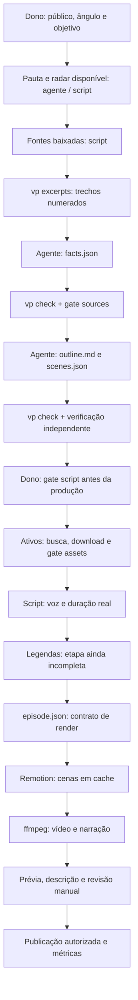

# Workspace atual e componentes que faltam

**Verificação:** 13/10/2026, árvore local da branch `objetivo-do-video`. **Escopo:** funcionamento da aplicação, cenas disponíveis, lacunas operacionais e caminhos de integração. As alterações em andamento foram lidas como estado local; isso não significa que estejam todas commitadas ou aprovadas.

## Resumo

Hoje o auto-play funciona como **workspace local de produção assistida de vídeos**. O dono decide pauta e aprova entregas; agentes escrevem artefatos editoriais; Python valida contratos, evidências e decisões; scripts produzem mídia; Remotion e motion-kit desenham o explicativo; ffmpeg junta imagem e narração.

O núcleo visual tem **13 tipos de plano**, dos quais **8 são permitidos em retrato**. O principal gap visual é permitir que o roteiro expresse listas, mecanismos e evidência em 9:16. O principal gap operacional é completar alinhamento, legendas, export e revisão antes de produzir: vários comandos aparecem no help, mas ainda não executam essas etapas.

As análises complementares são [audiência e engajamento](RELATORIO-GAPS-AUDIENCIA-ENGAJAMENTO.md) e [skills do GitHub e cenas](RELATORIO-SKILLS-GITHUB-MOTION-CENAS.md). As propostas abaixo descrevem implementação futura; este trabalho altera apenas documentação.

## Tópico 1 — Como o workspace funciona hoje

### Subtópico 1.1 — Responsabilidade de cada camada

| Camada | O que faz hoje | Onde conferir |
|---|---|---|
| Dono | Define público, pauta, objetivo/tese, ativos e aprovação final; autoriza publicação | `AGENT.MD`, [contexto](../CLAUDE.md), [gates](../app/pipeline/gates.py) |
| Agentes e skills | Produzem pauta, fichas, roteiro e checagem; não aprovam gates | `.agents/skills/`, `.claude/agents/`, `.claude/skills/` |
| Aplicação Python | CLI, schemas, referências, citações, âncoras, alertas e registro de decisões | [CLI](../app/cli.py), [schemas](../app/pipeline/schemas.py), [check](../app/pipeline/check.py) |
| Composição de provedores | Instancia somente a função usada; escolhe implementações e aplica a política de custo | [bootstrap](../app/bootstrap.py), [configuração](../config/providers.toml) |
| Arquivos do episódio | Guardam entradas, entregas editoriais, direitos, voz e render | `data/episodes/<id>/`, [storage](../app/storage/json_files.py) |
| Produção provisória | Cópia de radar, fontes, busca/download de ativos, voz e montagem | `scripts/provisorio/` |
| Template | Converte os planos em componentes visuais, camadas, legenda e apresentador | [ShotView](../video/src/ShotView.tsx), [Editorial](../video/src/Editorial.tsx), [Scene](../video/src/Scene.tsx) |
| Motores | Documentário: ffmpeg. Explicativo: cenas Remotion e montagem final ffmpeg | [ffmpeg](../app/render/ffmpeg.py), [Remotion](../app/render/remotion.py) |

As skills são instruções para o agente executar o trabalho no workspace. A CLI não instancia automaticamente uma equipe de agentes ao receber `vp script`. Ollama existe como adapter e é usado em benchmark e checagem local experimental; o roteiro assistido atual é produzido por agentes ou por edição dos arquivos.

O armazenamento principal é JSON no filesystem. Não há necessidade demonstrada de adicionar banco, servidor web ou outro framework para fechar esse fluxo. Remotion Studio é uma ferramenta de prévia, não um painel que orquestra toda a produção.

### Projetos vizinhos: onde motion-kit, lab-voz e radar entram

Os três diretórios existem ao lado do auto-play, dentro de `/home/viniciusk/projetos/`. Ter o checkout nessa pasta e utilizá-lo na produção são coisas distintas:

| Projeto | Como participa da pipeline | Momento e evidência | O que o auto-play não executa |
|---|---|---|---|
| `motion-kit/` | Dependência direta: `video/` importa `@viniciusk/motion-kit`, instalado pelo SHA fixado em `package.json` | Render do explicativo; imports em `Editorial`, `Scene` e `HostWindow` | O checkout vizinho não é importado diretamente em tempo de render; sua alteração precisa chegar ao pacote consumido |
| `radar-de-reels/` | Entrada por arquivo: `radar_resumo.py` copia `briefs/<nicho>.json` para `radar-brief.json` do episódio | Antes da pauta/roteiro; `vp check` também compara a forma com o brief | Não inicia coleta nem mineração automaticamente; gerar o brief é trabalho do radar |
| `lab-voz/` | Bancada de teste do Chatterbox, documentada na ADR 016; pode fornecer seu ambiente Python ao adapter | Produção de voz final: adapter usa o executável definido em `CHATTERBOX_PYTHON`; o Python `.venv/bin/python` do laboratório existe | Não chama `lab-voz/falar.py`; executa `chatterbox_worker.py` do próprio auto-play com o Python externo configurado |

**Uso observado:** `thiel-empresa-pt` e `thiel-contrato-pt` têm briefs locais e arquivos WAV com nome Chatterbox. Isso confirma artefatos compatíveis com uso dessas etapas, mas nomes de arquivo não certificam configuração ou execução histórica. A seleção padrão de voz final é Chatterbox; rascunhos usam Kokoro. O radar é opcional por episódio e o motion-kit pertence ao formato explicativo; não participam obrigatoriamente de toda peça.

Não foi inspecionado o `.env`: a ligação histórica com lab-voz está confirmada em [ADR 016](decisions/016-voz-clonada-do-dono.md), mas o caminho configurado hoje para `CHATTERBOX_PYTHON` não foi conferido. Pode apontar para o laboratório ou outro ambiente compatível. A documentação de integração não deve afirmar que o executável atual está naquela pasta sem essa verificação.

O [diagrama com os pontos de integração](pipeline-hoje.mermaid) mostra o radar como entrada editorial, o ambiente externo como suporte à voz e o pacote motion-kit como dependência do render. São mecanismos já existentes; uma CLI única que orquestre tudo ainda não está implementada.

### Subtópico 1.2 — Sequência editorial e execução disponível

Esse diagrama mostra a ordem editorial recomendada e identifica a etapa incompleta. **Não representa um comando único implementado.** O script atual pode ir de voz a render sem executar alinhamento, verificar os gates ou obrigar essa ordem. Há registro local antigo de gate 2 depois da prévia; validar roteiro antes de voz/render reduz retrabalho.

### Subtópico 1.3 — O que existe na CLI

| Situação | Comandos | Efeito |
|---|---|---|
| Implementados | `bench`, `excerpts`, `check`, `approve`, `reject`, `status` | Têm handlers reais em `app/cli.py` |
| Declarados, sem handler | `new`, `sources`, `script`, `scenes`, `assets`, `gallery`, `voice`, `subs`, `render`, `export`, `reopen` | Retornam código 3 e mensagem de etapa pendente |

`vp check` faz validação determinística; não julga sozinho se toda frase tem o sentido correto ou se o vídeo cumpre a promessa. `vp status` mostra decisões e sua validade; não acompanha automaticamente todos os trabalhos de mídia ou publicação.

Os gates disponíveis por comando são:

- `sources`: hash de `sources.json` e `facts.json`.
- `script`: hash de `scenes.json` e `outline.md`.
- `assets --asset <id>`: hash da mídia; aprovação também valida/carimba os metadados do ativo.

Pauta e prévia têm revisão manual. Não existe `vp approve --step preview`. A aprovação pertence ao dono; alterar o material revisado exige nova decisão. A função interna de reabertura existe no módulo de estado, mas `vp reopen` ainda não está ligada a um handler.

### Subtópico 1.4 — Provedores: configuração não prova implementação

| Função | Implementação disponível | Limite atual |
|---|---|---|
| Texto | Ollama | Groq/Gemini de texto estão registrados sem fábrica |
| Voz | Kokoro, Chatterbox e Gemini TTS | Padrões no TOML: Kokoro para rascunho e Chatterbox para final; `.env` pode sobrescrever configuração |
| Bancos de imagem | Pexels, Pixabay, Unsplash | Uso depende de credenciais e autorização; testes não fazem chamadas reais |
| Acervo histórico | Scripts provisórios e trabalho manual | Commons/LoC/Flickr na registry não têm fábrica de adapter |
| Geração de imagem | Porta e configuração para Workers AI | Registry sem fábrica: não é serviço operacional completo |
| Alinhamento | Porta `SubtitleAligner` | `aligner = "ffprobe"` não tem fábrica; medir duração não alinha palavras |
| Render | ffmpeg e Remotion | Remotion aceita o contrato do explicativo; não converte qualquer formato JSON externo |

O TOML declara intenção e seleção. `Registration(..., factory=None)` gera erro de configuração quando a função é usada. O carregamento sob demanda permite que `vp status` funcione mesmo com funções futuras ainda incompletas.

### Subtópico 1.5 — Arquivos e o que cada um significa

| Arquivo / pasta | Papel |
|---|---|
| `pauta.md`, `radar-brief.json` | Direcionamento e hipóteses de forma; radar não prova fatos |
| `sources.json`, `sources/`, `excerpts/` | Fontes baixadas e trechos numerados |
| `facts.json` | Fichas com evidência literal e perguntas em aberto |
| `outline.md`, `scenes.json` | Argumento e roteiro; cenas com narração e planos ancorados |
| `assets/<id>.json` e mídia | Direitos, hash, origem e arquivo aprovado |
| `voice/` | Áudio por cena e cache da síntese |
| `episode.json` | Entrada do render com duração real, áudio e planos resolvidos |
| `review.json` | Histórico de decisões humanas e hashes |
| `manifest.json` | Estado por etapa quando o caminho usa o mecanismo de estado |
| `captions.srt` | Legenda editável que o renderer sabe consumir; falta fechar sua geração/vínculo no script |
| `renders/` | Segmentos, prévias e saída final |

`data/episodes/` é ignorado pelo Git. Fixtures pequenas vivem em `tests/fixtures/`. Voz de referência, dados pessoais e segredos ficam fora dos relatórios e commits. JSON aprovado não deve ser reescrito para contornar gate.

### Subtópico 1.6 — Como um plano vira vídeo

1. O roteiro escolhe `kind`, conteúdo, claims, ativo e âncora literal na narração.
2. O script de montagem gera/reutiliza o WAV e mede sua duração com ffprobe.
3. `episode_shots` calcula o intervalo de cada plano proporcionalmente à posição da âncora. A duração da cena é real; o instante das palavras continua aproximado.
4. O adapter converte milissegundos em frames e entrega props à composição `Scene`.
5. `ShotView` despacha pelo `kind`; `Editorial` compõe as peças do motion-kit.
6. `Scene` mantém mídia por baixo dos overlays, aplica fontes, legenda e apresentador. Durante `keyword`, oculta a legenda por frase.
7. Cada cena é renderizada e pode ser reutilizada por hash de template, mídia e props.
8. `assemble` concatena vídeo e áudio separadamente e seleciona `0:v` e `1:a`. Áudio acrescentado só no render visual da cena não entra automaticamente no final.

O script `montar_episodio.py` não chama `record_decision`, `run_step` ou a checagem completa antes de renderizar; verifica schemas e presença de mídia, mas não aplica sozinho todos os limites editoriais/de aprovação. Ele também escreve `episode.json` diretamente. Locks e proteção do store não cobrem automaticamente todo script que escreve arquivos por fora dele.

Há três composições no template: `Scene`, `Shot` e `Clipe`. O clipe de letra usa um fluxo próprio, fora do contrato de episódio narrado. `npm run render` ainda aponta para `Episode`, que não é uma composição registrada; o caminho efetivo do explicativo passa pelo adapter/script.

## Tópico 2 — Catálogo visual realmente integrado

### Subtópico 2.1 — Os 13 tipos de plano

| `kind` | Componente principal | 9:16? | Limite relevante |
|---|---|---|---|
| `photo` | `ArchivalPhoto` / `ImageBackground` | Sim | Stock e arquivo têm tratamentos distintos; crop precisa preservar o assunto |
| `broll` | `FootageBackground` | Sim | Contrato não expõe escolha de trecho ou velocidade |
| `number` | `Odometer` ou texto | Sim | Valor como a ficha; tamanho ajustado no retrato |
| `chart` | `BarChart`, `LineChart`, `ShareChart` | Sim | Uma série; sem tabela, limite ou anotação no contrato |
| `quote` | Texto próprio / `DocumentPage` | Não | Citação com fonte; documento precisa de adaptação vertical |
| `map` | `GeoMap` | Não | Dados geográficos externos ao kit; rotas afirmam relações |
| `stamp` | `DateStamp` | Sim | Data/lugar; não substitui uma explicação temporal |
| `lower_third` | `LowerThird` | Sim | Identificação factual e espaço para mídia |
| `timeline` | `YearTimeline` | Não | Eventos e movimento de câmera; layout horizontal |
| `family_tree` | Implementação própria em `ShotView` | Não | Não é componente do kit integrado; layout precisa de caso concreto |
| `compare` | `ValueCompare` ou colunas de texto | Sim | Exatamente dois lados; razões automáticas desativadas |
| `network` | `ExpandingNetwork` | Não | Revelação por passos; canvas e rótulos preparados para paisagem |
| `keyword` | `KineticHeadline` | Sim | Até oito palavras; não recebe `wordFrames` do áudio |

São tipos de **plano**, não treze vídeos prontos. Uma cena contém narração e vários planos; uma receita editorial combina os planos para responder uma pergunta. Legenda, fonte e apresentador são camadas adicionais.

### Subtópico 2.2 — Recursos disponíveis na biblioteca que o contrato não expõe

O pacote instalado declara versão **0.3.0**, com pin `b39301244999c6b062445c90942c7fe470815496`. A consulta ao histórico e às declarações de `dist` confirmou `Callout`, `DrawPath`, `LottieAsset`, tokens de `StyleTheme.motion` e `KineticHeadline.wordFrames`. A existência do export não certifica funcionamento de todos os casos; pares opcionais do Lottie ainda precisam ser conferidos ao integrá-lo.

Também há base para processos (`Pipeline`), listas numéricas (`BarList`, `ShareList`), câmera, parallax, destaque e áudio. Uma lista de barras não equivale à lista textual acumulativa que nossos roteiros precisam. Não foi identificado `WordCaption`, `RevealList`, `ValueTable`, `LimitMeter` ou `Waterfall` como componente próprio no código de kit examinado.

## Tópico 3 — Componentes faltantes e como fazer

### Subtópico 3.1 — Alinhamento e legenda: prioridade de produção

**Problema:** porta definida, adapter ausente e script sem `captions`. A legenda por palavra também precisa de dados mais finos que o SRT por frase.

**Solução-descrição:**

| Caminho | Implementação | Tradeoff |
|---|---|---|
| 1 — SRT manual no piloto | Revisar alinhamento ao WAV, aceitar arquivo de legenda existente na montagem e preencher `episode.captions` | Pouco código; tempo humano por episódio |
| 2 — Adapter de alinhamento | Implementar `SubtitleAligner`, registry e comando `subs`; gerar SRT e, quando disponível, tempos de palavras | Repete o processo com menos trabalho manual; exige modelo/ferramenta e revisão de erros |
| 3 — `WordCaption` depois do alinhamento | Novo componente no kit recebendo palavras e tempos reais; adapter e `Scene` integram a camada | Melhor sincronização visual; exige contrato dos tempos e regras de convivência com `keyword` |

**Resumo:** começar pelo SRT e seu vínculo; criar o destaque por palavra quando houver timing confiável.

**Ação:** um episódio vertical completo, com fala, legendas e avaliação sem áudio. Testar que arquivo presente vira cues e que ausência não passa despercebida na entrega final.

### Subtópico 3.2 — Lista textual e processo: prioridade visual

**Problema:** faltam `list` e `process` no schema. Enumerar com vários `keyword` perde contexto; mostrar relações com um `compare` textual não demonstra fluxo.

**Solução-descrição:**

| Caminho | Implementação | Tradeoff |
|---|---|---|
| 1 — Integrar processo curto | Adaptar `Pipeline` para poucas etapas legíveis e tempos por etapa | Reutiliza componente; layout/stagger atuais precisam se adaptar à fala e ao retrato |
| 2 — Criar `RevealList` | Itens acumulam, espaço fica reservado, item atual recebe destaque | Resolve passos e fatores; novo componente e novo plano |
| 3 — Receita com planos atuais | Cartões sequenciais com continuidade e resumo final | Menor mudança; contexto acumulado continua limitado |

**Resumo:** esses dois componentes cobrem funções diferentes: lista enumera; processo expressa relações sustentadas por evidência.

**Ação:** lista de três itens e mecanismo de três etapas com dados neutros. Claims validam relações; âncoras determinam a ordem. Não exigir alinhamento por palavra para toda lista, mas declarar que âncoras proporcionais são aproximação e revisar os tempos.

### Subtópico 3.3 — Tabela, limite e comparação com contexto

**Problema:** o contrato aceita duas colunas de comparação e gráficos de unidade comum, mas não uma tabela que preserve unidades/notas distintas ou um limiar rotulado.

**Solução-descrição:**

| Caminho | Implementação | Tradeoff |
|---|---|---|
| 1 — Usar barras existentes | Comparar três ou mais categorias com a mesma unidade/base | Sem componente novo; não serve para unidades diferentes |
| 2 — Criar `ValueTable` | Linhas de rótulo, valor e nota; revelação/destaque por linha | Cobre comparação heterogênea; exige limites de texto, leitura e altura |
| 3 — Criar `LimitMeter` quando a pauta pedir | Barra com escala, marcador e zonas explicitamente fichados | Explica limiar; mais contrato e validação, sem utilidade imediata em toda série |

**Resumo:** tabela e limiar são gaps reais; construir primeiro o que uma pauta aprovada utilizar.

**Ação:** evitar médias, razões, líquido e conversões calculados implicitamente pela tela. O valor exibido precisa vir da ficha, mesmo quando uma geometria usa cálculo para desenhar sua proporção.

### Subtópico 3.4 — Documento, mapa e timeline em retrato

**Problema:** existem componentes, mas o schema proíbe seus tipos no vertical. Remover a proibição sem redesenhar o layout liberaria cenas que ainda não foram validadas para celular.

**Solução-descrição:**

| Caminho | Implementação | Tradeoff |
|---|---|---|
| 1 — Documento curto com destaque | Adaptar `DocumentPage`, limitar citação/cabeçalho e permitir o tipo validado | Aproxima explicação e evidência; exige espaço para fonte, legenda e apresentador |
| 2 — Locator com poucos lugares | Receita `GeoMap` com enquadramento vertical e rótulos curtos | Reaproveita base; exige preservar significado e coordenadas |
| 3 — Timeline em coluna | Poucos eventos, destaque do atual e pausa de leitura | Boa orientação temporal; requer layout próprio e tempos por evento |

**Resumo:** são integrações/adaptações, não três bibliotecas novas.

**Ação:** validar uma receita de cada vez e atualizar `PORTRAIT_SHOT_KINDS` só para os casos implementados. Conferir cantos do apresentador e claims de texto, lugar, data e relações.

### Subtópico 3.5 — Anotação, identidade de movimento e controle de B-roll

**Problema:** o roteiro não descreve chamadas para detalhe nem seleção de trecho do B-roll. O template também não passa `wordFrames` ao headline ou configura explicitamente `StyleProvider`.

**Solução-descrição:**

| Caminho | Implementação | Tradeoff |
|---|---|---|
| 1 — Integrar anotação existente | Expor `LineChart.annotate` ou chamada sobre crop com `Callout` | Reutiliza API; coordenadas e colisões precisam de validação |
| 2 — Direção com tokens disponíveis | Aplicar estilo editorial, tempos e hierarquia a movimentos comparáveis | Mais consistência; revisar defaults para preservar os planos existentes |
| 3 — Escolher trecho de B-roll | Campo de início/trecho validado contra duração da mídia, levado ao renderer | Menos imagens genéricas fora de contexto; muda schema, props e cache |

**Resumo:** integração e controle editorial produzem mais valor imediato que adicionar efeitos sem uso.

**Ação:** um plano de detalhe e um B-roll com momento relevante. Conferir no pin as props de mídia antes de escolher o campo; não presumir que adicionar JSON o conectará ao vídeo.

### Subtópico 3.6 — Fechar operação: preflight, reabertura e export

**Problema:** scripts podem produzir sem validar decisões; `reopen` e `export` não têm handlers. A proteção existente no store não cobre a escrita direta da montagem, e o pacote de publicação depende de trabalho manual.

**Solução-descrição:**

| Caminho | Implementação | Tradeoff |
|---|---|---|
| 1 — Revisão prévia manual, inicial | Conferir `vp check`, `vp status`, direitos, áudio e arquivos de entrega antes de chamar o script | Sem infraestrutura; disciplina humana ainda é o mecanismo de controle |
| 2 — Conferência no ponto de produção | Reusar check/gates/store e validar ativos antes da síntese e escrita; não chamar APIs se houver impedimento | Evita produção indevida/retrabalho; precisa definir exceção explícita para rascunhos sem aprovar gates |
| 3 — Ligar CLI às funções existentes | Completar `reopen`, `voice`, `render` e `export` incrementalmente, com estado/lock e decisão preservados | Operação mais previsível; é maior que adicionar um handler que só chama o script |

**Resumo:** separar rascunho e entrega aprovada por comportamento concreto, sem mudar status para contornar a revisão.

**Ação:** concluir primeiro o maior gargalo medido. Export precisa conferir vídeo, SRT, descrição e créditos; dados de fonte já presentes podem alimentar os créditos, sem inventar atribuições. Pauta, prévia e upload continuam decisões humanas.

## Tópico 4 — Onde a implementação deve chegar

### Subtópico 4.1 — Um novo componente precisa atravessar o fluxo completo

| Mudança | Lugares afetados | Verificação útil |
|---|---|---|
| Novo componente do kit | Fonte, export, build, `dist`, catálogo e demo | Contrato das props e quadros iniciais/intermediários/finais |
| Novo `kind` | União Python, validação da cena, conjuntos de tipos, `types.ts` | Válido no formato implementado; erro em input incompatível |
| Claims e texto | Fichas, check, atribuição, limites de texto e leitura | Dado/negação/unidade preservados; nenhum texto factual sem base |
| Revelação por etapas | Âncoras, `episode_shots`, `steps_ms`, adapter e props | Tempos ordenados, dentro do plano e consistentes com os itens |
| Novo layout | `ShotView`, `Editorial`, `Scene`, `host.py`, área segura | Fonte, legenda e apresentador não cobrem o ponto central |
| Ativo novo ou recorte temporal | Metadados/direitos, hash, validação de duração, props e cache | Mesmo input reutiliza; mudança de trecho invalida apenas o necessário |
| Áudio / trilha | Montagem final e cache quando afetado | Voz audível; trilha preservada uma vez, sem reinício por cena |
| Novos arquivos de template | `TEMPLATE_GLOBS` / `template_hash` | Alteração de implementação invalida segmento anterior |
| Uso editorial | Instruções do roteirista/verificador e exemplo neutro | Agente escolhe um plano que existe, com campos válidos |

As ADRs aceitas definem os contratos; specs locais são propostas. Mudar `episode.json` exige registrar a decisão do contrato. Nenhuma proposta deste relatório é aprovação automática para alterar episódios aprovados.

### Subtópico 4.2 — Ordem pequena e completa

1. Fechar SRT e vínculo no render de um vertical; documentar o limite de timing.
2. Definir direção e amostra de revisão temporal para os planos já existentes.
3. Integrar processo e lista com casos neutros e uma pergunta editorial concreta.
4. Integrar documento/detalhe em retrato e comparação necessária à pauta.
5. Completar controle de produção e export antes de ampliar volume; fechar reabertura preservando decisões.
6. Só depois adotar Lottie, trilha, waffle, cascata ou novos layouts se houver uso comprovado.

## Resumo e ação

O workspace já consegue produzir explicativos, mas combina etapas manuais, agentes, CLI parcial e scripts. O motion-kit é a biblioteca visual; quem limita quais cenas o roteiro pode pedir é o contrato do auto-play e sua integração. Completar legenda, lista, processo e documento vertical resolve funções narrativas concretas sem trocar o motor.

**Próxima entrega recomendada:** um vertical com promessa definida, SRT completo e um mecanismo em três etapas, usando o kit atual. O dono escolhe o episódio e aprova as mudanças editoriais; os demais componentes entram conforme a necessidade da pauta.

## Verificação e limites

Foram lidos CLI/handlers, registry, configuração, storage/estado, gates, scripts de montagem, schemas, timing, render, template e declarações do pacote instalado. `vp --help` foi executado; presença no help foi cruzada com `HANDLERS`. As contagens de planos e nomes dos comandos foram conferidas diretamente no código.

Não foram executados TTS, modelos, downloads de ativos, renders, revisão visual ou publicação. Não foi examinada a configuração secreta do `.env`; as escolhas descritas são defaults versionados. Custo, prazo e ganho de engajamento não foram medidos. `AGENT.MD`, skills e specs locais entram no versionamento solicitado pelo dono nesta revisão; a presença de uma spec não significa componente implementado.

## Plano de execução — 10 atividades

**Visão conjunta:** [30 atividades e sequência de execução](tarefas/plano-30-atividades.md).

Este bloco transforma as lacunas de componentes e contratos em entregas futuras. **P0**: pré-requisito do piloto; **P1**: base de leitura/explicação; **P2**: conforme pauta e necessidade concreta. Os pré-requisitos de legenda e revisão estão nas atividades AE. **S/M/L** indicam esforço relativo, sem datas. A numeração identifica o trabalho; as dependências definem a ordem.

Os planos [AE — audiência/operação](RELATORIO-GAPS-AUDIENCIA-ENGAJAMENTO.md) e [MC — método/cenas](RELATORIO-SKILLS-GITHUB-MOTION-CENAS.md) cuidam, respectivamente, de alinhamento, gates/métricas e de direção/receitas/revisão. Aqui fica a fabricação ou integração concreta de componentes. Nenhuma atividade implementa ou aprova agora suas decisões abertas.

**Alcance comum:** componente novo no kit exige API, export, demo neutra, testes úteis, catálogo, build e `dist`; integração no auto-play exige ADR quando muda contrato, schema Python/espelho TS, claims/check, timing/adapter, `ShotView`/`Editorial`/`Scene` e área segura conforme afetados. Pin/lock só mudam quando a API necessária não está no pacote instalado; arquivo novo do template entra no hash de cache. Preservar planos existentes e só atualizar instruções editoriais depois da implementação. Esses passos são etapas da mesma atividade, com entregas separadas em cada repositório.

**Conferência do código atual:** `Editorial.tsx` já passa o idioma a `ShareChart` e converte `chart.highlight` em uma anotação do rótulo em `LineChart`. Specs antigas que descrevem essas integrações como ausentes precisam ser reconciliadas ao implementar; CP-07 trata de anotação explicativa adicional. `StyleTheme.motion` e `Callout` já existem no pin, conforme o relatório de cenas.

### CP-01 — Legenda por palavra: `WordCaption`

- **Prioridade / esforço:** P1 / M; desenvolvimento possível com fixture, uso real depende de tempos confiáveis de AE-05.
- **Gap de origem:** §3.1 deste mapa; relatório de cenas §4.1. Cues de frase e `KineticHeadline.wordFrames` não fornecem uma legenda com palavra ativa.
- **Objetivo / escopo:** criar no kit um componente que recebe texto e intervalos revisados, sem transcrever nem inferir duração por caracteres. No auto-play, definir o contrato desses intervalos e a camada em `Scene`, com convivência explícita com `keyword`, fonte e apresentador.
- **Entrega:** componente/demo/teste no kit; depois ADR, props de cues por palavra, adapter, cache e integração de legenda no auto-play. SRT por frase continua sendo a saída editável da etapa AE.
- **Aceite verificável:** palavra ativa coincide com os tempos de uma fixture revisada; antes/depois do intervalo não fica destacada; pausa não destaca uma palavra inexistente; acentos/nomes e bloco em duas linhas permanecem legíveis em 9:16. Intervalos invertidos ou fora do áudio são rejeitados e a falta de tempos não produz sincronização fictícia.
- **Dependências / papel:** kit precede integração no auto-play; para episódio real, AE-05 entrega SRT/WAV e tempos por palavra revisados, não apenas duração de ffprobe. MC-04 coordena o blueprint da receita e sua demonstração posterior; verificador confere sincronização e dono decide a revisão da prévia.

### CP-02 — Lista textual acumulativa: `RevealList`

- **Prioridade / esforço:** P1 / M.
- **Gap de origem:** §3.2; relatório de cenas §4.2 e [spec existente](specs/reveal-list.md). `BarList`/`ShareList` não substituem lista textual.
- **Objetivo / escopo:** criar a lista com espaço reservado, destaque do item atual e itens anteriores legíveis. Resolver na ADR a literalidade dos textos, limites e convivência com legenda; integrar `list`, tempos por item e regras do apresentador.
- **Entrega:** API/demo/testes no kit; depois schema/TS, `steps_ms`, `episode_shots`, adapter, despacho, `text_fit`, claims da narração e exemplo de roteiro no auto-play. Estado de lista que continua em outra cena deve viajar explicitamente nas props.
- **Aceite verificável:** fixture com três itens revela na ordem da fala, não desloca itens assentados e preserva os anteriores; rejeita itens/âncoras incompatíveis, tempos fora do plano e texto que não cumpre o contrato decidido. Conferir também a capacidade máxima em retrato, com fonte/legenda/apresentador.
- **Dependências / papel:** MC-05 fornece a receita de enumeração; kit precede pin/integração; roteirista prepara âncoras e verificador checa o conteúdo. Timing proporcional pode ser usado com seu limite declarado, sem aguardar CP-01; tempos reais de AE melhoram a sincronização.

### CP-03 — Processo curto reutilizando `Pipeline`

- **Prioridade / esforço:** P1 / M.
- **Gap de origem:** §3.2; relatório de cenas §4.3. `Pipeline` está no pin, mas não há plano integrado para mecanismo em retrato.
- **Objetivo / escopo:** integrar um processo de três etapas com layout vertical, rótulos curtos e tempos por etapa. Estender `Pipeline` no kit apenas se a API confirmada não atender layout/timing; evitar outro motor de diagramas.
- **Entrega:** contrato de processo decidido em ADR, schema/TS, âncoras/`steps_ms`, adapter e composição em `ShotView`/`Editorial`, com claims verificadas para etapas e relações. Mudança de API no kit, se necessária, precede o pin do aplicativo.
- **Aceite verificável:** entrada → processamento → resultado aparece na ordem narrada em fixture neutra; cada seta tem relação sustentada nas fichas; erro para etapa sem base, ordem inválida ou tempo fora do plano. Rótulos, fontes, legenda e janela ficam separados em 9:16.
- **Dependências / papel:** MC-05 fornece o mecanismo/receita; pesquisador ficha relações, dono decide contrato, integrador reaproveita o kit e verificador revisa semântica. Independe de CP-02 e não exige alinhamento por palavra para a primeira versão.

### CP-04 — Tabela de valores heterogêneos: `ValueTable`

- **Prioridade / esforço:** P2 / M, somente para pauta que precise de notas ou unidades mistas.
- **Gap de origem:** §3.3; relatório de cenas §4.6 e [spec existente](specs/value-table.md). `compare` tem dois lados e barras exigem base comum.
- **Objetivo / escopo:** criar linhas de rótulo/valor/nota como texto pronto, com revelação e destaque; usar barras atuais quando resolverem a pergunta. Registrar na ADR a localização das claims e impedir barras proporcionais em unidades incompatíveis.
- **Entrega:** componente/API/demo/testes no kit; depois plano `table`, schema/TS, check/`text_fit`, tempos de linhas, adapter, `ShotView`/`Editorial`, fonte e regras de cantos no auto-play. Variante de prazos só como dados de tabela, sem fabricar `DeadlineBoard` na primeira entrega.
- **Aceite verificável:** fixture com moeda, percentual e ressalva preserva exatamente os valores; nenhuma soma/conversão é exibida; rótulo longo não corta o valor. Rejeitar claims ausentes, linhas repetidas, unidades mistas com barras e tempos inválidos; conferir quadro máximo em 9:16 e um caso em inglês.
- **Dependências / papel:** MC-07 escolhe tabela ou barras pelo argumento; dono decide ADR, kit entrega a peça e integrador fecha contrato/renderer; verificador confere cada linha e a equivalência entre valor textual e geometria quando houver barra.

### CP-05 — Limiar linear rotulado: `LimitMeter`

- **Prioridade / esforço:** P2 / M, condicionado a um limite já fichado.
- **Gap de origem:** §3.3; relatório de cenas §4.8 e [spec existente](specs/limit-meter.md). `Gauge` radial não resolve a régua sóbria com marcos/faixas.
- **Objetivo / escopo:** criar escala linear com até três marcos, faixas e marcador opcional. Resolver na ADR `limit` próprio ou extensão de `chart`; separar texto factual de coordenada geométrica e nunca calcular margem restante na tela.
- **Entrega:** API/layout/demo/testes no kit; depois schema/TS, claims, escala/ordem/limites, check/`text_fit`, tempos, adapter e composição com fontes e área segura no auto-play.
- **Aceite verificável:** marcos próximos ficam legíveis e apontam para a posição correta; rejeitar escala inválida, marcos repetidos/fora de ordem, faixa de tamanho incompatível e marcador fora da escala. Verificador confere `at` contra o valor da ficha; nenhum “faltam X” surge do desenho.
- **Dependências / papel:** pesquisador e dono fornecem pauta/limites/consequências sustentados; MC-07 especifica o uso; kit e integração são sequenciais. A ADR pode ser discutida com CP-04 sem obrigar a entrega de ambos juntos.

### CP-06 — Trecho documental e `quote` em retrato

- **Prioridade / esforço:** P2 / M.
- **Gap de origem:** §3.4; relatório de cenas §4.4. `DocumentPage` existe, mas `quote` é excluído do retrato.
- **Objetivo / escopo:** adaptar trecho/cabeçalho/destaque para celular, reaproveitando `DocumentPage` e `Highlighter`. Decidir o subconjunto de layouts aceito em 9:16; não liberar todo `quote` sem validação nem simular screenshot autêntico numa recriação.
- **Entrega:** layout de trecho e fixture; ADR de retrato, validação condicional de estilo/limites no schema/check, props/adapter quando afetados, `ShotView`/`Editorial`, fonte e cantos do apresentador. Pin só muda se for necessário alterar API do kit.
- **Aceite verificável:** citação com negação/ressalva mantém texto e atribuição; trecho legível na área segura em 720×1280 com legenda. Layout não validado permanece rejeitado; recorte real exige ativo aprovado e recriação tem identificação clara. Planos horizontais existentes mantêm comportamento.
- **Dependências / papel:** MC-06 define a receita; pesquisador fornece trecho literal, roteirista escolhe o recorte, integrador adapta e verificador confere fidelidade/direitos. Não depende de construir tabela.

### CP-07 — Detalhe visual e anotação explicativa

- **Prioridade / esforço:** P2 / M.
- **Gap de origem:** §3.5; relatório de cenas §4.5. `Callout`, `Marker`, `Highlighter` e câmera existem no pin; `highlight` já vira anotação do próprio rótulo no gráfico, mas falta chamada explicativa/alvo editorial.
- **Objetivo / escopo:** integrar alvo, crop/zoom e texto curto ligado às claims; começar pelo ponto destacado ou uma chamada sobre imagem. Estender campos de anotação apenas onde necessário, sem fabricar outro `ChartCallout`.
- **Entrega:** contrato restrito de alvo/texto em ADR, schema/TS, validação de coordenadas/dado, claims/check, adapter e composição reaproveitando as peças do kit; considerar hashes de crop/props e direitos da imagem.
- **Aceite verificável:** alvo dentro da imagem/gráfico e texto apoiado em ficha; crop preserva o assunto; chamada não cruza a fonte nem cobre o dado relevante. Rejeitar coordenada/ponto inexistente; caso sem novo campo mantém o `highlight` atual; conferir entrada, leitura e saída.
- **Dependências / papel:** MC-06/MC-07 fornecem receita documental ou de dado; integrador faz contrato/layout, roteirista aponta um detalhe e verificador confere significado do recorte. Multi-séries e controle de B-roll ficam fora deste primeiro alvo.

### CP-08 — Localização e cronologia legíveis em 9:16

- **Prioridade / esforço:** P2 / M, iniciando pela modalidade exigida na pauta.
- **Gap de origem:** §3.4; relatório de cenas §4.7. `GeoMap` e `YearTimeline` existem, mas os tipos são excluídos do retrato.
- **Objetivo / escopo:** compor locator de um/dois lugares e timeline curta em coluna, como adaptações independentes dentro desta frente. Permitir cada modalidade só após seu layout e contrato passarem; não encolher a versão horizontal.
- **Entrega:** fixtures e layouts para as modalidades selecionadas; ADR/validação de retrato, coordenadas/datas/claims, schema/TS e tempos se necessários, adapter, `ShotView`/`Editorial`, fontes e cantos seguros. Não criar biblioteca geográfica nem outro componente de cronologia.
- **Aceite verificável:** lugar real e evento/data coincidem com ficha; rótulos cabem e destaque acompanha a fala. Rota precisa de relação sustentada; prazo sem escala temporal usa tabela/selo. Modalidade ainda não validada segue proibida e nenhuma adaptação altera a cena horizontal por acidente.
- **Dependências / papel:** MC-08 decide recomposição; pesquisador ficha geografia/cronologia, dono decide escopo, integrador adapta e verificador confere relações. Não depende de CP-04 quando a ordem temporal/localização é a função essencial.

### CP-09 — Proporção e decomposição, somente quando necessárias

- **Prioridade / esforço:** P2 / L para a frente completa; integrar variante existente é S, waffle é M.
- **Gap de origem:** §3.3/§4.2; relatório de cenas §4.8 e [spec waffle](specs/waffle-chart.md). `ShareChart` já tem `bar100`/`donut`; waffle e `Waterfall` não foram identificados como componentes.
- **Objetivo / escopo:** reutilizar `share` primeiro; expor `donut` somente no formato/layout validado. Criar waffle só para “em cada 100”; cascata só quando entrada/deduções/resultado explícitos e comparáveis estiverem fichados. São alternativas por pergunta, não três peças obrigatórias.
- **Entrega:** decisão da visualização e demo; para nova variante/componente, API/testes/build no kit antes do pin. ADR/schema/TS/check, adapter/template e instruções registram denominador, unidade, arredondamento e política dos valores derivados.
- **Aceite verificável:** proporção usa base comum e valor exato no rótulo; grade preserva total de células e declara arredondamento; resto não recebe valor editorial inventado. Cascata recebe líquido explícito e consistência revisada; falha para unidade/base incompatível. `share` sem variante continua `bar100`; donut não é liberado em retrato por simples inclusão no enum.
- **Dependências / papel:** MC-07 escolhe o gráfico; dono decide política de número derivado; pesquisador/verificador sustentam valores. Kit/integrador executam apenas a alternativa necessária e registram as demais como adiadas, sem custo de implementação obrigatório.

### CP-10 — Camada sonora licenciada na montagem final

- **Prioridade / esforço:** P2 / L, depois de fechar voz/legenda/entrega sem trilha.
- **Gap de origem:** §1.6/§4.1; relatório de cenas §5.1. `MusicBed`/`SfxTrack` existem, mas `assemble` seleciona vídeo e narração e pode descartar áudio do render visual.
- **Objetivo / escopo:** integrar uma trilha opcional na duração do episódio, com licença/hash, fades e nível subordinado à voz. Reusar ffmpeg/fluxo atual; áudio não deve reiniciar nem ser aplicado duas vezes por cena. J/L-cuts ficam para caso que justifique mudar a timeline.
- **Entrega:** ADR do contrato sonoro quando necessária, entrada validada de ativo/caminho/duração, montagem final com mix e cache, fixture curta de áudio e créditos entregues ao pacote de revisão AE-06. Conferir a compatibilidade antes de encaminhar saída dos componentes sonoros do kit; export automatizado continua uma decisão operacional separada.
- **Aceite verificável:** fixture de duas cenas tem voz e trilha no arquivo final, continuidade no corte, duração correta e ausência de clipping; rejeitar ativo sem licença/caminho válido. Sem trilha, a montagem atual permanece igual; revisar inteligibilidade por escuta, pois pico medido sozinho não comprova compreensão.
- **Dependências / papel:** ativo aprovado/licenciado é pré-requisito real; coordenar checklist de direitos/entrega com AE-06 sem esperar toda sua revisão final. MC-09 fornece direção dos cortes; integrador fecha mixagem, verificador confere créditos e dono revisa a prévia. Whiteboard/Lottie/2.5D fica como receita MC condicional à pauta, sem novo motor ou pacote aqui.

**Ordem de início:** AE-05 fecha SRT/timing; CP-01 pode nascer com fixture e aguarda esses dados para uso real. CP-02 e CP-03 podem avançar em paralelo sem depender de CP-01. Escolher CP-06/CP-07 ou CP-04 pelo próximo roteiro; CP-05/CP-08/CP-09 só entram pelo argumento e CP-10 após a entrega básica estável. MC fornece blueprints antes da integração e demonstra as receitas depois; revisão temporal usa MC-10 e leitura/camadas usa AE-07, sem dependências circulares.

**Limites deste plano:** apenas documentação; nenhum componente, contrato, pin ou decisão humana foi alterado. Demos, testes e revisão audiovisual acima são critérios futuros; esforço e ganho de compreensão/engajamento continuam hipóteses até execução e medição.
