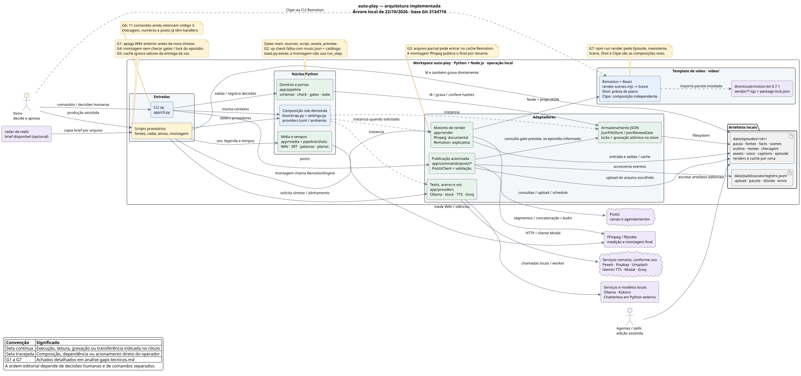

# Análise técnica do auto-play

**Data:** 22/10/2026. **Base:** árvore local da branch `main`, commit `313d718`.
**Escopo:** entradas, composição, validação, decisões, arquivos, produção de voz,
cache de render e integração com publicação. As alterações preexistentes foram preservadas.

O repositório produz vídeos narrados a partir de fontes e ativos revisados. Agentes e o dono
preparam os arquivos editoriais; Python valida contratos e registra decisões; scripts produzem
voz, legendas e montagem; Remotion/React e ffmpeg geram o vídeo. Existe também uma composição
independente para clipes de letra e uma CLI para trabalhar com o Postiz.

A carga assumida é um dono operando o workspace local, com uma produção pesada por vez.
Portas/adaptadores, JSON e cache por cena são adequados a esse uso. A prioridade técnica é
preservar os artefatos e integrar as proteções já implementadas ao caminho de produção.

**Atualização de 23/10/2026:** na árvore local `ee737fb`, branch `modelo-por-agente`, o G2 já está
corrigido: `timeline_length` está importada. O teste específico da checagem de trilha e o Ruff do
módulo passaram nesta data. Os resultados da suíte completa abaixo pertencem à execução de 22/10.
O backlog da evolução está no [épico #187](https://github.com/ViniciusKoiti/video-pipeline/issues/187);
o G2 não recebeu uma nova issue de correção.

## Diagrama PlantUML

- [Fonte editável](arquitetura-atual.puml).
- [Diagrama em SVG](arquitetura-atual.svg).

O desenho representa componentes e integrações existentes. Os marcadores G1–G7 correspondem
aos achados abaixo. Setas rotuladas mostram execução ou troca de arquivos; a sequência editorial
continua sendo conduzida por pessoas e comandos separados.

## Arquitetura conferida no código

| Parte | Responsabilidade e limite atual |
|---|---|
| [CLI](../app/cli.py#L389) | Handlers de `bench`, `excerpts`, `check`, `approve`, `reject`, `status`, `checagem`, `numeros` e `postiz`; outros 11 comandos permanecem pendentes. |
| [Composição](../app/bootstrap.py#L191) | `LazyContext` monta provedores sob demanda. A seleção vem de TOML e ambiente; nome registrado não significa implementação disponível. |
| [Domínio](../app/pipeline/) | Schemas Pydantic, evidências, planos, números, decisões e estado. `run_step` implementa retomada com lock, mas a montagem provisória segue um caminho próprio. |
| [Armazenamento](../app/storage/json_files.py#L20) | JSON no filesystem, substituição atômica e lock por episódio quando o chamador usa essas operações. |
| [Gates](../app/pipeline/gates.py#L46) | Existem **quatro** gates: `sources`, `script`, `assets` e `preview`. O gate de roteiro exige parecer atual ou motivo explícito do dono; mudanças no conteúdo alteram os hashes. |
| [Produção](../scripts/provisorio/montar_episodio.py#L227) | Gera/reutiliza WAV, mede duração, calcula planos, gera SRT por frase e escreve `episode.json`. Reconhecimento por palavra via Groq depende de `--legenda-palavra`. |
| [Render](../app/render/remotion.py#L279) | Explicativo: props JSON → Node/Remotion → segmentos → montagem ffmpeg. O documental tem motor ffmpeg próprio. O pacote motion-kit vem do tarball versionado `0.7.1`. |
| [Clipes](../video/src/Root.tsx#L21) | `Clipe` tem entrada própria de letra/áudio e não passa pelo contrato de episódio narrado. |
| [Postiz](../app/commands/postiz_cadeia.py#L181) | Upload, pacote de decisão, parecer de dúvida e agendamento. Consulta a validade do gate de prévia quando um episódio foi informado; autorização humana continua necessária. |

Alguns documentos anteriores descrevem legenda, gate de prévia e Groq como ausentes. Esses
recursos já aparecem no código atual e nos testes; não foram classificados como funcionalidades
faltantes nesta análise. O radar entra por cópia de arquivo. Chatterbox local usa um worker com
Python externo; o Modal é uma alternativa remota aceita na [ADR 024](decisions/024-voz-clonada-no-modal.md).

## Corrigir primeiro

### G1 — A síntese pode apagar a última voz disponível

**Onde:** [montar_episodio.py:267](../scripts/provisorio/montar_episodio.py#L267).

- **O que faz:** quando a chave da fala muda, prepara um novo WAV por cena.
- **Problema:** remove os WAVs anteriores daquele provedor antes de chamar a síntese. Na reprodução
  offline, o provedor falhou e o áudio anterior já havia sido apagado. Um `episode.json` anterior que
  apontava para esse arquivo fica sem sua entrada de áudio.
- **Correção mínima:** manter versões anteriores; gerar o novo WAV em arquivo temporário e promover
  apenas após validar o áudio. Fazer limpeza separada, preservando arquivos referenciados pela versão revisada.
- **Se ficar assim:** uma falha de modelo, cota ou rede transforma uma tentativa de atualização em perda
  de mídia que já podia estar pronta ou revisada.

### G2 — A checagem da trilha encerra com NameError

**Situação em 23/10/2026: corrigido na árvore local e verificado no teste específico.**
O problema descrito abaixo é o registro histórico da análise de 22/10.

**Onde:** [check.py:621](../app/pipeline/check.py#L621),
[teste existente](../tests/test_music.py#L168).

- **O que faz:** estima a duração para validar o plano de trilha contra o catálogo.
- **Problema:** com `scenes.json`, `music.json` e catálogo disponíveis, chama `timeline_length`, que
  não está importada. O teste existente falhou exatamente nesse caminho; o Ruff também acusou `F821`.
- **Correção mínima:** importar a função de `app.media.narration`, onde já está implementada, e repetir
  o teste de integração da trilha e o lint.
- **Se ficar assim:** episódios com trilha não completam `vp check`, impedindo a validação técnica normal.

### G3 — Um segmento interrompido pode ser reutilizado como pronto

**Onde:** [remotion.py:307](../app/render/remotion.py#L307),
[render-scenes.mjs:14](../video/render-scenes.mjs#L14).

- **O que faz:** reutiliza segmentos por hash para renderizar apenas as cenas alteradas.
- **Problema:** o Node recebe o caminho definitivo do segmento; na retomada, Python aceita apenas
  `segment.exists()`. Um processo interrompido que deixe MP4 incompleto nesse caminho faz a próxima
  execução tratá-lo como cache pronto. A reprodução com renderizador simulado confirmou essa reutilização.
- **Correção mínima:** renderizar em caminho temporário e renomear após sucesso e validação. O motor
  [ffmpeg já usa essa estratégia](../app/render/ffmpeg.py#L255); o Remotion pode seguir o mesmo padrão.
- **Se ficar assim:** a retomada pode falhar repetidamente na montagem ou usar uma cena incompleta,
  exigindo limpeza manual do cache.

## Fechar a integração

### G4 — As proteções do núcleo não cobrem a montagem provisória

**Onde:** [montar_episodio.py:227](../scripts/provisorio/montar_episodio.py#L227),
[gravação direta](../scripts/provisorio/montar_episodio.py#L309),
[run_step](../app/pipeline/state.py#L130).

- **O que faz:** o script efetivo de produção lê cenas e inicia voz/render.
- **Problema:** não executa a checagem completa, não exige decisões atuais nem usa o lock do episódio.
  A reprodução iniciou a síntese sem `review.json`, mesmo com o lock do store já adquirido. A gravação
  de `episode.json` também ocorre diretamente, fora da substituição atômica do store.
- **Correção mínima:** usar um ponto de entrada de produção que confira validação e gates necessários,
  adquira o lock e grave pelo store. Reaproveitar as funções existentes; preservar a decisão humana e
  definir explicitamente os pré-requisitos de rascunho e final.
- **Se ficar assim:** o operador precisa garantir manualmente toda a ordem; duas execuções podem
  disputar arquivos e uma montagem pode consumir materiais ainda não revisados.

### G5 — Mudar a expressividade configurada não invalida o cache de voz

**Onde:** [fingerprint](../scripts/provisorio/montar_episodio.py#L91),
[chave do WAV](../scripts/provisorio/montar_episodio.py#L260),
[parâmetros efetivamente usados](../app/providers/tts/chatterbox.py#L199).

- **O que faz:** a configuração de `delivery` controla ênfase e expressividade no Chatterbox.
- **Problema:** a chave inclui o nome da entrega, mas não seus valores `exaggeration` e `cfg_weight`.
  Alterar esses valores mantendo texto e nome da entrega produziu os mesmos caminhos de WAV na reprodução.
- **Correção mínima:** incluir os parâmetros efetivos da entrega, inclusive a neutra, na chave de voz.
  Testar que mudar um parâmetro altera a chave e manter os parâmetros iguais preserva o reaproveitamento.
- **Se ficar assim:** o operador muda a configuração e recebe a fala antiga sem indicação de que
  a nova direção não foi aplicada.

### G6 — A CLI anuncia etapas sem execução e a configuração seleciona adapters pendentes

**Onde:** [handlers](../app/cli.py#L389), [retorno 3](../app/cli.py#L445),
[registry](../app/bootstrap.py#L162), [configuração](../config/providers.toml#L6).

- **O que faz:** apresenta comandos de ponta a ponta e permite selecionar implementações por porta.
- **Problema:** `new`, `sources`, `script`, `scenes`, `assets`, `gallery`, `voice`, `subs`, `render`,
  `export` e `reopen` retornam código 3. Na configuração padrão, geração de imagens, alinhador de frases
  e os três primeiros acervos apontam para registros sem fábrica. Acessar essas portas falha apenas no uso;
  por exemplo, `context.archives` para no primeiro acervo pendente.
- **Correção mínima:** identificar etapas pendentes no próprio help e conferir capacidades antes de
  iniciar a produção. Ligar primeiro o caminho já funcional de voz/render à CLI e ao núcleo; manter
  geração editorial assistida conforme a ADR 009. Ajustar a seleção para adapters disponíveis quando a
  respectiva etapa for integrada.
- **Se ficar assim:** um usuário seguindo o help descobre os limites no meio do fluxo, e uma configuração
  carregada com sucesso pode parecer operacional sem que as portas selecionadas funcionem.

### G7 — npm run render pede uma composição inexistente

**Onde:** [package.json:7](../video/package.json#L7),
[Root.tsx:17](../video/src/Root.tsx#L17).

- **O que faz:** oferece o comando de renderização do pacote Node.
- **Problema:** o script seleciona `Episode`, mas a raiz registra somente `Scene`, `Shot` e `Clipe`.
  O adapter Python usa `Scene`, por isso esse erro não aparece no caminho habitual da montagem.
- **Correção mínima:** fazer o script apontar para uma composição existente com suas props documentadas,
  ou removê-lo se a entrada suportada for somente o adapter e os comandos explícitos de clipe.
- **Se ficar assim:** a entrada de render indicada pelo pacote falha e dificulta testar o template isoladamente.

## Evidência executada

| Verificação | Resultado |
|---|---|
| `.venv/bin/python -m pytest -q` | **749 passaram, 1 falhou, 6 desmarcados** em 22,46 s. Falha em `test_vp_check_reads_music_json_with_the_catalog` por `NameError`. |
| `.venv/bin/ruff check .` | **1 erro:** `F821` para `timeline_length` em `app/pipeline/check.py:621`. |
| `npm test` em `video/` | **2 passaram**: testes de rótulos e números. Isso não valida a renderização visual. |
| Reprodução de falha de voz em diretório temporário | Confirmou início sem gates, lock existente ignorado e exclusão do WAV anterior antes da falha simulada. |
| Reprodução de troca dos parâmetros de entrega | Confirmou os mesmos nomes de WAV com valores de expressividade diferentes. |
| Reprodução de retomada de render com processo simulado | Confirmou que um segmento parcial existente entra em `last_run.reused`. |
| Capacidades da CLI e registry, com configuração pública e sem credenciais | Confirmou os 11 comandos pendentes, retorno 3 de `voice` e falhas nas portas `archives`, `image_gen` e `aligner`. |
| Script npm versus raiz Remotion, por comparação estática | Confirmou `Episode` no script e apenas `Scene`, `Shot` e `Clipe` registradas. `npm run render` não foi executado. |
| PlantUML local | Fonte conferida e SVG gerado com PlantUML 1.2025.2, usando Smetana. |

As reproduções adicionais usaram fixtures públicas, mocks e diretórios temporários. A síntese e o
renderizador foram simulados; nenhum modelo foi carregado por elas. Não foram adicionados testes ou
correções ao código da aplicação nesta entrega.

O grafo `home-viniciusk-projetos-auto-play` estava pronto, com geração de **15/10/2026**.
Foram consultados estrutura, símbolos e chamadas, além da cobertura dos caminhos usados. Como vários
arquivos estavam alterados ou ausentes desse índice, a análise foi confirmada diretamente nas fontes
atuais. A busca textual também confirmou que a montagem não usa `run_step` e que os callers atuais
desse executor estão nos testes. O grafo não foi usado para concluir que código planejado deve ser excluído.

**Veredito atualizado em 23/10:** corrigir a preservação da voz e a publicação dos segmentos em cache;
depois conectar as proteções existentes ao fluxo de produção. A checagem da trilha passou na verificação focal.

**Não verificado:** modelos pesados, qualidade audiovisual de episódios reais, chamadas reais aos
provedores, deploy do Modal, configuração privada, gravações do dono, projetos vizinhos e testes
marcados `slow`. A leitura aprofundou os fluxos principais; não é uma auditoria exaustiva de cada
componente visual ou arquivo de pesquisa. O G2 foi resolvido na árvore consultada em 23/10; os demais
gaps seguem no backlog, sem implementação nesta entrega.
