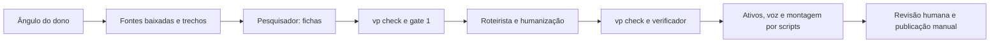

# Análise da pipeline e dos agentes

Leitura do workspace em 12/10/2026, incluindo as alterações locais já existentes. Este documento separa código implementado, prática registrada e propostas. Foram inspecionados CLI, adapters, schemas, gates, scripts provisórios, agentes, skills, decisões, benchmarks e manifestos de episódios. Nenhum episódio foi alterado; não foram executados modelos, TTS, render ou chamadas a provedores. Os números de produção abaixo vêm dos registros do projeto, não de métricas públicas estimadas.

## Diagnóstico

O projeto já tem uma base sólida para produzir conteúdo verificável: fichas com evidência literal, contratos tipados, validação determinística, verificação independente e decisões humanas registradas. Hoje ele funciona como **workspace de produção assistida**, com agentes escrevendo arquivos e scripts executando etapas. A CLI ainda não orquestra o processo completo.

O gargalo editorial mais concreto é começar a pesquisar e escrever antes de fechar público, objetivo e promessa. Isso já gerou retrabalho no caso Thiel: a pauta foi escrita depois do roteiro e concluiu que o ângulo escolhido não tinha a evidência necessária. O segundo gargalo é que o sistema registra melhor custo e integridade dos dados do que desempenho de audiência. Não há, nos arquivos inspecionados, resultado próprio de retenção, compartilhamento ou conversão que permita afirmar qual tema engaja mais.

A melhoria de maior valor é fechar o ciclo **público → pergunta → evidência → promessa → roteiro → medição → próxima pauta**, mantendo os motores de produção existentes. Skills portáveis ajudam a repetir esse método com agentes OpenAI; acrescentar um framework de agentes à aplicação não resolve as lacunas atuais.

## O que está implementado

| Parte | Situação observada | Evidência |
|---|---|---|
| CLI | Funcionam `bench`, `excerpts`, `check`, `approve`, `reject` e `status`. | `app/cli.py:238` |
| CLI prevista | `new`, `sources`, `script`, `scenes`, `assets`, `gallery`, `voice`, `subs`, `render`, `export` e `reopen` aparecem no help, mas não têm handler. Comandos sem handler retornam código 3. | `app/cli.py:94`, `app/cli.py:279` |
| Pesquisa | Downloads e extração de HTML/PDF por script; manifestos precisam existir antes. `vp excerpts` gera trechos numerados. | `scripts/provisorio/baixar_fonte.py:48`, `app/cli.py:137` |
| Etapas criativas | Pesquisador escreve `facts.json`; roteirista escreve `outline.md` e `scenes.json`; verificador devolve relatório, em contexto separado. | `.claude/agents/`, ADR 009 |
| Validação | `vp check` confere schemas, citações literais, referências, âncoras, números e ritmo estimado. Não chama LLM. | `app/pipeline/check.py:126`, `app/pipeline/check.py:154` |
| Gates por comando | Fontes/fichas, roteiro/outline e ativos individuais. Decisões têm hash; mudanças invalidam a decisão correspondente. | `app/pipeline/gates.py:24`, `app/pipeline/gates.py:48` |
| Radar | Copia um brief existente do projeto externo, valida `script_brief.v1` e guarda versão anterior ao atualizar. Não coleta dados. | `scripts/provisorio/radar_resumo.py:47` |
| Busca visual | Scripts consultam os bancos com adapter e chave disponíveis; Commons, LoC e Flickr ainda não têm factory registrada. | `scripts/provisorio/buscar_candidatos.py:37`, `app/bootstrap.py:141` |
| Voz | Kokoro para rascunho; Chatterbox como voz final configurada; Gemini disponível por escolha explícita. | `config/providers.toml:6`, `scripts/provisorio/montar_episodio.py:130` |
| Montagem | Script gera voz por cena, mede WAV, deriva tempos dos planos, escreve `episode.json` v2 e chama Remotion para explainer. | `scripts/provisorio/montar_episodio.py:118` |
| Render | ffmpeg e Remotion implementados, com cache por segmento/cena. Vertical é explainer; legendas são queimadas quando há arquivo de captions no manifesto. | `app/render/ffmpeg.py:124`, `app/render/remotion.py:158` |
| Estado/cache | Há módulos para estado, hash, imutabilidade e lock. A existência desses módulos não significa que todos os scripts os usem. | `app/pipeline/state.py:83`, `app/storage/json_files.py:36` |
| Provedores previstos | Workers AI, alinhador ffprobe e adapters de acervo histórico constam da configuração, mas ainda sem factory. | `app/bootstrap.py:133` |
| Publicação e audiência | Publicação manual; leituras manuais aos 7 e 28 dias previstas, sem integração de analytics. | `CLAUDE.md:276` |

Não é correto apresentar `config/providers.toml` como prova de que toda a cascata funciona: o registro em `app/bootstrap.py` determina se há implementação. Também não é correto usar o help como lista de comandos executáveis de ponta a ponta.

## Fluxo observado e fluxo recomendado

O caminho que já produz episódios é:



Para Reels, a ADR 018 já acrescentou radar e pauta antes das fontes; a ADR 019 já definiu objetivo em `scenes.json`. A adoção nos episódios antigos ainda é incompleta. A inspeção dos 16 diretórios diretamente em `data/episodes/` que têm `scenes.json` encontrou 11 verticais, nenhum com `objective`, dois com `radar-brief.json` e um com `pauta.md`. São arquivos locais de trabalho, fora do Git; a contagem exclui versões em subpastas, fixtures e episódios que só têm fontes/fichas. Não mede número de vídeos publicados.

Há divergência explícita na ordem do gate 2: `CLAUDE.md:119` descreve aprovação do roteiro antes dos ativos/voz; `CLAUDE.md:359` e `docs/pipeline-hoje.mermaid:34` colocam a aprovação após a prévia. O agente verificador e a ADR 009 descrevem sua atuação antes do gate 2. A recomendação operacional é aprovar o conteúdo antes da voz final e do render final; prévias locais para avaliar ritmo podem continuar sendo rascunhos. Uma mudança formal na ordem deve atualizar a decisão e os documentos juntos.

Fluxo proposto para o próximo episódio, sem depender de comandos ainda ausentes:

1. Ler o radar existente, quando houver, e registrar data, nicho, amostra e limitações. Não coletar nem atualizar dados externos automaticamente.
2. Escrever `pauta.md`: público específico, pergunta central, objetivo do dono, promessa, recorte, uma hipótese editorial e fatos mínimos exigidos. Obter a decisão editorial do dono antes de ampliar a pesquisa.
3. Pesquisar só as perguntas necessárias. Fichar trechos já baixados, distinguindo fato, atribuição, inferência e pergunta sem resposta.
4. Passar `vp check`; no gate 1, selecionar as fichas que sustentam a promessa. Se não sustentarem, devolver a pauta ao dono.
5. Escrever um roteiro que responda uma pergunta. Cada cena deve adicionar evidência, mecanismo ou consequência; evitar listas de fatos com conexão apenas temática.
6. Humanizar, passar `vp check` e realizar verificação independente. Revisar também se o vídeo entrega a promessa e se a tela insinua algo além das fontes.
7. Registrar gate 2; planejar os ativos, registrar licença e obter gate 3. Produzir rascunho de voz e prévia; reservar voz final para conteúdo estabilizado.
8. Rever vídeo, legenda, fontes e créditos no gate 4. Publicar manualmente somente quando o dono decidir publicar.
9. Registrar resultados no mesmo prazo para todos os vídeos; usar os resultados para a próxima pauta.

## Gargalos comprovados

| Prioridade | Problema e implicação | Evidência | Ação pequena |
|---|---|---|---|
| 1 | Público e promessa foram definidos tarde. Um roteiro factual pode ficar sem ponto e sem ponte comprovada com quem assiste. | `data/episodes/thiel-empresa-pt/pauta.md:3`, `:17`, `:97`; ADR 019 | Pauta antes do fichamento; critério de parada por evidência; objetivo decidido pelo dono. |
| 1 | Citação válida não prova que a frase é sustentada. O check verifica existência/pertencimento do trecho, não equivalência semântica. No registro Thiel, a segunda rodada ainda tinha um erro; as correções finais passaram pelo check, sem um terceiro verificador. | `app/pipeline/check.py:165`; `CLAUDE.md:338`; `data/benchmarks/custo-reels-thiel-20261012.json:199` | Verificador lê trecho completo e narração/tela; revalida claims alteradas. Instruções aos autores usam IDs e perguntas neutras. |
| 1 | A montagem provisória não exige gates válidos nem executa `check_episode`; grava `episode.json` diretamente. O gate 4 também não tem alvo em `vp approve`; `status` não representa sozinho prontidão para publicar. | `scripts/provisorio/montar_episodio.py:118`, `:185`, `:192`; `app/pipeline/gates.py:24` | Coordenador consulta `check` e `status` antes da produção e lista prévia, legenda, créditos e decisão final pendente. Futuro preflight exige revisões aplicáveis. |
| 2 | Retrabalho e contexto custam mais que a pesquisa reutilizada sugere. Dois roteiros Thiel consumiram 13 execuções, 1.033.350 tokens reportados de agentes e 179 minutos corridos; 26 de 53 fichas foram ajustadas. | `data/benchmarks/custo-reels-thiel-20261012.json:102`, `:121`, `:152` | Dar a cada papel pauta, fichas/trechos pertinentes e achados anteriores; dividir tarefas por pergunta; corrigir registros pontuais quando permitido. |
| 2 | Muitos alertas tornam revisão difícil. A amostra validada tem zero erros, mas dezenas de avisos; zero erros não significa pronto. | Verificação descrita abaixo; `app/pipeline/check.py:73` | Entregar alertas agrupados por fonte, afirmação, leitura visual e hipótese; destacar decisões que impedem cumprir a promessa. |
| 2 | Estimativa por caracteres não mostra a perda de atenção real nem garante tempo de leitura na voz escolhida. | `app/pipeline/check.py:177`; `app/pipeline/shots.py`; `config/providers.toml:25`, `:39` | Usar estimativa só no roteiro; rever duração real e leitura no rascunho antes da voz final. |
| 2 | Checagem local em CPU é cara para cobertura integral. Benchmark de `qwen3:4b`, anterior ao ajuste desta revisão: mediana de 31 s por chamada, 23,7 min para 36 casos; dois superlativos passaram. | `data/benchmarks/checagem-local.md:15`, `:22`, `:30` | Modelo local como alerta em claims de maior risco; benchmark após mudar prompt, usando casos reservados. |
| 3 | Na leitura inicial, a documentação descrevia plataformas/formas diferentes: README priorizava documentário; workspace já tinha explainers/Reels; o diagrama apontava Gemini como final. | README anterior a esta análise; `docs/pipeline-hoje.mermaid:27`; ADR 016 | Instruções de workspace devem apontar decisões recentes, scripts reais e comandos implementados. |

Na validação somente leitura, `check_episode` e `gate_report` foram chamados diretamente com `JsonFileStore`, sem carregar `.env` ou montar provedores. Resultado em 12/10/2026:

| Episódio | Erros | Alertas | Gate 1 | Gate 2 |
|---|---:|---:|---|---|
| `thiel-contrato-pt` | 0 | 40 | aprovado, hash válido | sem decisão |
| `thiel-empresa-pt` | 0 | 40 | aprovado, hash válido | sem decisão |
| `votorantim-dinheiro` | 0 | 73 | aprovado, hash válido | aprovado, hash válido |

Os três recebem alerta de objetivo ausente. A consulta não aprovou nem reabriu gates. As contagens são um retrato do conteúdo local; não são falhas de teste nem qualidade editorial quantificada.

## Como usar agentes para melhorar resultado

O arranjo atual de três papéis é adequado. A melhoria está nos contratos de entrada/saída e no que cada um considera concluído.

| Papel | Entrada suficiente | Entrega | Critério de conclusão |
|---|---|---|---|
| Coordenador editorial | pedido do dono, decisões, disponibilidade de fontes, radar e resultados próprios | pauta com público, objetivo, promessa, recorte e hipótese | dono definiu objetivo/tese; requisitos de evidência e parada explícitos |
| Pesquisador | pauta e trechos numerados baixados | fichas úteis à pergunta, evidência literal, interesse/independência e perguntas abertas | nenhuma citação inventada; lacunas críticas expostas; check sem erros |
| Roteirista | pauta e fichas aprovadas | outline, narração e planos tipados | uma promessa reconhecível; resposta entregue; fatos e tela rastreáveis |
| Humanização | roteiro factual estabilizado | narração oral, concisa e pronunciável | nenhum número, escopo, certeza ou atribuição mudou silenciosamente |
| Verificador independente | roteiro final, fichas e trechos completos | relatório com cena/claim/trecho, gravidade e correção requerida | suporte semântico e contexto conferidos; afirmações alteradas rechecadas |
| Leitura editorial | pauta e roteiro, sem histórico de justificativas do autor | em uma frase: público, pergunta e resposta percebida | coincide com a promessa; se não coincidir, volta ao autor/coordenador |
| Produção | conteúdo revisado e ativos aprovados | rascunho, timing medido, prévia e pacote de revisão | nenhuma mídia sem registro; duração e tela revisáveis; sem aprovação autônoma |
| Análise de resultados | métricas próprias com denominadores e prazo | observação, hipóteses, limitações e próximo teste | separa audiência de terceiros, resultados próprios e opinião editorial |

Leitura editorial pode ser uma passagem curta do verificador ou do coordenador; não exige um quarto agente permanente. O método cabe em Markdown portável e arquivos existentes, como a ADR 009 determina. Skills no workspace OpenAI devem reaproveitar as skills editoriais atuais e chamar os mesmos schemas/checks; não criar uma segunda definição incompatível de fichas ou cenas.

Paralelizar pesquisa de perguntas independentes ou revisão de subconjuntos distintos pode economizar tempo. Atribuir um único responsável por arquivo evita sobrescrita e perda de correções. O roteirista só começa depois das fichas aprovadas; o verificador recebe a versão resultante, em contexto novo. Mais agentes não equivalem a mais qualidade: medir rodadas, retrabalho, duração e consumo antes de ampliar papéis.

Para delegar, usar um pedido como:

> Episódio `<id>`. Leia a pauta e a skill da etapa. Pergunta aprovada: `<pergunta do dono>`. Use somente as fichas `<ids>` e os trechos registrados. Seu único arquivo de escrita é `<arquivo>`. Liste lacunas que impedem cumprir a promessa; não as preencha por conhecimento geral. Entregue resultado, validação, alterações e decisões pendentes. Não aprove gates nem altere arquivos de outro papel.

## Direcionamento de temas

O workspace já experimenta dinheiro/poder, privacidade, economia comparada e nutrição, enquanto pesquisas documentam MEI e system design como candidatos. Isso evidencia capacidade de produção e interesse do dono; não comprova que esses públicos cabem no mesmo canal nem que algum deles terá melhor engajamento.

Antes de pontuar temas, aplicar quatro filtros:

1. O público e o objetivo foram definidos pelo dono.
2. Existe uma pergunta concreta que cabe no formato e cujo fechamento é possível com fontes.
3. Há evidência adequada para a promessa e licença/visual realizável. Pergunta em aberto não vira fato.
4. O episódio permite observar um resultado útil: entendimento, compartilhamento, salvamento, comentário qualificado ou ação posterior.

Depois, comparar candidatos numa ficha editorial de 0 a 2 por item: relevância para esse público; clareza da pergunta; qualidade/independência da evidência; diferença em relação ao conteúdo já produzido; facilidade de mostrar o mecanismo; custo de fechar a pesquisa. As notas são julgamento editorial, sem aparência de probabilidade de viralizar. Lacuna essencial de evidência exclui o candidato, mesmo que sua soma seja alta.

Três linhas coerentes com materiais existentes podem ser avaliadas, sem escolher o nicho pelo dono:

| Linha | Pergunta de pauta, ainda a confirmar | Evidência necessária | Hipótese testável |
|---|---|---|---|
| Dinheiro e poder | Qual mecanismo explica a escala de um negócio e o que mudou em uma virada específica? | fichas sobre mecanismo, regra e virada; períodos/unidades compatíveis | uma explicação causal pode ser mais fácil de recontar que biografia cronológica |
| Dados e privacidade | O que uma fonte permite afirmar sobre um produto ou contrato, e o que permanece desconhecido? | produto, finalidade, período e partes identificados; ponte com o público apenas se comprovada | delimitar uma pergunta pode aumentar entendimento e comentários sobre o ponto central |
| Economia do cotidiano | O que um indicador ou comparação mede, e o que não permite concluir? | definições oficiais, mesma base de comparação e período; limitações claras | uma comparação legível pode gerar salvamentos como referência |

MEI e system design já têm propostas em `docs/pesquisa/nichos-reels-animados.md:275`; seguem como frentes candidatas. Informações regulatórias, preços, limites técnicos e dados atuais precisam de novas fontes antes de virarem episódios. Não usar os exemplos antigos como fatos prontos para publicação.

No próximo ciclo, escolher uma linha e um público por conta. Reaproveitar um conjunto aprovado de fichas para perguntas diferentes, evitando vídeos que repetem quase a mesma narração. O caso Thiel mostra que reaproveitar a pesquisa reduz duplicação, mas não dispensa pauta própria para cada vídeo.

## O radar: utilidade e limites

O brief de privacidade tem 34 Reels e usa a mediana de compartilhamentos/visualizações por grupo. Por exemplo, a característica `long_video` apresenta grupos de 17/17 e taxas aproximadas de 2,3%/1,2%. Isso é **associação na amostra**, não previsão de desempenho do nosso vídeo. O método e as limitações estão em `data/episodes/thiel-contrato-pt/radar-brief.json:3` e ADR 018.

O radar deve sugerir uma hipótese por ciclo, com amostra, data e ressalvas junto da sugestão. Muitas características e palavras testadas aumentam a chance de aparecer um padrão por acaso; contas, tamanho de audiência e temas podem explicar parte da diferença. O repo já registra esse risco na pauta Thiel (`pauta.md:10`). Não presumir que a palavra que correlacionou com compartilhamento contém a causa.

O check mede aproximações textuais: `addresses_viewer` depende de pronomes explícitos; `screen_alert` significa que há um plano `keyword` entre os dois primeiros; pedido de comentário é busca por `coment/comment`. “Já ouviu falar...” recebe alerta de que não fala com quem assiste, porque falta o pronome procurado. Essas regras ajudam a localizar revisão; não devem forçar o autor a acrescentar palavras nem validar o sentido da abertura (`app/pipeline/radar.py:26`, `:132`, `:141`, `:148`).

O padrão de pessoa real falando à câmera não valida a hipótese de avatar desenhado. Essa transferência deve ser testada em vídeos próprios. O objetivo do dono também não muda porque o radar sugeriu outro tipo de vídeo. Nenhuma afirmação factual vem do brief.

## Medição que falta e plano de teste

Há medições reais de máquina e produção, inclusive custos/tokens Thiel. O registro informa 179 minutos corridos entre fontes e roteiro, incluindo esperas; horas humanas são `null`, e voz/render/publicação ficaram fora daquele custo. Logo, API paga igual a zero não significa esforço de produção igual a zero (`data/benchmarks/custo-reels-thiel-20261012.json:19`, `:121`, `:243`).

Para audiência, há planos em `CLAUDE.md:276` e `docs/pesquisa/nichos-reels-animados.md:337`. Não foram encontrados schema, comando de importação ou arquivo com resultados de audiência própria nos caminhos inspecionados. Métricas do radar são de terceiros. O texto antigo “nenhum vídeo publicado” não prova o estado atual das contas; este workspace não permite confirmar publicação ou desempenho fora dele.

O primeiro passo pode ser um CSV manual, sem integração com API nem dependência nova. Registrar uma linha por episódio, plataforma e janela de leitura, com:

```text
episode_id,platform,post_id,published_at,snapshot_at,window_days,audience,theme,objective,hypothesis,variant,duration_s,views,reach,shares,saves,comments_qualified,avg_watch_s,retention_30s,impressions,ctr,profile_visits,follows,human_minutes,agent_tokens,render_seconds,notes
```

O arquivo é uma proposta de registro, não um novo contrato pydantic já implementado. Guardar a captura/exportação que originou os números; ausência de métrica vira campo vazio com explicação, nunca zero. Especificar se o alcance é único, se views incluem replay, o período e a origem orgânica/paga. Desdobrar `notes` ou acrescentar colunas se o painel oferecer métricas diferentes, preservando a definição.

| Resultado | Medida | Como usar |
|---|---|---|
| Atenção | tempo médio e curva de retenção; tempo médio/duração como índice descritivo | localizar perdas na abertura, transições e explicação; o índice não é taxa de conclusão e pode ser afetado por replay |
| Compartilhamento | `1000 × shares / views` | comparar com o radar somente quando plataforma e definição de views forem compatíveis |
| Utilidade | `1000 × saves / views` quando disponível | avaliar conteúdo que serve de referência, sem confundir salvar com compreender |
| Conversa qualificada | comentários que respondem à pergunta ou trazem dúvida específica | contar separadamente emoji, spam, amigos e palavra-chave de CTA; não comparar só total bruto |
| Crescimento | seguidores atribuídos ao post / alcance, quando disponível | registrar denominador e atribuição; deixar ausente se o painel não os fornecer |
| Embalagem YouTube | impressões, CTR e origem do tráfego | comparar contexto e formato; não misturar com distribuição de Reels |
| Eficiência | minutos humanos, tokens, segundos de voz/render e gasto por episódio | escolher testes cujo aprendizado compense o custo |

O YouTube oferece tempo de exibição, duração média e curva de retenção; recomenda comparar retenção de vídeos de duração semelhante. Isso fundamenta usar atenção junto da resposta editorial, em vez de julgar por visualizações isoladas. [Documentação oficial do YouTube](https://support.google.com/youtube/answer/9313698?hl=en).

Para Reels, a Meta documentou tempo total e médio de exibição como instrumentos de revisão. A página detalhada de Insights exigiu login durante esta consulta; portanto, disponibilidade e definição atuais devem ser registradas a partir do painel da conta, sem inventar métricas ausentes. [Anúncio oficial da Meta sobre Insights de Reels](https://about.fb.com/news/2023/04/instagram-reels-trending-audio-and-gifts-updates/).

Proposta de ciclo inicial, a iniciar somente quando o dono decidir publicar:

1. Selecionar uma conta, público e linha editorial. Definir antes do primeiro post a hipótese, métrica principal, orçamento de tempo e critério de parada.
2. Criar quatro Reels como dois pares comparáveis, apoiados em pesquisa reaproveitável. Escolher uma única variável por ciclo: abertura por pergunta concreta versus abertura por consequência comprovada, por exemplo. Formato, idioma, duração aproximada, CTA e faixa de publicação ficam semelhantes.
3. Registrar os valores brutos aos 7 e 28 dias de cada post; leitura aos 14 dias pode complementar o ciclo, com a janela identificada. Comparar com a mesma idade, conta e plataforma.
4. Ler a curva de atenção com as cenas, os comentários com a promessa e as taxas com seus denominadores. Se uma variante parece melhor nos dois pares, repetir em outro conjunto; não declarar causalidade ou percentual de ganho com quatro posts.
5. Decidir manter, ajustar ou parar com base em resultado repetido e custo humano. Se o alcance é insuficiente ou as definições de métricas diferem, a conclusão é “evidência insuficiente”. Não escolher um tema vencedor pelo post de maior alcance isolado.

Pares publicados em momentos distintos continuam sujeitos a distribuição, tema e conta; são um teste editorial inicial, não um experimento controlado. O plano de quatro vídeos longos em 4–6 semanas de `CLAUDE.md` continua uma validação separada: não somar resultados de longos e Reels como se fossem a mesma amostra.

## Instruções entregues no workspace

[AGENT.MD](../AGENT.MD) documenta contexto, limites, papéis, fluxo, engajamento e os comandos realmente disponíveis. [AGENTS.md](../AGENTS.md) é a entrada de instruções para agentes no workspace. Esses arquivos foram criados nesta revisão; o inventário das skills portáveis e o relatório dos prompts locais constam da entrega conjunta da tarefa.

## Ordem sugerida de melhoria

**Agora:** instruções portáveis de workspace e skills que encaminhem às regras existentes; pauta orientada a público/objetivo; revisão de promessa; prompts locais mais rigorosos; registro manual padronizado de hipótese e medição. Não é necessário trocar modelo, motor ou stack.

**No próximo episódio:** adotar objetivo e pauta antes de fontes, restringir contexto por papel, rechecagem das claims alteradas, medir tempo humano e entregar uma lista curta de decisões editoriais junto dos alertas. Um resultado útil imediato é diminuir reescrita que ocorre por ausência de promessa; esse resultado também precisa ser medido.

**Depois de resultados próprios:** ajustar direção dos temas com evidência por conta/plataforma; avaliar se preflight, legendas, export e comandos faltantes justificam implementação; automatizar somente o registro que estiver sendo usado regularmente. Sem publicação autorizada e métricas próprias, qualquer promessa de aumento de engajamento seria especulação.
