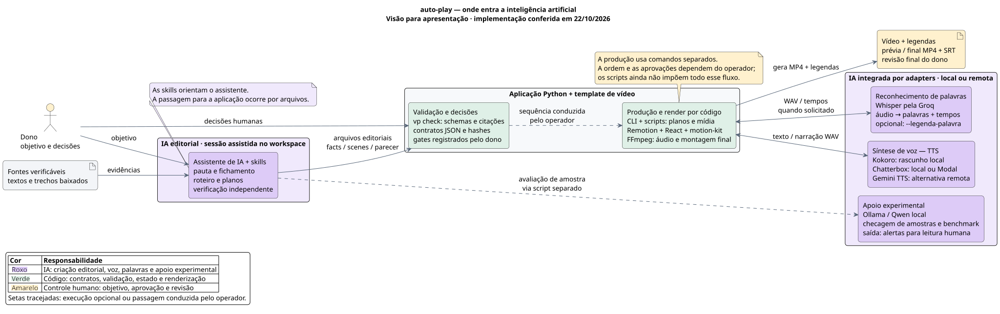

# Arquitetura para apresentação: a camada de IA

> O auto-play transforma fontes verificáveis em vídeos narrados. A IA apoia a criação e a
> revisão editorial, produz a voz e pode fornecer os tempos das palavras. O código valida
> os contratos, registra as decisões humanas e monta o vídeo.

[Diagrama SVG](arquitetura-ia.svg) · [Fonte PlantUML](arquitetura-ia.puml)

Próximas melhorias, critérios de entrega e atuação de personagens 2D:
[evolução do fluxo por camadas](evolucao-por-camadas.md).

## Onde está a IA

A IA participa em dois pontos principais: **trabalho editorial assistido** e **modelos
integrados à produção de mídia**. Há também um caminho experimental de avaliação com Ollama.
Esses pontos compartilham contratos e artefatos com o restante da aplicação.

| Ponto | Entrada → saída | Onde executa / código de referência |
|---|---|---|
| **IA editorial** | Objetivo do dono e fontes → pauta, fichas, roteiro, planos e parecer de revisão | Assistente na sessão do workspace, orientado pelas [skills](../.agents/skills/). A [ADR 009](decisions/009-agentes-para-etapas-criativas.md) define a integração por arquivos. |
| **Síntese de voz** | Texto, idioma e direção da fala → WAV por cena | Adapters de [TTS](../app/providers/tts/): Kokoro local; Chatterbox local ou no Modal; Gemini TTS remoto. |
| **Reconhecimento de palavras, opcional** | WAV → palavras reconhecidas com tempos | [Whisper pela Groq](../app/providers/alignment/groq.py), chamado pela montagem com `--legenda-palavra`. O código associa esses tempos ao texto do roteiro para exibição. |
| **Apoio experimental local** | Afirmações e trechos de uma amostra → confronto, rótulos e relatório de avaliação | [Checagem local](../app/pipeline/checagem_local.py), pelo adapter [Ollama](../app/providers/text/ollama.py). Também usado no benchmark. |

A sessão editorial é o ponto em que um assistente interpreta as fontes e escreve os arquivos.
As skills descrevem o método e os limites de cada papel. O aplicativo Python recebe o resultado
em arquivos estruturados; sua CLI ainda não executa automaticamente a criação editorial.
O parecer de verificação é uma entrega separada, registrada por `vp checagem`.

Na produção de mídia, o próprio código solicita inferência por interfaces de provedor.
[bootstrap.py](../app/bootstrap.py) escolhe o adapter conforme a configuração. O TOML versionado
seleciona Kokoro para rascunho e Chatterbox no Modal para voz final; configurações locais podem
substituir essa escolha. A configuração privada não foi inspecionada.

Ollama atende à checagem experimental e ao benchmark atuais. Seu adapter de texto disponível
não equivale a um roteirista automático conectado a `vp script`.

## Como apresentar as responsabilidades

1. **O dono define a intenção:** público, pergunta, objetivo e decisões editoriais.
2. **A IA editorial prepara e revisa o conteúdo:** usa fontes e entrega arquivos rastreáveis.
3. **O núcleo Python confere os contratos:** schemas, referências, citações literais e hashes;
   registra os gates decididos pelo dono.
4. **Os modelos de mídia produzem entradas do vídeo:** voz e, quando solicitado, palavras com tempos.
5. **O código monta a apresentação:** planos, legendas, componentes visuais, áudio e MP4.
6. **O dono revisa a saída e autoriza a publicação:** o Postiz é uma integração operacional de publicação.

`vp check` executa regras determinísticas e funciona sem chamar um modelo. A verificação de
significado pertence à revisão editorial. Remotion, motion-kit e FFmpeg executam a renderização
por código. O SRT por frase também pode ser produzido pelo código, usando duração e silêncios;
o reconhecimento remoto é uma opção para os tempos por palavra.

O desenho apresenta a sequência operacional conduzida pelo dono. O fluxo atual combina
arquivos, comandos e scripts; a montagem ainda não exige todos os gates automaticamente.
Os detalhes de implementação e os gaps estão na [visão técnica](analise-gaps-tecnicos.md).
Geração de imagem por Workers AI tem porta/configuração, mas está sem fábrica implementada
na registry; portanto não aparece como uma capacidade operacional no desenho.

## Verificação desta visão

Conferidos os contratos de integração, as skills editoriais, os adapters e seus callers.
O grafo do workspace foi consultado e a cobertura indicou arquivos desatualizados ou ausentes;
as ligações relevantes foram confirmadas no código atual. A fonte PlantUML foi validada e
renderizada localmente em SVG com PlantUML 1.2025.2 / Smetana.

Esta entrega acrescenta documentação. Não executou inferência, TTS, APIs externas ou produção
de vídeos, nem repetiu a suíte da aplicação. As verificações da análise anterior continuam
registradas no relatório técnico.
