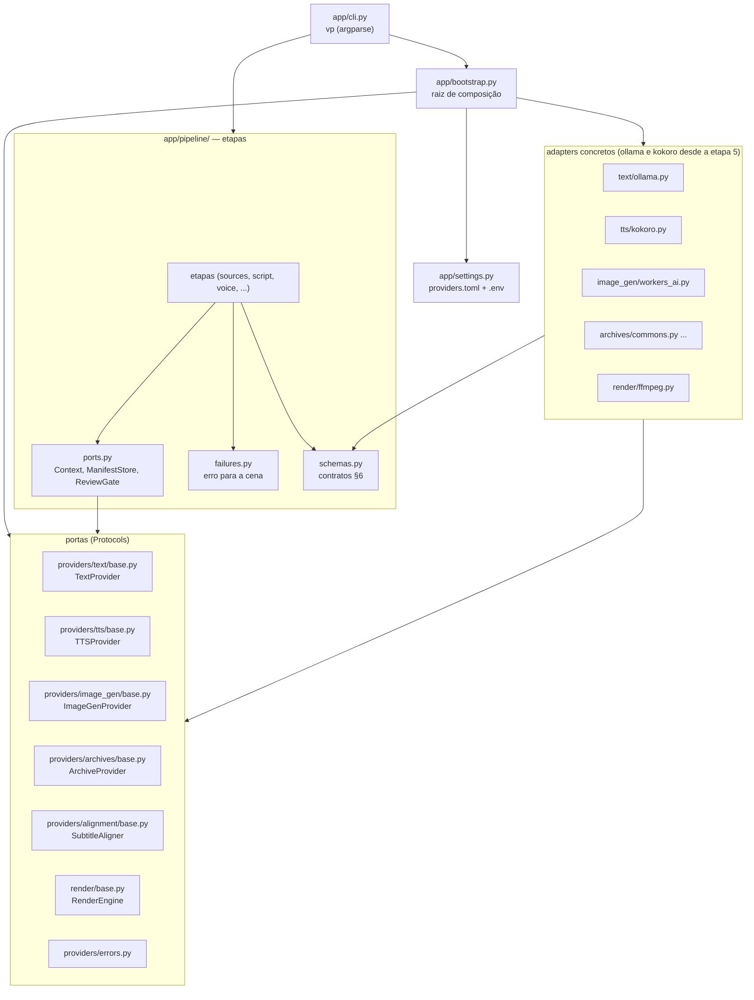

# Arquitetura: portas e adaptadores

Decisão e motivos em [ADR 006](decisions/006-arquitetura-portas-adaptadores.md). As setas indicam
"importa". As regras são verificadas por `tests/test_architecture.py`.

## Regras

| Módulo | Pode importar | Não pode importar |
|---|---|---|
| `app/pipeline/**` | `schemas`, `ports`, `app.settings`, módulos `base` e `errors` | adapters concretos, `app.bootstrap`, `app.cli`, bibliotecas pesadas (torch, kokoro…) |
| `app/providers/**`, `app/render/**` | `app.pipeline.schemas`, outras portas | resto de `app.pipeline`, `app.settings`, `app.bootstrap`, `app.cli` |
| `app/bootstrap.py` | tudo; é o único que conhece adapters concretos | — |

## Como trocar de abordagem

1. Escrever o adapter em `app/providers/<função>/<nome>.py` (ou `app/render/<nome>.py`) implementando a porta.
2. Registrar em `DEFAULT_REGISTRY` (`app/bootstrap.py`) com a fábrica, que importa o adapter dentro da função.
3. Acrescentar o adapter à lista da porta em `tests/test_contracts.py` e fazê-lo passar.
4. Mudar uma linha em `config/providers.toml`.
