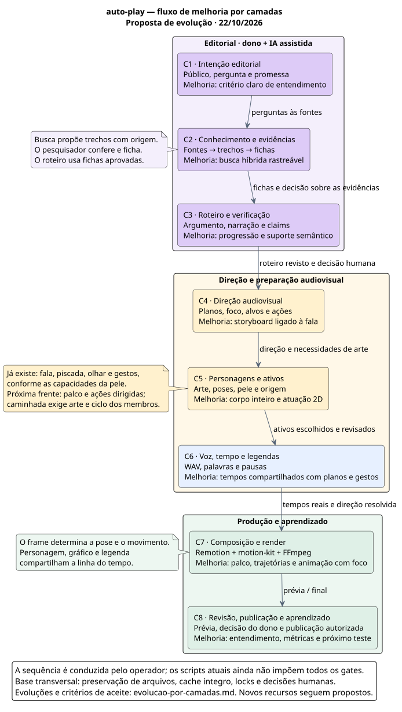

# Evolução do fluxo por camadas

**Data:** 22/10/2026. **Detalhamento de classes e integração:** 23/10/2026.
**Situação:** proposta de evolução baseada no código atual.
Este documento organiza as melhorias; os recursos propostos ainda precisam ser implementados e medidos.
As camadas representam responsabilidades do fluxo, aproveitando as pastas e os contratos existentes.

A busca de evidências pode enriquecer o roteiro com fatos, contexto e contrapontos. A direção audiovisual
decide como transformar esse material em uma explicação visível. Personagens, voz e animação executam
essa direção. Cada frente tem uma entrega e um teste próprios.

[Fluxo em SVG](fluxo-evolucao.svg) · [Fonte PlantUML](fluxo-evolucao.puml) ·
[Arquitetura atual e IA](arquitetura-ia.md) · [Gaps técnicos verificados](analise-gaps-tecnicos.md)

Organização do código: [classes e componentes](classes-e-integracao.svg),
[sequência de execução proposta](execucao-proposta.svg) e [PlantUML](classes-e-integracao.puml).



## Mapa das responsabilidades

| Camada | Base que existe hoje | Próxima melhoria | Entrega / como conferir |
|---|---|---|---|
| **C1 — Intenção editorial** | Pauta assistida, `Objective` e `Funnel`: público, pergunta, promessa e chamada. | Definir uma pergunta concreta e o que o espectador deve conseguir explicar ao terminar. Conferir título, abertura e fechamento contra a mesma promessa. | Pauta decidida pelo dono; a revisão identifica as cenas que respondem à pergunta. |
| **C2 — Conhecimento e evidências** | Fontes baixadas, trechos numerados, `facts.json`, evidências literais e perguntas em aberto. | Piloto de busca literal + semântica, com origem e versão de cada trecho; buscar também limites e contrapontos. | Lista de candidatos com fonte; comparar recuperação em cerca de 20 perguntas com gabarito humano. |
| **C3 — Roteiro e verificação** | Skills de roteiro, humanização e checagem; claims e fontes; parecer registrado no gate 2. | Avaliar progressão, resposta à promessa, suporte de cada afirmação e função de cada bloco. Testar a oralidade pela leitura. | `outline.md`, `scenes.json` e parecer rastreável; revisão aponta repetição, lacunas e frases sem suporte. |
| **C4 — Direção audiovisual** | Planos tipados, âncoras na narração, etapas de contas/redes e alertas de legibilidade. | Planejar o foco visual: o que aparece, o que muda, o que permanece, para onde o personagem olha/aponta e quando há tempo para ler. | Storyboard curto por cena, inicialmente em documento de direção; conferir compreensão em quadros estáticos antes do movimento. |
| **C5 — Personagens e ativos** | `Host`, peles, boca pelo áudio, piscada, olhar, gestos, expressões e sprites em camadas. | Apresentador no palco, arte de corpo inteiro e ações com propósito; depois trajetória, caminhada e interação com elementos. | Personagem com origem registrada e vocabulário de poses; prova curta de entrada, fala, apontar e reação. |
| **C6 — Voz, tempo e legendas** | TTS por cena, duração medida, SRT por frase e reconhecimento opcional de palavras pela Groq. | Usar tempos reconhecidos também nas âncoras de planos, etapas e ações. Revisar pausas e pronúncia. | Linha do tempo derivada do WAV; elementos entram junto da fala e ficam legíveis. Trechos estimados permanecem identificados. |
| **C7 — Composição, animação e render** | Remotion/React/motion-kit, camadas, câmera, transições, cache por cena e montagem ffmpeg com áudio. | Encenação com palco, trajetórias e foco; revelação gradual dos gráficos; continuidade entre ações; cache íntegro e custo de render medido. | Prévia e MP4, com legendas e voz; comparar começo, meio, cortes e fim em 9:16 e 16:9 quando aplicáveis. |
| **C8 — Revisão, publicação e aprendizado** | Gates humanos, prévia, pacote de decisão e integração Postiz. | Registrar entendimento, falhas visuais, esforço de produção e resultados por publicação; testar uma variável por vez. | Revisão final do dono; após publicação autorizada, métricas da mesma plataforma, formato e janela de observação. |

**Base transversal — confiabilidade:** tratar os [G1–G7](analise-gaps-tecnicos.md) da análise técnica.
Preservação dos WAVs, validação da trilha, segmentos atômicos, validade do cache e uso de locks/gates
precisam acompanhar o crescimento visual. A produção atual depende de comandos separados e do operador.

## Como a vetorização entra em C2

O primeiro piloto usa um episódio e as fontes que já foram baixadas. O fluxo proposto é:

`pergunta da pauta → busca nos trechos → candidatos com origem → fichamento → decisão humana → roteiro`

1. Reutilizar `excerpts_of` para preservar os ids. A chave completa inclui episódio, fonte e trecho,
   pois episódios diferentes podem ter seus próprios `source-01#E1`.
2. Guardar o texto original, hash do documento, idioma e metadados disponíveis de origem/data. Se um trecho
   longo exigir partes para a busca, manter a ligação de cada parte com o trecho original e seu contexto.
3. Gerar embeddings locais pelo Ollama e guardar um cache reconstruível. No primeiro piloto, usar
   `data/episodes/<id>/cache/` para aproveitar o store do episódio. Registrar o modelo e sua versão/digest;
   mudar texto, modelo ou preparação invalida o cache correspondente. O acervo compartilhado entre
   episódios pode ser integrado depois, quando houver uma medição que justifique esse uso.
4. Comparar busca literal, busca por significado e combinação das duas. Combinar posições dos rankings
   por RRF é uma opção de piloto, descrita na [documentação da técnica](https://www.elastic.co/docs/reference/elasticsearch/rest-apis/reciprocal-rank-fusion).
5. Devolver, por exemplo, os cinco primeiros candidatos com texto, ids e origem. O pesquisador lê os
   trechos e seu contexto, escreve as fichas e registra o que continua sem resposta.
6. Avaliar perguntas diretas, paráfrases, nomes, números, períodos, negações e perguntas sem resposta.
   Medir quantas perguntas encontram ao menos um trecho útil nos cinco primeiros, erros de contexto,
   latência e esforço de revisão. A seleção do modelo depende dessa comparação.

O Ollama dispõe de [`POST /api/embed`](https://docs.ollama.com/api/embed), que recebe um texto ou uma lista
de textos. Um candidato inicial é o [Qwen3 Embedding 0.6B](https://ollama.com/library/qwen3-embedding:0.6b),
a ser avaliado nas fontes em pt-BR e inglês e na CPU disponível. No piloto, `truncate: false` permite
detectar entradas longas; a aplicação precisa tratar esse caso preservando a origem.

O índice serve à recuperação. O roteiro continua baseado nas fichas aprovadas e nas evidências
conferidas. A aprovação de uma pesquisa anterior precisa ser considerada no contexto do novo episódio.

## Personagens 2D: o que temos e o que desenvolver

### Base confirmada

- [HostWindow](../video/src/HostWindow.tsx) coloca o personagem numa janela e a desloca entre cantos.
- [host_direction](../app/media/host.py) escolhe olhar, expressão pela entrega e gestos automáticos;
  aponta quando entram números, comparações, contas, notas e gráficos.
- [donoSkin](../video/src/donoSkin.ts) aceita a pele antiga de 12 imagens e sprites em camadas.
  A pele antiga tem repouso e expressão neutra; outras ações dependem da arte disponível.
- O pacote instalado **motion-kit 0.7.1** expõe `Host`, agendamento de gestos/olhares/expressões,
  `HostNodeSkin` e movimento por camada com `createSpriteSkin(..., {motion})`.
  Transformações suportam posição, escala, giro e ponto de articulação. Essas APIs foram conferidas
  nas declarações do pacote instalado; sua presença não significa que exista uma caminhada pronta.
- A [ADR 017](decisions/017-apresentador-do-dono-em-palco.md) já descreve palco como proposta.
  A [ADR 029](decisions/029-pele-do-dono-em-sprites.md) registra a direção e os sprites implementados.

### Evolução em três níveis

| Nível | Comportamento pretendido | Trabalho necessário |
|---|---|---|
| **1 — Apresentador expressivo** | Falar, olhar para o conteúdo, apontar e reagir; alternar destaque e canto. | Aproveitar `Host` e as peles disponíveis; integrar palco e direção por trecho. Desenhar as poses que faltarem. |
| **2 — Ator que se desloca** | Entrar, caminhar até uma posição, parar, virar e apontar para um elemento. | Arte de corpo inteiro em peças; trajetória da raiz; ciclo de braços/pernas; transições entre repouso, passos e gesto. |
| **3 — Encenação com interação** | Dois personagens, passagem de objeto, olhar compartilhado e pequenas situações explicativas. | Identidades/vozes separadas, posições e objetos coordenados, continuidade e composição que preserve a informação principal. |

O primeiro piloto proposto usa um apresentador, aproveitando a integração existente. A preferência
entre apresentador e encenação pode ajustar essa ordem. As cenas devem usar arte própria ou licenciada;
a aprovação dos ativos e as decisões sobre a aparência do dono continuam com ele.

### Como implementar a atuação no Remotion

**Arte:** preparar cabeça, tronco, braços/mãos e pernas/pés como peças coerentes, com pontos de articulação.
Manter uma identidade visual entre poses. Um busto existente precisa de nova arte de corpo inteiro para
mostrar passos. SVG em peças ou sprites transparentes em camadas são caminhos compatíveis com o projeto;
o piloto deve escolher um deles conforme a arte disponível.

**Direção:** descrever ações pequenas e observáveis: repouso, fala, apontar, andar e reagir. Cada ação tem
uma âncora da fala, duração, posição e, quando necessário, um alvo visual. A regra automática atual pode
continuar servindo às cenas que usam o apresentador em janela.

**Tempo:** resolver as âncoras após produzir a voz. Usar os tempos reconhecidos das palavras quando
existirem; marcar estimativas quando houver divisão proporcional. O frame da ação vem desse tempo.
Isso também deve alimentar a entrada do gráfico ou número para que gesto e conteúdo coincidam.

**Movimento:** a trajetória desloca o personagem inteiro; o ciclo de passos articula pernas e braços.
Um movimento por camada pode usar o callback `motion` existente no kit. Uma pele React pode atender
a um desenho que precise de outro controle. A escolha fica com a menor prova que execute a ação desejada.

**Render:** calcular a pose pelo frame com `useCurrentFrame()`, `interpolate()` e, quando adequado,
`spring()`. A [documentação do Remotion](https://www.remotion.dev/docs/animating-properties) orienta que
o movimento seja dirigido pelo frame. Isso permite renderizar fora de ordem e repetir o mesmo instante.
Uma curva de [spring](https://www.remotion.dev/docs/spring) pode controlar uma entrada ou acomodação;
o ciclo dos passos precisa da fase e da cadência próprias.

**Composição:** reservar espaço para personagem, evidência, gráfico, legenda e fonte. Apontar exige
resolver a posição do alvo no layout, inclusive em retrato. O gesto genérico `point` atual não calcula
automaticamente uma mão tocando qualquer alvo da tela. Quando a figura não participa da explicação,
o plano pode manter o conteúdo em destaque e reduzir a atividade do personagem.

**Continuidade:** o render atual é separado por cena. Registrar posição e pose de entrada/saída quando
uma ação continuar no próximo segmento. Arte, ações e direção resolvida precisam participar do hash
das props/cache, seguindo a estratégia já usada para os sprites.

Exemplo conceitual de uma ação — **não é um campo aceito pelo schema atual**:

```json
{
  "actor": "apresentador",
  "anchor": "compare estas duas opções",
  "action": "point",
  "target": "comparacao",
  "position": "stage-left"
}
```

No piloto, essa direção pode ser preparada separadamente, sem reescrever episódios aprovados.
Após conferir a prova visual, formalizar somente os campos necessários nos contratos Python e TS.

### Prova visual proposta: aproximadamente 15 segundos

| Momento de planejamento | Ação | O que conferir |
|---|---|---|
| 0–3 s | O personagem entra no palco e olha para a câmera. | Entrada clara; se houver caminhada, pés, velocidade e deslocamento se correspondem. |
| 3–8 s | Duas opções aparecem e o personagem aponta para a comparação. | O alvo está claro e o gesto coincide com a fala; legenda e fonte continuam legíveis. |
| 8–12 s | O foco muda de uma opção para a outra, com reação do personagem. | A mudança ajuda a perceber a diferença e preserva a posição dos elementos relacionados. |
| 12–15 s | O personagem conclui e abre espaço para a resposta visual. | A conclusão permanece tempo suficiente para leitura. |

Essas durações são uma proposta de encenação. O tempo final vem do WAV. Usar uma situação fictícia
identificada na prova, com voz/arte autorizadas, e produzir uma variante com movimento simples para
comparar entendimento. A demo não precisa representar uma afirmação histórica ou um vídeo aprovado.

## Ordem de entrega e critérios de aceite

| Entrega proposta | Camadas | Resultado concreto | Critério de aceite |
|---|---|---|---|
| **E0 — Produção preservável** | Base transversal | Correções de falhas de voz, trilha e segmentos; cache e acesso a arquivos consistentes. | Falha/interrupção preserva a saída anterior; retomar recusa arquivo incompleto; checagem da trilha passa no teste existente. |
| **E1 — Busca de evidências medida** | C2–C3 | Piloto de consulta local sobre as fontes de um episódio e relatório das perguntas. | Melhor resultado útil em relação à busca literal, com origem íntegra e custo aceitável medido na máquina. |
| **E2 — Linha do tempo compartilhada** | C4–C6 | Âncoras de planos, números e gestos resolvidas contra o áudio. | Prova curta coincide com a fala; casos repetidos/ausentes e limites de cena têm tratamento explícito. |
| **E3 — Personagem no palco** | C4–C5–C7 | Prova de aproximadamente 15 s: entrada, fala, gesto e reação; caminhada quando a arte de corpo inteiro estiver disponível. | Um mesmo frame produz a mesma pose; sem corte de membros/legendas; gestos e deslocamento comunicam a intenção; custo de render registrado. |
| **E4 — Um vídeo completo e comparável** | C1–C8 | Roteiro revisado, storyboard, voz, vídeo e revisão final do dono. | Teste de entendimento com perguntas da pauta; após publicação autorizada, observar métricas na mesma janela e mudar uma variável por comparação. |

E1 e a preparação de arte/storyboard de E3 podem avançar independentemente. E3 usa o resultado de E2
para a sincronização final. E0 protege a integração ao fluxo real de produção.

### Onde a implementação alcançaria

| Frente | Pontos a revisar na implementação |
|---|---|
| Recuperação | `excerpts.py`, transporte HTTP/Ollama e composição por portas; cache local; pequeno piloto de avaliação. |
| Contrato de direção | `app/pipeline/schemas.py`, `video/src/types.ts`, fixtures e skills pertinentes após validar o vocabulário da prova. |
| Sincronização | `app/media/word_captions.py`, `app/pipeline/shots.py`, `app/media/host.py` e montagem do episódio. |
| Palco e ações | `video/src/HostWindow.tsx`, seleção de pele compartilhada, um componente de palco e sua composição em `Scene.tsx`. |
| Props e cache | `app/render/remotion.py`; hashes de arte/direção; incluir novos arquivos relevantes no hash do template. |
| Verificação | Testes das âncoras, direção, contratos e cache; prova audiovisual medida; revisão de legibilidade, som, direitos e compreensão. |

## Organização concreta do código e das classes

As oito camadas funcionais cabem na arquitetura atual de portas/adaptadores. Os contratos de conteúdo
são classes Pydantic; busca, timing e produção podem continuar sendo funções. No Remotion, as peças
visuais são componentes React. Os nomes abaixo para novos recursos são propostas, ainda sem implementação.

### Onde cada responsabilidade fica

| Local | Classes, funções ou componentes | Situação e responsabilidade |
|---|---|---|
| `.agents/skills/` | Pauta, fichamento, roteiro e checagem | **Existente.** Instruções usadas pelo assistente; entregam artefatos editoriais e pareceres. |
| `app/pipeline/schemas.py` | `Source`, `Fact`, `Scene`, `ScenesManifest`, `EpisodeScene`, `EpisodeManifest` | **Existente.** Contratos de fontes, fichas, roteiro e entrada do render. |
| `app/pipeline/schemas.py` | `HostAction` e `ResolvedHostAction` | **Proposto.** Ação ligada à fala e sua versão com tempo resolvido. Campos opcionais nas cenas após validar o piloto. |
| `app/pipeline/excerpts.py` | `excerpts_of()` | **Existente.** Mantém a identidade dos trechos usados pela pesquisa. |
| `app/pipeline/retrieval.py` | `search_excerpts()` e um registro de resultado `RetrievedExcerpt` | **Proposto.** Busca e ordenação dos candidatos, com origem e versão. Recebe a capacidade de embedding pela porta. |
| `app/providers/text/base.py` | `EmbeddingProvider`, com `embed(texts)` | **Proposto.** Contrato da operação de gerar vetores; a porta de geração de texto atual continua atendendo ao texto. |
| `app/providers/text/ollama.py` | `OllamaText`; novo `OllamaEmbeddings` | **Existente / extensão proposta.** O primeiro gera JSON; o segundo chamaria o endpoint local de embeddings pelo transporte HTTP já disponível. |
| `app/bootstrap.py` | `LazyContext` e fábricas | **Existente / extensão proposta.** Constrói os adapters e injeta as portas usadas pelo fluxo. Aqui se liga a implementação de embeddings à sua configuração. |
| `app/pipeline/ports.py` | `Context`, `ManifestStore`, `ReviewGate` | **Existente / extensão proposta.** Contratos recebidos pelas etapas. Completar `Context` conforme as capacidades usadas na produção, incluindo voz final, palavras e embeddings quando integrados. |
| `app/pipeline/production.py` | `produce_episode()` | **Proposto.** Função que reúne a execução de voz, timing, direção e render com as verificações necessárias. Reaproveita a lógica do script provisório. |
| `app/pipeline/shots.py` e `app/media/host.py` | `shot_bounds()`, `episode_shots()`, `host_direction()`; resolução das novas ações | **Existente / extensão proposta.** Regras de tempo e direção; devolvem dados para renderizar. |
| `app/storage/json_files.py` | `JsonFileStore` e `JsonReviewGate` | **Existente.** Persistência, gravação atômica do store, locks e registro das decisões humanas. |
| `app/render/remotion.py` | `RemotionEngine.render()` e `scene_props()` | **Existente / extensão proposta.** Converte o manifesto em props, quadros e jobs Node; incluiria as ações do palco e seus hashes. |
| `video/src/types.ts` | `SceneProps`, `HostProps`; novo `HostStageProps` | **Existente / extensão proposta.** Contrato JSON recebido pelo template; ações resolvidas chegam em frames e coordenadas adequados ao layout. |
| `video/src/Scene.tsx` | `Scene` | **Existente / extensão proposta.** Compõe conteúdo, legenda, fontes e personagem, escolhendo a apresentação de palco ou janela. |
| `video/src/HostWindow.tsx` | `HostWindow` e seleção da pele | **Existente.** Apresentador em janela. A seleção da pele seria compartilhada com o palco quando necessário. |
| `video/src/HostStage.tsx` | `HostStage` | **Proposto.** Posiciona o personagem no cenário, resolve a pose do frame e aplica sua trajetória, usando o `Host` e as peles do kit. |
| `app/cli.py` e `scripts/provisorio/montar_episodio.py` | Handlers e entrada provisória | **Existente / integração proposta.** Encaminham as operações à mesma função de produção, preservando as opções necessárias. |

Os adapters concretos continuam concentrados na composição. O pipeline recebe portas e dados; o
Remotion recebe props. Essa direção já é protegida pelos [testes de arquitetura](../tests/test_architecture.py).

### Estrutura proposta para a primeira integração

```text
app/
  cli.py                        ligar os handlers às etapas
  bootstrap.py                  construir e injetar adapters
  settings.py                   configurar o embedding local separado do modelo de texto
  pipeline/
    ports.py                    Context e portas recebidas pelas etapas
    schemas.py                  contratos atuais + ações opcionais do apresentador
    retrieval.py                NOVO: recuperar trechos e devolver candidatos
    production.py               NOVO: reunir as etapas já disponíveis
    excerpts.py                 ids e texto original
    shots.py                    tempos dos planos e suas etapas
  providers/text/
    base.py                     TextProvider + contrato de embeddings
    ollama.py                   OllamaText + adapter de embeddings
  media/
    host.py                     direção e resolução das ações do apresentador
    word_captions.py            palavras reconhecidas e seus tempos
  storage/json_files.py         arquivos, locks e decisões
  render/remotion.py            manifesto → props → render
video/src/
  types.ts                      props atuais + props do palco
  Scene.tsx                     composição da cena
  HostWindow.tsx                personagem em janela
  HostStage.tsx                 NOVO: personagem no cenário
  donoSkin.ts                   seleção e montagem da arte existente
```

Essa árvore descreve a integração futura. Os três arquivos marcados `NOVO` ainda não existem.
O primeiro experimento de busca pode ficar em um script provisório até passar pela avaliação;
a integração permanente incorpora a capacidade na composição e na CLI existentes.

### Como as peças se reúnem em execução

**Ponto 1 — composição de dependências:** `bootstrap.py` entrega um `LazyContext` com store, revisão,
voz, alinhamento e render. A extensão de embeddings segue essa mesma composição. Cada etapa usa
somente as portas de que precisa.

**Ponto 2 — execução da produção:** `produce_episode()` receberia esse contexto e o id do episódio.
Uma função compartilhada reúne os passos hoje presentes em `montar_episodio.py`; CLI e script chamam
o mesmo caminho. A proposta verifica gates atuais e entradas antes de produzir, gera/reutiliza WAV,
resolve os tempos e as ações, grava o manifesto e solicita o render. Os pré-requisitos de rascunho e
final precisam ser definidos na integração.

O executor de etapas `run_step()` já adquire o lock do episódio. Ao reaproveitá-lo por etapa, as
checagens pertinentes devem acontecer no escopo protegido da ação. Evitar adquirir outro lock do
mesmo episódio por fora: essa composição geraria um bloqueio contra a própria execução. Os hashes
das entradas e saídas precisam representar os arquivos realmente consumidos.

**Ponto 3 — composição do vídeo:** `RemotionEngine` transforma `EpisodeManifest` em `SceneProps`.
O `Scene` desenha os planos, fontes, legendas e a representação escolhida do personagem. No palco,
`HostStage` usa o mesmo `Host`/pele e acrescenta trajetória e atuação. Cada frame deve ter uma única
representação ativa do apresentador durante a troca entre palco e janela.

Hoje o script ainda instancia `RemotionEngine()` diretamente. Na integração proposta, a produção usa
`context.renderer(formato)`, para que o motor e sua configuração venham da composição existente.

### Os dados atravessam as camadas em duas formas

- **Antes da voz:** `Scene` descreve narração, planos e, futuramente, ações como `HostAction`.
  Uma ação identifica intenção, âncora e eventual alvo visual. As ações não acrescentam fatos ao roteiro.
- **Depois da voz:** `EpisodeScene` guarda duração, áudio, planos e, futuramente, `ResolvedHostAction`.
  Os intervalos ficam em milissegundos relativos à cena; o adapter produz os frames usados pelo template.

No piloto há um apresentador. A resolução precisa conferir âncoras repetidas ou ausentes, limites de
tempo, alvos existentes e origem da arte. As ações propostas usam listas opcionais; episódios sem elas
continuam com o comportamento atual. A emenda do contrato segue as decisões do projeto após a prova visual.

Exemplo de execução futura: a fala “compare estas duas opções” identifica uma âncora; o resolvedor
encontra seu intervalo no WAV; o adapter calcula os frames; `HostStage` faz o apresentador olhar e
apontar para a comparação, enquanto `ShotView` apresenta o conteúdo. A posição do alvo deve vir do
layout validado do plano. O gesto genérico `point` sozinho não resolve essa geometria.

**Primeira integração recomendada:** uma cena separada de teste com entrada, apontar e reação,
usando o personagem e os contratos mínimos necessários. A caminhada exige a arte de corpo inteiro
e seu ciclo. A busca de evidências tem uma avaliação própria e pode avançar independentemente.

Para explicar o projeto numa apresentação: a IA auxilia a produção editorial; os contratos guardam
o conteúdo e a direção; Python valida e resolve a execução; Remotion desenha o que acontece em cada
instante; o dono decide as aprovações e a publicação.

### Verificação do detalhamento de 23/10

O MCP de código não estava exposto nesta retomada. Foi usada a CLI instalada, com `list_projects`,
`index_status`, busca de símbolos, rastreamento de `scene_props` e cobertura dos caminhos. A geração
continuava em 15/10, com vários arquivos alterados ou ausentes; a descrição foi confirmada nas fontes.
Os diagramas novos foram validados e renderizados localmente. A alteração continua sendo documental.

## Backlog publicado em 23/10/2026

O [épico #187](https://github.com/ViniciusKoiti/video-pipeline/issues/187) reúne **16 novas tarefas**, com escopo, critérios de aceite,
prioridade e dependências. Os corpos publicados foram relidos e conferidos após a criação.

| Issue | Entrega | Prioridade | Dependências novas |
|---|---|---|---|
| [#188](https://github.com/ViniciusKoiti/video-pipeline/issues/188) | [G1] Preservar WAVs anteriores quando a nova síntese falhar | P1 | — |
| [#189](https://github.com/ViniciusKoiti/video-pipeline/issues/189) | [G3] Publicar segmentos Remotion de forma atômica e validar a retomada | P1 | — |
| [#190](https://github.com/ViniciusKoiti/video-pipeline/issues/190) | [G5] Incluir os parâmetros efetivos de entrega no cache da voz | P2 | [#188](https://github.com/ViniciusKoiti/video-pipeline/issues/188) |
| [#191](https://github.com/ViniciusKoiti/video-pipeline/issues/191) | [G7] Corrigir o script npm de render para uma composição registrada | P2 | — |
| [#192](https://github.com/ViniciusKoiti/video-pipeline/issues/192) | [G6] Mostrar capacidades pendentes da CLI e dos provedores antes da produção | P2 | — |
| [#193](https://github.com/ViniciusKoiti/video-pipeline/issues/193) | [G4] Compartilhar a produção entre CLI e script com validação, gates e locks | P1 | [#188](https://github.com/ViniciusKoiti/video-pipeline/issues/188), [#189](https://github.com/ViniciusKoiti/video-pipeline/issues/189), [#190](https://github.com/ViniciusKoiti/video-pipeline/issues/190), [#192](https://github.com/ViniciusKoiti/video-pipeline/issues/192) |
| [#194](https://github.com/ViniciusKoiti/video-pipeline/issues/194) | [C2] Integrar embeddings locais pelo Ollama com porta e configuração própria | P1 | — |
| [#195](https://github.com/ViniciusKoiti/video-pipeline/issues/195) | [C2] Recuperar trechos por busca híbrida com origem, cache e avaliação | P1 | [#194](https://github.com/ViniciusKoiti/video-pipeline/issues/194) |
| [#196](https://github.com/ViniciusKoiti/video-pipeline/issues/196) | [C3] Padronizar a cobertura factual e a resposta à promessa no parecer editorial | P1 | — |
| [#197](https://github.com/ViniciusKoiti/video-pipeline/issues/197) | [C4] Definir storyboard por cena com foco visual, alvos e ações do personagem | P1 | — |
| [#198](https://github.com/ViniciusKoiti/video-pipeline/issues/198) | [C6] Compartilhar os tempos das palavras entre planos, etapas e gestos | P1 | — |
| [#199](https://github.com/ViniciusKoiti/video-pipeline/issues/199) | [C5] Criar HostStage reutilizando o Host para uma prova de atuação 2D | P1 | [#197](https://github.com/ViniciusKoiti/video-pipeline/issues/197) |
| [#200](https://github.com/ViniciusKoiti/video-pipeline/issues/200) | [C4/C5] Formalizar HostAction e ResolvedHostAction e ligar a atuação ao episódio | P1 | [#199](https://github.com/ViniciusKoiti/video-pipeline/issues/199), [#198](https://github.com/ViniciusKoiti/video-pipeline/issues/198), [#193](https://github.com/ViniciusKoiti/video-pipeline/issues/193) |
| [#201](https://github.com/ViniciusKoiti/video-pipeline/issues/201) | [C5] Preparar arte de corpo inteiro e um ciclo de caminhada 2D | P2 | [#199](https://github.com/ViniciusKoiti/video-pipeline/issues/199), [#200](https://github.com/ViniciusKoiti/video-pipeline/issues/200) |
| [#202](https://github.com/ViniciusKoiti/video-pipeline/issues/202) | [C5] Demonstrar encenação 2D com dois personagens e uma interação simples | P2 | [#199](https://github.com/ViniciusKoiti/video-pipeline/issues/199), [#200](https://github.com/ViniciusKoiti/video-pipeline/issues/200) |
| [#203](https://github.com/ViniciusKoiti/video-pipeline/issues/203) | [C7] Preservar posição, pose e foco entre segmentos de cena no Remotion | P2 | [#200](https://github.com/ViniciusKoiti/video-pipeline/issues/200), [#199](https://github.com/ViniciusKoiti/video-pipeline/issues/199), [#189](https://github.com/ViniciusKoiti/video-pipeline/issues/189) |

Pontos já acompanhados foram vinculados ao plano:

| Frente | Issues existentes | Cobertura |
|---|---|---|
| C1 | [#124](https://github.com/ViniciusKoiti/video-pipeline/issues/124) | Gancho, embalagem e próxima ação coerentes com a promessa; base editorial #119 já concluída. |
| C3 | [#118](https://github.com/ViniciusKoiti/video-pipeline/issues/118), [#120](https://github.com/ViniciusKoiti/video-pipeline/issues/120) | Método/handoffs e preflight atuais; a nova issue de parecer detalha a cobertura. |
| C7/C8 | [#121](https://github.com/ViniciusKoiti/video-pipeline/issues/121) | Revisão de compreensão, legibilidade, movimento e áudio. |
| C8 | [#31](https://github.com/ViniciusKoiti/video-pipeline/issues/31), [#123](https://github.com/ViniciusKoiti/video-pipeline/issues/123) | Resultados por publicação, próximo experimento e custo de produção. |
| Acervo | [#174](https://github.com/ViniciusKoiti/video-pipeline/issues/174) | Reutilização entre episódios, distinta do índice local do piloto. |
| CLI/legendas | [#13](https://github.com/ViniciusKoiti/video-pipeline/issues/13), [#16](https://github.com/ViniciusKoiti/video-pipeline/issues/16), [#17](https://github.com/ViniciusKoiti/video-pipeline/issues/17) | Entradas de render/voz e legendas já acompanhadas; as novas issues cobrem lacunas específicas. |

O G2 já estava corrigido na árvore `ee737fb`; o teste específico da trilha e o lint do módulo passaram.
Os números completos da suíte da análise de 22/10 permanecem históricos. O backlog registra trabalho
futuro e não altera aprovações ou episódios.

## Limites da proposta

Não foram gerados novos sprites, voz, animações ou vídeos nesta entrega. Não foram instalados modelos,
SDKs ou bibliotecas, nem alterados contratos ou decisões humanas. A fonte PlantUML e seu SVG foram
validados localmente. Os caminhos relevantes foram conferidos na fonte atual e no pacote instalado;
o grafo de 15/10/2026 estava parcialmente desatualizado nesses caminhos.

Recuperação melhor, personagem mais expressivo e animação mais elaborada são hipóteses de melhoria.
Precisam ser avaliadas pelo suporte factual, entendimento, esforço de produção e resultados observados.
Sem vídeos comparados e métricas próprias, não há aumento de retenção demonstrado.
