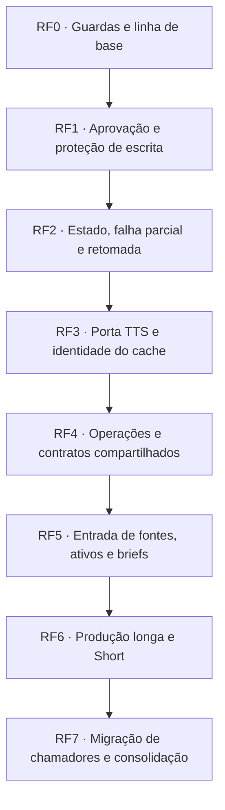

# Fluxo de refatoração SOLID e gates de aceite

Data: 2026-11-01. Sequência de execução da
[análise de gaps](analise-gaps-solid-2026-10-31.md), complementando o
[inventário dos scripts](analise-scripts-provisorios-2026-10-31.md), o
[desenho em objetos](desenho-orientado-a-objetos-2026-10-31.md) e o
[gate de tamanho](analise-tamanho-modulos-2026-10-31.md).

Cada etapa entrega uma mudança pequena e verificável; a próxima começa quando os critérios anteriores
estiverem demonstrados. A ordem abaixo corrige a dependência do plano antigo, que extraía o narrador antes
de definir sua porta TTS. Os identificadores `RF` são gates de engenharia; os gates 1–4 dos episódios
continuam sendo decisões humanas, registradas em `review.json`.

**Foco desta entrega:** primeiro o [gate de qualidade](gate-qualidade.md), executado por
`bash scripts/check_qualidade.sh`. As demais etapas são plano de execução e permanecem pendentes.

**Estado atual:** modelos e constantes foram separados por área (ADRs 037–038), com guardas no gate:
311 constantes em 54 classes, tipagem estrita sem erros em 362 arquivos e 958 testes passando (6 lentos
fora pela configuração existente). A baseline de tamanho caiu para 10 arquivos e 9 funções. RF0 ainda
não está fechado: o lint global reprova dois `B006` preexistentes em demonstrações locais de `renders/`,
identificados no gate de qualidade. O próximo gate funcional é RF1, após resolver essa pendência.

## 1. Sequência e situação

| Gate | Gaps cobertos | Situação atual |
|---|---|---|
| RF0 | G12; prevenção da dependência de G09 | Guardas de arquitetura, modelos, constantes, tamanho e tipagem implantadas; lint global pendente |
| RF1 | G01; fronteira de proteção de G02 | Pendente |
| RF2 | G03; recuperação de G02 | Pendente |
| RF3 | G04–G05 | Pendente |
| RF4 | G06–G09 | Pendente |
| RF5 | G02, G10–G11 | Pendente |
| RF6 | Integração G01–G11 no longo e Short | Pendente |
| RF7 | G12 e encerramento da migração | Pendente |

“Implantado” significa que há código de verificação, não que todos os gaps foram resolvidos. Teste antigo
passando não comprova serviço que ainda não existe. A migração de uma casca fina offline, como métricas,
pode ocorrer antes, se não depender dos contratos pendentes nem escrever artefatos protegidos.

## 2. Regra comum de passagem

Para cada fatia, registrar no PR ou na revisão local: gate, arquivos alterados, comportamento comprovado,
comandos e resultados, pendências e forma de desfazer a mudança sem apagar dados de episódio.

- O teste de regressão deve falhar com o defeito e passar com a correção. Não usar `skip` ou `xfail` para
  declarar um critério cumprido.
- Executar os testes específicos da mudança e `bash scripts/check_qualidade.sh` (suíte completa, tipagem e lint).
  Uma falha preexistente deve aparecer como pendência identificada, sem ser escondida ou contada como passe.
- Arquitetura e tamanho rodam no pytest, no CI e no pré-commit: 200 linhas por arquivo de `app/`, 50 por
  função; a baseline só encolhe. Não regenerá-la para aceitar crescimento.
- Alteração de contrato atualiza porta, adapters aplicáveis, fakes, chamadores e fixtures na mesma fatia.
  Preservar imports públicos ao repartir módulos.
- Chamadas externas, renders e episódios reais continuam sujeitos às autorizações existentes. O teste do
  gate usa pastas temporárias e provedores falsos. Aprovação de engenharia não aprova conteúdo nem publicação.

Se um critério falhar, corrigir a mesma fatia e repetir os checks afetados. Não começar a migração que depende
dele. Descobrir uma regressão em gate já verificado reabre sua pendência e exige nova evidência; não se edita
o histórico para fingir que a execução anterior nunca ocorreu.

## 3. Critérios por gate

### RF0 — Guardas e linha de base

**Entrega:** guarda de arquitetura compatível com pacotes, fronteiras explícitas e execução local/CI.

- [x] `app.bootstrap` e seus submódulos podem compor adapters; nomes parecidos não ganham essa permissão.
- [x] Pipeline continua impedido de importar adapters concretos e raiz de composição.
- [x] Mídia pode usar schemas, mas não importar orquestração de produção; imports relativos também são analisados.
- [x] Gate de tamanho preservado em 200/50, sem ampliar baseline.
- [x] Pré-commit executa arquitetura e tamanho; o CI executa ambos pela suíte existente.
- [x] Mypy estrito integrado ao comando único; linha de base dos erros de tipos registrada.
- [x] Modelos por área, uma classe por arquivo, com compatibilidade dos imports existentes (ADR 037).
- [x] Constantes por área, atributos Final e coleções imutáveis em profundidade, verificados no gate (ADR 038).
- [ ] Checks globais inteiramente verdes, incluindo lint e tipagem; registrar qualquer impedimento antes de avançar.

Comando rápido: `uv run pytest tests/test_architecture.py tests/test_tamanho_modulos.py -q`.
O hook depende de `git config core.hooksPath .githooks` no clone; a presença do arquivo não ativa essa configuração.

### RF1 — Aprovação e proteção antes de escrever

**Entrega:** uma regra de proteção consultada pelos escritores, com `review.json` como autoridade e
reabertura explícita; nenhuma migração de episódio real para provar o mecanismo.

- [ ] Aprovar pelo CLI e tentar alterar fontes/fichas, roteiro e saídas do gate 4 recusa antes da escrita.
- [ ] A fronteira de proteção também pode ser consultada antes de substituir binários; integração dos
  escritores concretos será demonstrada em RF5/RF6.
- [ ] Status de topo aprovado dos ativos continua protegido, incluindo ativos reaproveitados.
- [ ] Reabertura tem motivo e autor registrados, libera apenas o alvo solicitado e não apaga decisões antigas.
- [ ] Alteração de `asset_id` no gate 3 e bloco numérico derivado mantêm as exceções já definidas para o gate 2.
- [ ] Decisões existentes e hashes legados continuam reconhecidos; nenhuma segunda autoridade de aprovação.

**Evidência:** ampliar `tests/test_gates.py`, `tests/test_state.py` e testes do CLI; incluir aprovação pelo
caminho público seguida da tentativa de escrita. Fechar o contrato de reabertura antes de ligar novos escritores.

### RF2 — Estado e retomada

**Entrega:** contrato de resultado incompleto e reutilização, provado com ações falsas e saídas persistidas.
Não depende de o futuro `Narrator` já existir.

- [ ] Três cenas independentes: a segunda falha; primeira e terceira deixam saídas válidas.
- [ ] Reexecutar a mesma entrada tenta só a cena pendente; `needs_review` parcial não impede a tentativa.
- [ ] Revisão humana pendente é distinguida de produção incompleta: não refazer um resultado íntegro que
  esteja apenas aguardando revisão.
- [ ] Saída reutilizada é reconstruída após reiniciar o processo, sem depender de estado em memória.
- [ ] Arquivo ausente ou inválido gera recuperação ou erro explícito; aprovado não é recriado automaticamente.
- [ ] Lock continua exclusivo, inclusive no erro; não aninhar `store.lock` com o lock de `run_step`.
- [ ] Entrada mutável é conferida sob a trava; mudança entre etapas não produz resultado misto silencioso.
- [ ] Erro inesperado sobe e é registrado; falha recuperável fica ligada à cena e bloqueia só dependências dela.

**Evidência:** testes em `tests/test_state.py` e `tests/test_failures.py`, com disco temporário e ações falsas.
Interromper uma gravação não pode transformar resultado parcial em saída concluída reutilizável.

### RF3 — TTS, lotes, ciclo de vida e cache

**Entrega:** porta definida antes de extrair o código compartilhado de voz.

- [ ] Fingerprint representa os mesmos parâmetros efetivos usados na síntese: idioma, voz, modelo,
  referência, pausa, entrega neutra/fallback e corte/junção; overrides têm regra explícita.
- [ ] Identidade de cache e nome de exibição são distintos; alias legado `gemini` é tratado explicitamente.
- [ ] Compatibilidade dos nomes de WAV de longo e Short é testada; invalidar cache incorreto é mudança
  declarada e limitada às falas afetadas, não promessa de zero regenerações.
- [ ] Lote respeita voz/idioma, limite e pausas; mantém ordem, quantidade e correspondência entre pedidos e saídas.
- [ ] Só recusa de corte prevista aciona fallback por cena; cota esgotada não gera nova rajada de chamadas.
- [ ] Falha não publica WAV inválido; fechamento acontece também na exceção; propriedade e reuso do TTS
  após `close` estão definidos.
- [ ] Fakes e adapters aplicáveis passam pelos mesmos contratos, com transporte falso para remotos.

**Evidência:** ampliar `tests/test_contracts.py`, `tests/test_chatterbox_tts.py`, `tests/test_gemini_tts.py`
e testes de nomenclatura. Só depois extrair `VoiceKey`, biblioteca e narrador e migrar seus dois chamadores.

### RF4 — Operações públicas e direção das dependências

**Entrega:** contratos e limites dos objetos que vão receber os scripts.

- [ ] `voice` apenas produz voz; `subs` usa WAVs existentes; `render` não sintetiza nem alinha remotamente.
- [ ] Cada operação funciona em um processo novo com pré-requisitos próprios; voz de rascunho não exige
  ativos finais. Resolver as condições da voz final e do render final antes de habilitá-los.
- [ ] Composição resolve configuração e entrega aos serviços só as portas e valores necessários.
- [ ] `Context` e `FakeContext` declaram as capacidades realmente usadas pelo CLI.
- [ ] `EpisodeFolder` cuida do acesso/layout; política de proteção e preparação de post não se duplicam nele.
- [ ] Narração compartilhada não depende de `ShortProduction`; plano de revisão de áudio chega pronto à mídia.
- [ ] Registro de comandos preserva argumentos e códigos de saída; nenhuma descoberta dinâmica de módulos.

**Evidência:** testes do CLI, bootstrap e arquitetura; acrescentar testes de operações separadas quando
forem implementadas. Os exemplos antigos de `run_voice -> Production.run()` não são critério de implementação.

### RF5 — Fontes, ativos e dados externos

**Entrega:** migrar uma entrada por fatia, usando os contratos de proteção e retomada já verificados.

- [ ] Fontes baixadas, locais e declaradas compartilham registro; ID é alocado sob lock; repetição não duplica
  nem substitui fonte aprovada.
- [ ] Falha no registro de bruto/texto/trechos/manifesto deixa uma recuperação definida; o manifesto de
  conclusão é publicado por último. `replace` individual não é chamado de transação de vários arquivos.
- [ ] Busca distingue banco indisponível, busca sem resultado e erro de programação; motivos ficam registrados.
- [ ] Download escolhido preserva associação de cenas anteriores, é idempotente e protege mídia aprovada.
- [ ] Entradas validam IDs, caminhos contidos, fps e durações positivos/finitos, intervalos de fala e referências.
- [ ] Leitura/escrita do conteúdo do kit preserva campos que o auto-play não interpreta.
- [ ] Cópias de briefs e catálogo de música mantêm seus contratos de substituição e licença.

**Evidência:** criar testes específicos de fontes, ativos e briefs e ampliar os de música/Short conforme a
fatia. Nenhum critério passa só porque um arquivo foi movido para `app/`.

### RF6 — Integração da produção longa e Short

**Entrega:** comandos sobre os componentes verificados, uma operação por mudança revisável.

- [ ] Longo e Short compartilham voz sem herdar de uma classe genérica de produção.
- [ ] WAV novo é validado e promovido antes de remover versões obsoletas; erro conserva o anterior utilizável.
- [ ] Estado, relatório por cena e cache permitem retomar depois de encerrar o processo.
- [ ] Motor vem da porta configurada por formato; substituição é demonstrada com renderer falso.
- [ ] Montagem incompleta não avança para render final; precondições são verificadas na operação.
- [ ] Prévia e final não se confundem no estado/cache nem no conteúdo protegido pelo gate 4.
- [ ] Pacote de vídeo e texto é preparado e validado antes de publicar; falha injetada não produz pacote
  considerado completo. Recusar substituição de pacote aprovado antes da primeira cópia.
- [ ] Timestamps, legendas, áudio e efeitos preservam os contratos existentes; teste visual real, quando
  aplicável, segue o vídeo-régua e as autorizações atuais.

**Evidência:** testes de integração da produção a criar, mais os testes existentes de narração, captions,
shots, efeitos e Shorts. O vídeo-régua complementa esses testes; não substitui provas de proteção e retomada.

### RF7 — Chamadores, documentação e encerramento

**Entrega:** remover as dependências dos scripts migrados e consolidar os módulos tocados.

- [ ] Tests passam a importar de `app/`; nenhum consumidor ativo ainda importa script removido por caminho.
- [ ] Skills, referências do CLI e documentação apontam para os comandos implementados.
- [ ] Configurações locais e rotina diária são conferidas pelo dono quando precisarem de alteração fora
  do escopo editável; não remover o script enquanto houver um consumidor pendente.
- [ ] Ferramentas de uma vez e benchmarks são classificados e preservam referências históricas.
- [ ] Módulos grandes são divididos por responsabilidade ao serem tocados; imports públicos e schemas persistidos
  mantêm compatibilidade. Baseline encolhe apenas com redução comprovada.
- [ ] Testes globais e lint passam; não restam critérios obrigatórios sem evidência.

**Evidência:** busca dos caminhos antigos em app, testes e instruções; help do CLI; checks globais e
conferência dos consumidores operacionais. Não acrescentar publicação ou agendamento ao teste de migração.

## 4. Registro desta entrega

Foi implantado `scripts/check_qualidade.sh`, compartilhado pelo pré-commit e CI, com lint, tipagem estrita
via Mypy e suíte completa.
A guarda de arquitetura foi ampliada em `tests/test_architecture.py`; o gate de tamanho existente foi
preservado. RF1–RF7 continuam pendentes; escrever seus critérios não os implementa. A linha de base e os
resultados locais estão no [registro do gate de qualidade](gate-qualidade.md).

O próximo trabalho da sequência é RF1: reproduzir aprovação pelo CLI, recusar escrita antes de alterar o
arquivo e fechar a reabertura, mantendo decisões antigas compatíveis.
