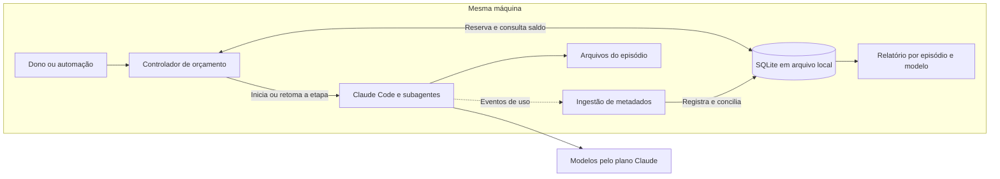
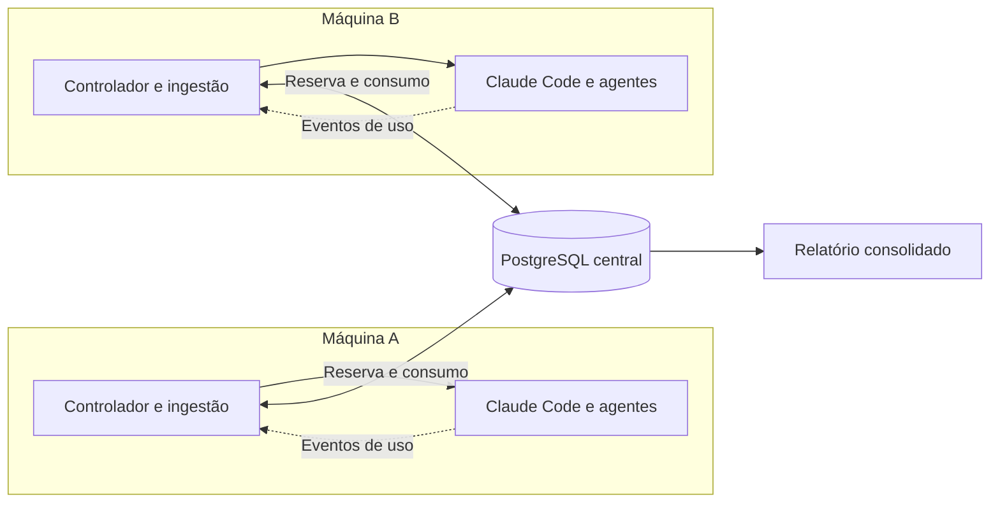
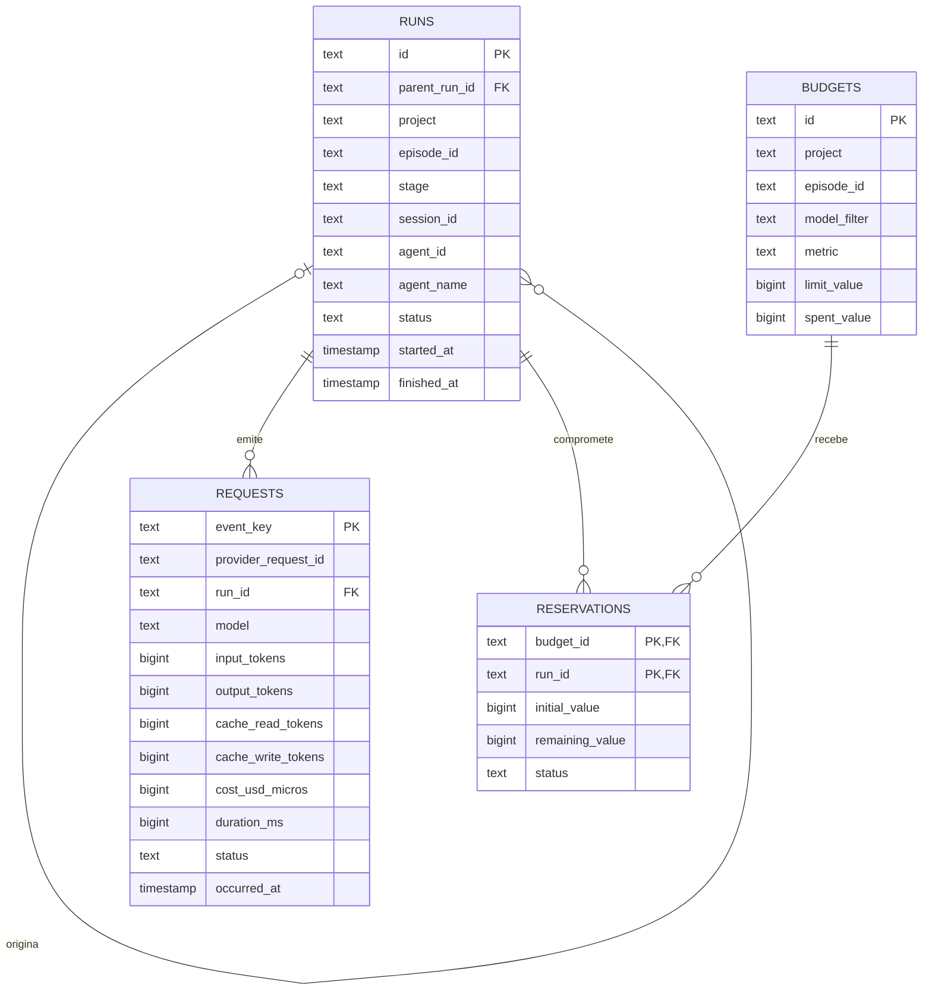

# Proposta: banco de consumo e orçamento dos agentes

Status: SQLite local implementado na [ADR 032](decisions/032-sqlite-consumo-agentes.md),
com comandos em [usage.md](usage.md). O controlador de lançamento, a coleta automática
e PostgreSQL permanecem propostas. O diagrama é lógico; o schema concreto está em
`app/storage/usage_sqlite.py`.

Diagramas renderizados em SVG: [SQLite](diagramas-consumo/sqlite.svg) ·
[PostgreSQL](diagramas-consumo/postgresql.svg) ·
[Modelo de tabelas](diagramas-consumo/modelo-logico.svg).
Versões PNG: [SQLite](diagramas-consumo/sqlite.png) ·
[PostgreSQL](diagramas-consumo/postgresql.png) ·
[Modelo de tabelas](diagramas-consumo/modelo-logico.png).

O banco registra consumo de modelos e orçamento por episódio. O mesmo modelo lógico
serve para SQLite local e PostgreSQL centralizado. A implantação e as transações de
reserva mudam entre os dois.

Esta proposta cobre o trabalho editorial no Claude Code. Os manifestos, as fontes,
as fichas, o roteiro e os gates continuam nos arquivos atuais. Os valores em dólares
são estimativas equivalentes de API, separadas da cota do plano Claude.

## Implantação com SQLite



Controlador e ingestão são responsabilidades do mesmo programa local; as caixas
não exigem serviços separados. Um caminho proposto é `data/telemetry/usage.sqlite3`,
fora do Git. Vários processos locais podem usar o mesmo banco, mantendo curtas as
transações de escrita. O tempo de inferência fica fora dessas transações.

SQLite em WAL permite leitura e escrita simultâneas, mas continua com um escritor
por vez. Todos os processos devem estar na mesma máquina, com arquivo em disco
local. Não compartilhar o arquivo WAL por NFS ou pasta de rede.
[Documentação de WAL](https://www.sqlite.org/wal.html).

## Implantação com PostgreSQL



O PostgreSQL centraliza o saldo entre máquinas. A conexão exige driver, credencial,
operação do servidor e backup. Projetos diferentes têm seu consumo separado pelo
campo `project`; a primeira proposta limita o orçamento por projeto e episódio.

## Modelo lógico comum



Tipos no diagrama são lógicos. Em SQLite, contadores usam `INTEGER`, ids usam
`TEXT` e datas usam texto ISO 8601 em UTC. Em PostgreSQL, contadores usam `BIGINT`
e datas usam `TIMESTAMPTZ`.

| Tabela | Responsabilidade |
|---|---|
| `runs` | Identifica cada execução e seus subagentes. Uma retomada mantém o vínculo com projeto e episódio; uma nova execução recebe outro id. |
| `requests` | Guarda o uso individual informado pelo Claude Code, sem prompts, respostas ou credenciais. |
| `budgets` | Define o teto e o consumo já contabilizado. `model_filter = '*'` representa todos os modelos; outro valor identifica um modelo concreto. |
| `reservations` | Registra o orçamento ainda comprometido por uma execução, antes de todo o consumo chegar. A chave composta impede repetir a reserva da mesma execução no mesmo orçamento. |

`metric` aceita `tokens_total` ou `cost_usd_micros`. Cada linha de orçamento usa
uma única unidade. `tokens_total` soma entrada, saída, leitura e escrita de cache;
é uma métrica interna de volume, sem pretensão de reproduzir a cota da assinatura.
Uma unidade de `cost_usd_micros` corresponde a US$ 0,000001; dinheiro não usa float.

O saldo disponível de cada orçamento é:

```text
limit_value - spent_value - SUM(reservations.remaining_value)
```

`spent_value` é um acumulador reconstruível a partir das requisições conhecidas
que pertencem ao escopo do orçamento. Os quatro contadores de tokens permanecem
separados em `requests`, mesmo quando o orçamento usa a soma.

## Reserva, execução e conciliação

1. O controlador identifica projeto, episódio, etapa e execução. Resolve os
   orçamentos aplicáveis antes de iniciar o trabalho.
2. Em uma transação curta, confere o saldo de todos esses orçamentos e cria as
   reservas. Se qualquer um não comportar a reserva, desfaz toda a transação e
   devolve a pendência ao dono.
3. Confirma a transação e inicia o Claude Code. Nenhum bloqueio do banco fica
   aberto durante chamadas ao modelo.
4. A ingestão recebe os eventos de uso e identifica a execução correspondente.
   A execução principal e os subagentes compartilham o episódio. Uma reserva
   da execução principal cobre seus descendentes; uma reserva adicional de um
   descendente precisa descontar ou redistribuir o valor já reservado.
5. Na mesma transação, registra a requisição nova, aumenta o consumo dos
   orçamentos aplicáveis e reduz suas reservas restantes. Evento duplicado não
   altera os totais. Uma chamada pode consumir o teto geral e o teto do modelo;
   o relatório soma as requisições, nunca os acumuladores desses dois tetos.
6. Após o término, só libera a sobra quando houver confirmação de que os eventos
   da execução foram conciliados. Falha do processo ou lacuna de telemetria deixa
   a reserva em `pending_reconciliation`, até conferir o consumo.

Os eventos oficiais `claude_code.api_request` incluem modelo, identificadores,
tokens e custo estimado. A implementação precisa validar a correlação entre as
sessões, os subagentes e as etapas na versão instalada antes de aplicar bloqueios.
[Contrato dos eventos](https://code.claude.com/docs/en/monitoring-usage#api-request-event).

### Regras de consistência

- A `event_key` é derivada da identidade estável do evento de origem; retransmitir
  o mesmo evento produz a mesma chave. Quando houver id do provedor, conferir
  também sua unicidade no escopo da origem. Não gerar uma nova chave a cada ingestão.
- Entrada, saída e cache ausentes permanecem desconhecidos (`NULL`), sem virar zero.
  Uso ou custo incompleto mantém a conciliação pendente.
- Os valores observados são registrados mesmo quando ultrapassam o teto. O banco
  preserva a ultrapassagem e o controlador impede a continuidade correspondente.
- Novas reservas exigem valores não negativos e confirmação transacional. Reservas
  pendentes continuam comprometendo o saldo até serem conciliadas.
- O escopo de cada requisição é validado contra sua execução. Evento sem vínculo
  confiável fica pendente de classificação e impede liberar a reserva afetada.
- Uma reabertura de sessão consulta o saldo persistido. A ingestão recupera eventos
  pendentes do registro local antes de liberar novas execuções controladas.

## O que muda entre SQLite e PostgreSQL

| Ponto | SQLite | PostgreSQL |
|---|---|---|
| Implantação | Arquivo local, acessado pelo programa | Servidor acessado por conexão autenticada |
| Cliente Python | `sqlite3`, da biblioteca padrão | Driver PostgreSQL |
| Reserva de orçamento | `BEGIN IMMEDIATE`, leitura do saldo, reserva e `COMMIT` | `BEGIN`, bloqueio das linhas de orçamento com `SELECT ... FOR UPDATE`, reserva e `COMMIT` |
| Concorrência | Um escritor por vez; transações curtas e espera limitada por bloqueio | Reservas em orçamentos diferentes podem escrever em paralelo |
| Mais de um teto | Uma transação cobre todas as reservas | Bloquear os orçamentos em ordem estável para reduzir deadlocks |
| Integridade | Habilitar `foreign_keys` em cada conexão e tratar banco ocupado | Usar FKs e tratar conflitos/deadlocks com repetição limitada |
| Backup | Usar a API de backup; copiar só o arquivo principal durante WAL ativo pode perder mudanças | Backup e recuperação do servidor |
| Crescimento | Processos na mesma máquina e baixa disputa por escrita | Várias máquinas ou centralização que já justifique operar o servidor |

`BEGIN IMMEDIATE` disputa a transação de escrita antes de ler o saldo em SQLite;
se outro escritor estiver ativo, a aplicação precisa tratar `SQLITE_BUSY`.
[Transações SQLite](https://www.sqlite.org/lang_transaction.html).

`FOR UPDATE` mantém as linhas de orçamento bloqueadas até terminar a transação
no PostgreSQL. [Bloqueios PostgreSQL](https://www.postgresql.org/docs/current/explicit-locking.html#LOCKING-ROWS).

A migração preserva as entidades, mas exige migrar dados e adaptar conexão,
tipos, transações e backup. Não é apenas trocar uma URL de conexão.

## Limite efetivo e validação futura

O banco registra e coordena o saldo; o controlador aplica a decisão de iniciar,
retomar ou interromper uma etapa. Chamadas internas do Claude Code já em andamento
podem ultrapassar a reserva antes de o evento de uso chegar. Um teto estrito antes
de cada chamada exigiria controlar esse envio individualmente. Esta proposta não
introduz proxy nem muda a autenticação do plano Claude.

Antes de usar o bloqueio, testar pelo menos: evento duplicado; duas reservas
concorrentes no mesmo saldo; reserva conjunta de teto geral e teto de modelo;
subagente e retomada sem contagem dupla; queda com telemetria pendente; e consumo
acima do teto preservado no histórico.

Para a operação local atual, SQLite é o ponto de partida proposto. PostgreSQL
passa a ser a escolha quando o controle precisar atender várias máquinas ou a
disputa por escrita justificar um servidor. Critérios de escolha:
[usos apropriados do SQLite](https://www.sqlite.org/whentouse.html).

A implementação local usa rollback journal (`DELETE`) no SQLite 3.50.4 do ambiente,
conforme ADR 032; WAL só deve ser reconsiderado após atualização para versão corrigida.
O comando `vp usage init` cria o banco. Coleta automática e controle de lançamento
ainda não estão conectados; os agentes, gates e modelos seguem os contratos existentes.
